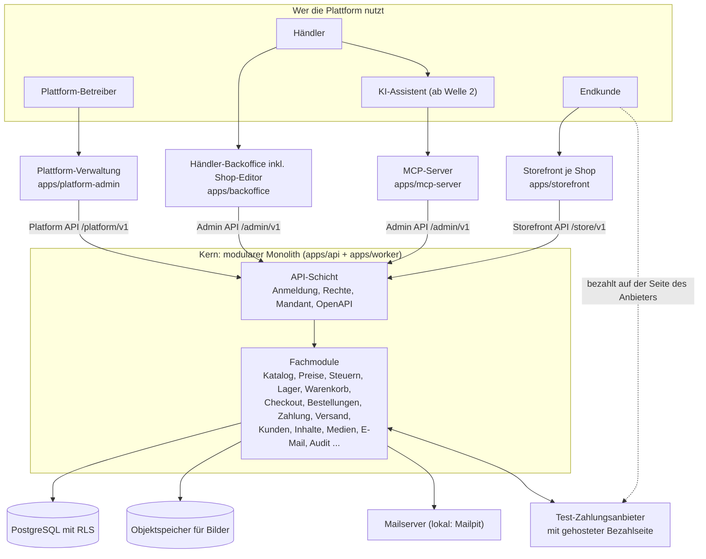
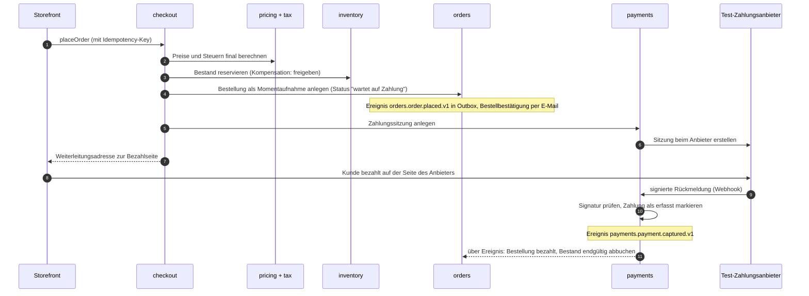

# Architektur der Shop-Plattform

Stand: 27.10.2026, angepasst am 28.10.2026 (Abweichungen aus Datenmodell Kapitel 7 und ADR-008 eingearbeitet). Zweck: Dieses Dokument legt fest, wie die Shop-Plattform technisch gebaut wird. Es baut auf der Marktanalyse (`docs/01_Marktanalyse.md`) und dem Featurekatalog (`docs/02_Featurekatalog.md`) auf und setzt die Entscheidungen aus `FRAGEN.md` um: Die Plattform ist ein rein privates Experiment, sie wird als modularer Monolith gebaut, und Welle 1 enthält alle 63 Muss-Funktionen inklusive der deutschen Rechtspflichten.

**Bewertungsskala in diesem Dokument:** 1 = beste Eignung, 9 = schlechteste Eignung.

**Disclaimer:** Versionsnummern und der Pflegezustand der Bibliotheken entsprechen dem Planungsstand. Beim Aufsetzen des Codes prüft Claude jeweils die aktuelle stabile Version. Punkte mit dem Hinweis „zu prüfen“ sind nicht abschließend belegt. Rechtliche Hinweise sind technische Anforderungen und keine Rechtsberatung.

Die wichtigsten Entscheidungen stehen zusätzlich als kurze Entscheidungsprotokolle in `docs/entscheidungen/`. Ein solches Protokoll heißt ADR (Architecture Decision Record, also „Aufzeichnung einer Architekturentscheidung“). Es hält fest, warum etwas so entschieden wurde, damit man es später nachvollziehen oder bewusst ändern kann.

---

## 1. Kurzfassung

Die Plattform besteht aus **einem einzigen Server-Programm** (dem „Kern“), das intern in etwa 20 streng getrennte Fachbausteine zerlegt ist. Diese Bauweise heißt **modularer Monolith**: Es ist ein Programm („Monolith“), aber innen herrscht Ordnung wie in einem Bürogebäude mit abgeschlossenen Abteilungen („Module“). Jede Abteilung hat ihre eigenen Akten (Datenbanktabellen) und spricht mit anderen Abteilungen nur über einen festgelegten Schalter (ihre öffentliche Schnittstelle). Ein Prüfprogramm schlägt bei jeder Änderung automatisch Alarm, wenn jemand diese Regel bricht.

Der Kern bietet alle Funktionen als **API** an. Eine API (Programmierschnittstelle) ist ein fest beschriebener Weg, über den andere Programme Funktionen aufrufen, zum Beispiel „lege ein Produkt an“. Es gibt drei getrennte APIs, je eine für jede Ebene der Plattform:

- Die **Platform API** bedient die Plattform-Verwaltung, in der der Betreiber Händler, Shops und Tarife verwaltet.
- Die **Admin API** bedient das Händler-Backoffice inklusive Shop-Editor und später den KI-Assistenten.
- Die **Storefront API** bedient die Shops, die Endkunden im Browser sehen.

Die drei Oberflächen sind eigene kleine Programme, die nichts anderes tun, als diese APIs aufzurufen und das Ergebnis schön darzustellen. Dadurch gibt es keine versteckten Sonderwege: Was das Backoffice kann, kann auch die KI und später jede Partner-App.

Alle Daten liegen in **einer PostgreSQL-Datenbank**. PostgreSQL ist eine bewährte, freie Datenbank. Jeder Datensatz trägt die Kennung seines Shops, und die Datenbank selbst erzwingt mit **Row-Level-Security** (RLS, „Sicherheit auf Zeilenebene“), dass jede Anfrage nur die Zeilen des eigenen Shops sieht. Selbst ein Programmierfehler im Kern kann deshalb keine fremden Shopdaten ausliefern.

Alles läuft in **Containern**. Ein Container ist ein abgeschlossenes Paket aus Programm und allem, was es zum Laufen braucht. Mit **Docker Compose**, einem Werkzeug, das mehrere Container gemeinsam startet, läuft die ganze Plattform mit einem Befehl auf jedem Rechner oder Server. Es werden nur freie Open-Source-Bausteine verwendet.



**Die sieben wichtigsten Entscheidungen in einem Satz:**

1. Die Programmiersprache ist **TypeScript** für alle Teile, damit Backend, Oberflächen und Tests dieselbe Sprache sprechen.
2. Der Kern ist ein **modularer Monolith** auf **NestJS**, dessen Modulgrenzen automatisch geprüft werden (ADR-002).
3. Die Mandantentrennung erfolgt über **ein gemeinsames Datenbankschema mit `tenant_id` und PostgreSQL-RLS** (ADR-003).
4. Die APIs sind **REST mit OpenAPI-Beschreibung**, und aus dieser Beschreibung entstehen Dokumentation, Typen und KI-Werkzeuge (ADR-004).
5. Der Shop-Editor speichert Seiten als **Abschnitte und Bausteine im JSON-Format**, nie als freies HTML (ADR-005).
6. Geldbeträge sind **ganze Zahlen in Cent mit Währungscode** (ADR-006).
7. Module benachrichtigen einander über **Ereignisse nach dem Outbox-Muster**, damit kein Ereignis verloren geht (ADR-007).

---

## 2. Technik-Auswahl (Tech-Stack)

Ein Tech-Stack ist die Liste aller Werkzeuge und Bausteine, aus denen ein System gebaut wird. Alle hier gewählten Bausteine sind kostenlos und Open Source. Wo Alternativen ernsthaft verglichen wurden, steht eine Bewertung (1 = beste Eignung, 9 = schlechteste). Die Gesamtentscheidung ist in ADR-001 festgehalten.

### 2.1 Entscheidungstabelle

| Baustein | Entscheidung | Begründung in einem Satz | Bewertung | Verglichene Alternativen (Bewertung) |
|---|---|---|---|---|
| Sprache | **TypeScript** (streng eingestellt) | Eine Sprache für alle Teile, und die Typprüfung findet Fehler, bevor der Code läuft, was gerade bei KI-geschriebenem Code wichtig ist. | 1 | Python (3), PHP (4), Go (4) |
| Laufzeitumgebung | **Node.js 24 LTS** | LTS heißt „Long Term Support“, die Version bekommt also mehrere Jahre Sicherheitsupdates. | 1 | Bun (4), Deno (4) |
| Paketverwaltung | **pnpm** | pnpm installiert Bibliotheken schnell und platzsparend und unterstützt mehrere Pakete in einem Repository sehr gut. | 1 | npm (3), Yarn (3) |
| Monorepo-Werkzeug | **pnpm Workspaces + Turborepo** | Ein Monorepo ist ein einziges Code-Archiv für alle Teile des Systems, und Turborepo baut und testet darin nur, was sich geändert hat. | 2 | Nx (4), moon (4) |
| Backend-Framework | **NestJS** mit **Fastify** als Webserver | Ein Framework ist ein Grundgerüst für Programme, und NestJS bringt Module, saubere Schichten und Abhängigkeitsverwaltung mit, die zum modularen Monolithen passen. | 2 | Reines Fastify (4), Hono (4), Express (6) |
| Eingabeprüfung und Schemas | **Zod** | Zod beschreibt einmal, wie Daten aussehen müssen, prüft damit jede Eingabe und erzeugt daraus die OpenAPI-Beschreibung. | 2 | TypeBox (3), class-validator (5) |
| Datenbank | **PostgreSQL 18** | PostgreSQL hat RLS, JSON-Spalten, Volltextsuche und erzeugt seit Version 18 zeitlich sortierbare IDs (UUIDv7) selbst. | 1 | MySQL/MariaDB (6) |
| Datenbankzugriff | **Kysely** (typsicherer Abfrage-Baukasten), Typen mit **kysely-codegen** aus der echten Datenbank erzeugt | Kysely schreibt fast reines SQL mit Typprüfung und lässt sich problemlos mit RLS und Transaktionen kombinieren. | 2 | Drizzle ORM (3), Prisma (6), TypeORM (7) |
| Migrationen | **SQL-Dateien pro Modul**, ausgeführt mit dem Migrator von Kysely | Eine Migration ist eine Datei, die die Datenbankstruktur schrittweise ändert, und reines SQL zeigt RLS-Regeln offen und prüfbar. | 2 | Drizzle Kit (3), Prisma Migrate (5) |
| Anmeldung | **Better Auth** (TypeScript-Bibliothek, MIT-Lizenz) für Betreiber und Händler, eigene API-Token mit Berechtigungen für Skripte, KI und später Apps | Better Auth läuft im Kern mit, nutzt intern selbst Kysely und bringt Passkeys und Zwei-Faktor-Anmeldung mit, ohne dass ein schwerer Zusatzdienst nötig ist. | 3 | Keycloak (5), Zitadel (4), Ory (5), Eigenbau (6) |
| Passwort-Speicherung | **Argon2id** über `@node-rs/argon2` | Argon2id ist das empfohlene Verfahren, Passwörter unumkehrbar zu speichern. | 1 | scrypt (3), bcrypt (4) |
| Warteschlange | **pg-boss** (läuft in PostgreSQL) | Eine Warteschlange sammelt Hintergrundaufgaben wie E-Mail-Versand, und pg-boss braucht dafür keinen zusätzlichen Dienst. | 2 | BullMQ mit Valkey (4), RabbitMQ (5) |
| Objektspeicher | **S3-Schnittstelle**, Server: **Garage** | Ein Objektspeicher hält Dateien wie Bilder, und weil der Code nur die verbreitete S3-Schnittstelle spricht, ist der Server jederzeit austauschbar. | 3 | SeaweedFS (3), MinIO (5, Lizenz- und Vertriebsänderungen seit 2025, zu prüfen) |
| Bildverarbeitung | **sharp** | sharp verkleinert Bilder schnell, wandelt sie in WebP und AVIF um und entfernt dabei versteckte Zusatzdaten. | 1 | ImageMagick (4) |
| Suche | **PostgreSQL-Volltextsuche** in Welle 2, **Meilisearch** ab etwa 1.000 Shops | Für die Produktsuche reicht zunächst die Datenbank selbst, und Meilisearch kommt erst, wenn es spürbar nötig ist. | 2 | OpenSearch (6), Typesense (4) |
| Storefront | **Astro** mit Server-Rendering (Node-Adapter), interaktive Teile als kleine **React**-Inseln | Astro erzeugt fertige HTML-Seiten auf dem Server, die schnell laden, von Suchmaschinen gut gelesen werden und auch ohne JavaScript bedienbar bleiben. | 2 | Next.js (3), React Router 7 (3), SvelteKit (4), Nuxt (4) |
| Backoffice und Plattform-Verwaltung | **React** mit **Vite**, **TanStack Router** und **TanStack Query**, Bausteine aus **shadcn/ui** (auf Radix) und **Tailwind CSS** | Das ist der verbreitetste Werkzeugkasten für Verwaltungsoberflächen, und Radix liefert barrierefreie Grundbausteine. | 2 | Vue mit Nuxt (4), Svelte (4) |
| API-Client der Oberflächen | **openapi-typescript + openapi-fetch** | Die Oberflächen bekommen ihre Typen automatisch aus der OpenAPI-Beschreibung und können die API nicht falsch aufrufen. | 2 | Orval (3), handgeschrieben (7) |
| E-Mail | **Nodemailer** (Versand), **React Email** (Vorlagen), **Mailpit** (lokaler Test-Mailserver) | Mailpit fängt alle E-Mails ab und zeigt sie im Browser, sodass nie versehentlich eine echte Mail rausgeht. | 2 | MJML (3) |
| Reverse Proxy und TLS | **Caddy** | Ein Reverse Proxy nimmt alle Anfragen aus dem Internet an und verteilt sie, und Caddy besorgt die TLS-Zertifikate für verschlüsselte Verbindungen automatisch, auch für eigene Händler-Domains. | 1 | Traefik (3), Nginx (4) |
| Container | **Docker Compose** (Dateien auch mit Podman nutzbar), später optional **Kubernetes mit Helm** | Compose startet alle Dienste mit einem Befehl auf jedem Rechner. | 1 | Kubernetes ab Tag 1 (7) |
| Protokolle und Messwerte | **pino** (Protokolle), **OpenTelemetry** (Messpunkte), ab Welle 2 **Grafana, Prometheus, Loki** | OpenTelemetry ist ein freier Standard, dessen Daten jedes Überwachungswerkzeug versteht. | 2 | – |
| Tests | **Vitest** (Unit und Integration), **Testcontainers** (echte Wegwerf-Datenbank pro Testlauf), **Playwright** (Browser-Tests), **axe-core** (Barrierefreiheit), **Schemathesis** (automatisches Bombardieren der API mit Zufallseingaben) | Ohne Tests kann die KI nicht sicher ändern, und echte Datenbanken in Tests finden RLS-Fehler, die Attrappen übersehen. | 1 | Jest (3), Cypress (4) |
| Code-Prüfung | **ESLint** mit typescript-eslint (streng), **Prettier** (Formatierung), **dependency-cruiser** (Modulgrenzen) | Lint-Werkzeuge lesen den Code und melden typische Fehler und Regelverstöße, bevor er läuft. | 2 | Biome (3) |
| Sicherheits-Scans | **OSV-Scanner** und `pnpm audit` (bekannte Lücken in Bibliotheken), **gitleaks** (versehentlich eingecheckte Passwörter), **Trivy** (Container), **Dependabot** (Update-Vorschläge) | Diese Werkzeuge sind kostenlos und decken die Lieferkette ab, also alle fremden Bausteine. | 2 | Snyk (5, kostenpflichtig ab gewissem Umfang) |
| CI | **GitHub Actions** | CI (Continuous Integration) bedeutet, dass bei jeder Änderung automatisch gebaut und geprüft wird, und das Repository liegt bereits auf GitHub. | 2 | Woodpecker CI selbst gehostet (4), GitLab CI (4) |
| Geheimnisse | `.env`-Datei lokal (nie in Git), auf Servern **SOPS mit age** verschlüsselt, später **OpenBao** | So stehen Passwörter nie im Code, und verschlüsselte Dateien können trotzdem versioniert werden. | 2 | – |
| KI-Werkzeuge (ab Welle 2) | **MCP TypeScript SDK**, Werkzeuge aus OpenAPI erzeugt, Sprachmodell über eine austauschbare Schnittstelle | MCP (Model Context Protocol) ist der offene Standard, über den KI-Modelle Programme bedienen. | 2 | Eigenes Werkzeugformat (6) |

### 2.2 Begründungen zu den knappen Entscheidungen

- **NestJS statt reinem Fastify.** NestJS zwingt jedes Modul, ausdrücklich zu „exportieren“, was andere benutzen dürfen. Nicht exportierte Teile kann ein anderes Modul technisch gar nicht anfordern. Das ist eine zweite Sicherung neben dependency-cruiser. Der Preis ist etwas mehr Gerüstcode. Fastify bleibt darunter als schneller Webserver erhalten.
- **Kysely statt Drizzle.** Beide wären gut. Kysely ist stabil, sehr nah an SQL und wird von Better Auth selbst verwendet. Die Typen erzeugen wir aus der echten Datenbank (kysely-codegen). Damit ist die Datenbank die Quelle der Wahrheit, und RLS-Regeln, Rollen und Trigger stehen offen in SQL statt versteckt in einer Zwischenschicht. Prisma ist ausgeschieden, weil das zuverlässige Setzen des Mandanten pro Transaktion dort umständlich ist.
- **Astro statt Next.js.** Next.js ist mächtiger, bringt aber viel Komplexität beim Zwischenspeichern und bei selbst gehosteten Installationen mit und hatte 2025 mehrere schwere Sicherheitslücken (zu prüfen, ob inzwischen alle behoben sind). Ein Shop besteht überwiegend aus Seiten, die man liest, und nur wenige Teile müssen interaktiv sein (Warenkorb-Zähler, Mengenauswahl). Genau dafür ist Astro gemacht: Es liefert fertiges HTML aus und lädt JavaScript nur für die kleinen interaktiven „Inseln“. Formulare wie der Checkout funktionieren auch ohne JavaScript, was der Barrierefreiheit nach BFSG (Barrierefreiheitsstärkungsgesetz) hilft.
- **Better Auth statt Keycloak.** Keycloak ist ein großer, eigener Java-Dienst mit eigener Datenbank und eigener Oberfläche. Für ein Lernprojekt mit einem Server ist das zu schwer. Better Auth läuft im Kern mit und hält sich an Standards (Sitzungen, Passkeys nach WebAuthn, Zwei-Faktor nach TOTP). Falls später ein eigener Anmeldedienst nötig wird, bleibt der Wechsel zu Zitadel oder Keycloak möglich, weil die Rechteprüfung im Kern nicht von Better Auth abhängt, sondern nur von einem „angemeldeten Akteur mit Rechten“.
- **Garage als Objektspeicher.** Garage ist ein schlanker, selbst hostbarer S3-Server. Seine Lizenz (AGPL) ist für ein privates Projekt unproblematisch, weil wir ihn nur benutzen und nicht verändern. Der Code spricht ausschließlich die S3-Schnittstelle über das offizielle AWS-SDK, sodass ein Wechsel nur eine Konfigurationsänderung ist.

---

## 3. Module (fachliche Bausteine)

### 3.1 Was ein Modul ist

Ein Modul ist ein abgeschlossener Fachbereich, im Fachjargon ein **Bounded Context** („abgegrenzter Zusammenhang“). Innerhalb eines Moduls haben Begriffe eine eindeutige Bedeutung. „Preis“ heißt im Modul `pricing` zum Beispiel „Preisregel mit Gültigkeit“, im Modul `orders` dagegen „eingefrorener Betrag zum Kaufzeitpunkt“.

Jedes Modul hat:

- **eigene Tabellen** in einem eigenen Datenbankschema. Ein Datenbankschema ist ein benannter Bereich in der Datenbank, vergleichbar mit einem Ordner. Das Modul `catalog` besitzt zum Beispiel alle Tabellen im Schema `catalog`.
- **eine öffentliche Schnittstelle** (Facade, „Fassade“), also eine kleine Liste von Funktionen, die andere Module aufrufen dürfen. Alles andere ist intern.
- **Ereignisse**, die es veröffentlicht, wenn sich etwas Wichtiges ändert, zum Beispiel `orders.order.placed.v1` („Bestellung aufgegeben, Version 1“).
- **HTTP-Endpunkte**, also die Adressen in der API, über die Oberflächen und Partner es erreichen.

### 3.2 Die Modulliste

Die Spalte „Welle“ nennt, wann das Modul gebaut wird. „1 (Grundgerüst)“ heißt, die Tabellen und das Grundverhalten entstehen in Welle 1, die sichtbare Funktion folgt später.

**Plattform und Zugang**

| Modul | Aufgabe | Eigene Tabellen | Öffentliche Schnittstelle (Auszug) | Ereignisse (Auszug) | Welle |
|---|---|---|---|---|---|
| `identity` | Anmeldung, Sitzungen, Passkeys, Zwei-Faktor, Mitgliedschaften und Rollen, API-Token mit Berechtigungen | `user`, `session`, `account`, `verification`, `passkey`, `two_factor` (nur über die Rolle `shop_auth`, ADR-008), `membership`, `role`, `role_permission` (nur eigene Rollen ab Welle 5, Systemrollen `owner` und `staff` stehen im Code), `api_token` | `getActor(token)`, `assertPermission(actor, permission)`, `listMemberships(userId)`, `createApiToken(...)` | `identity.user.registered.v1`, `identity.login.failed.v1`, `identity.membership.changed.v1` | 1 |
| `platform` | Händlerkonten, Shops (Mandanten), Tarife und Funktionsschalter, Domains, Plattform-Einstellungen | `merchant`, `tenant`, `tenant_domain`, `plan`, `plan_feature`, `tenant_feature_override`, `platform_setting` | `resolveTenantByHost(host)`, `getTenant(id)`, `isFeatureEnabled(tenantId, feature)`, `createTenant(...)` | `platform.tenant.created.v1`, `platform.tenant.suspended.v1`, `platform.tenant.deleted.v1` | 1 |
| `shop-settings` | Firmendaten und Pflichtangaben des Händlers, Verkaufskanäle, Länder und Zonen, Nummernkreise | `shop_profile`, `sales_channel`, `sales_country`, `zone`, `zone_country`, `number_range` | `getShopProfile()`, `getDefaultChannel()`, `nextNumber(type)` | `shop_settings.profile.updated.v1`, `shop_settings.shop.went_online.v1` | 1 |
| `audit` | Unveränderliches Änderungsprotokoll: wer hat was wann getan, ob Mensch, KI oder App | `audit_entry` | `record(entry)`, `list(filter)` | keine (hört auf alle anderen) | 1 |

**Katalog und Preise**

| Modul | Aufgabe | Eigene Tabellen | Öffentliche Schnittstelle (Auszug) | Ereignisse (Auszug) | Welle |
|---|---|---|---|---|---|
| `catalog` | Produkte, Varianten, Merkmale, Produkttypen, Kategorien, Hersteller mit Produktsicherheitsangaben (GPSR), Lieferzeit, Grundpreis-Angaben | `product`, `product_translation`, `variant`, `product_type`, `attribute`, `attribute_value`, `variant_attribute_value`, `category`, `category_translation`, `product_category`, `product_media`, `manufacturer`, `product_channel_listing` | `getVariantsForCart(ids)`, `getPublishedProduct(slug)`, `listProducts(filter)` | `catalog.product.created.v1`, `catalog.product.published.v1`, `catalog.product.updated.v1`, `catalog.product.archived.v1` | 1 (Varianten sichtbar ab 2) |
| `pricing` | Preise mit Währung, Kanal, Kundengruppe, Mindestmenge und Gültigkeit, Preisauswahl nach fester Rangfolge, Preisverlauf für den 30-Tage-Tiefstpreis | `price`, `price_history` | `resolvePrices(variantIds, context)`, `lowestPriceLast30Days(variantId)` | `pricing.price.changed.v1` | 1 |
| `tax` | Steuerklassen, Steuersätze je Land, Steuerberechnung brutto und netto, Kleinunternehmerregelung | `tax_class`, `tax_rate` (globale Referenzdaten), `tenant_tax_setting` | `calculate(lines, context)`, `getRate(class, country, date)` | `tax.setting.changed.v1` | 1 |
| `inventory` | Bestand pro Variante und Lagerort, Reservierungen, Bewegungsprotokoll, kein Überverkauf | `stock_location`, `stock_level`, `stock_movement`, `reservation` | `reserve(lines, ref)`, `commit(ref)`, `release(ref)`, `getAvailability(variantIds)` | `inventory.stock.low.v1`, `inventory.stock.depleted.v1` | 1 |
| `promotions` | Gutscheine, Rabatte, Regelmotor (Regeln als Daten) | `promotion`, `promotion_rule`, `coupon_code`, `promotion_usage` | `applyToCart(cart, context)` | `promotions.coupon.redeemed.v1` | 2 |
| `search` | Produktsuche im Shop und im Backoffice | `search_document` (Welle 2), später Meilisearch-Index | `searchProducts(query, context)` | keine (hört auf `catalog`- und `pricing`-Ereignisse) | 2 |

**Kauf und Abwicklung**

| Modul | Aufgabe | Eigene Tabellen | Öffentliche Schnittstelle (Auszug) | Ereignisse (Auszug) | Welle |
|---|---|---|---|---|---|
| `cart` | Warenkorb für Gäste und später Kunden, Mengen, Neuberechnung | `cart`, `cart_line` | `getCart(token)`, `addLine(...)`, `updateQuantity(...)`, `freeze(cartId)` | `cart.line.added.v1` | 1 |
| `checkout` | Ablauf vom Warenkorb bis zur Bestellung: Adresse, Versandart, Zahlart, Zusammenfassung, Bestätigung der Rechtstexte, Button „zahlungspflichtig bestellen“ | `checkout_session` | `start(cartId)`, `setAddress(...)`, `setShipping(...)`, `placeOrder(...)` (Workflow) | `checkout.completed.v1`, `checkout.abandoned.v1` | 1 |
| `orders` | Bestellungen als unveränderliche Momentaufnahme, getrennte Status für Bestellung, Zahlung und Versand, Zeitleiste, Widerruf per Button | `order`, `order_line`, `order_address`, `order_tax_line`, `order_legal_acceptance`, `order_event`, `withdrawal` | `createFromCheckout(snapshot)`, `getOrder(id)`, `changeStatus(...)`, `requestWithdrawal(...)` | `orders.order.placed.v1`, `orders.order.paid.v1`, `orders.order.shipped.v1`, `orders.order.cancelled.v1`, `orders.withdrawal.requested.v1` | 1 |
| `payments` | Anbieterneutrale Zahlungsabwicklung über austauschbare Adapter, zuerst ein Test-Anbieter mit gehosteter Bezahlseite, Prüfung signierter Rückmeldungen | `payment_method_config`, `payment`, `payment_attempt`, `refund`, `provider_event` | `createPaymentSession(order)`, `handleProviderWebhook(provider, request)`, `refund(...)` | `payments.payment.authorized.v1`, `payments.payment.captured.v1`, `payments.payment.failed.v1`, `payments.refund.completed.v1` | 1 |
| `shipping` | Versandarten, Versandkostenregeln (pauschal, später Gewicht, Wert, Zonen), Sendungen | `shipping_method`, `shipping_rate`, `shipment` | `quote(cart, address)`, `createShipment(...)` | `shipping.shipment.created.v1` | 1 |
| `customers` | Kunden und Gastkunden, Adressen, Kundengruppen (Standardgruppe „Endkunden“), vorbereitete Firmenkonten | `customer`, `customer_address`, `customer_group`, `customer_group_member`, `company`, `company_member` | `findOrCreateGuest(email)`, `getCustomerGroups(customerId)` | `customers.customer.created.v1`, `customers.customer.erased.v1` | 1 (Kundenkonto ab 2, Firmen ab 3) |
| `invoicing` | Rechnungen, Gutschriften, Stornorechnungen als unveränderliche Belege, später E-Rechnung | `invoice` (Belegart Rechnung, Gutschrift, Storno in `document_type`), `invoice_line` | `issueInvoice(orderId)` | `invoicing.invoice.issued.v1` | 2 |

**Inhalte, Darstellung und Kommunikation**

| Modul | Aufgabe | Eigene Tabellen | Öffentliche Schnittstelle (Auszug) | Ereignisse (Auszug) | Welle |
|---|---|---|---|---|---|
| `content` | Inhaltsseiten und Rechtstexte (Impressum, AGB, Widerruf, Datenschutz, Versand und Zahlung) mit Versionen, Menüs, Weiterleitungen bei geänderten Adressen | `page`, `page_version`, `legal_document`, `legal_document_version`, `navigation_menu`, `url_redirect` | `getPublishedPage(slug)`, `getCurrentLegalVersions()`, `assertLegalPagesComplete()` | `content.page.published.v1`, `content.legal_document.published.v1` | 1 |
| `storefront` | Themes, Vorlagen und Seitenaufbau aus Abschnitten und Bausteinen (Sections und Blocks als JSON), Entwurf und Veröffentlichung, Grundlage für den Shop-Editor | `theme`, `theme_installation`, `template`, `template_version` | `getPublishedTemplate(kind)`, `saveDraft(...)`, `publish(...)` | `storefront.template.published.v1` | 1 (Grundgerüst), Editor ab 2 |
| `media` | Hochladen, Prüfen, Umrechnen und Ausliefern von Bildern und Dokumenten | `media_asset`, `media_rendition`, `media_usage` | `createUploadUrl(...)`, `confirmUpload(...)`, `getRenditions(assetId)` | `media.asset.processed.v1` | 1 |
| `notifications` | E-Mails an Kunden und Händler, Meldungen im Backoffice | `email_template`, `email_message`, `inbox_notification` | `send(templateKey, data, recipient)` | `notifications.email.sent.v1`, `notifications.email.failed.v1` | 1 |
| `ai` | KI-Assistent: Unterhaltungen, Änderungsvorschläge mit Bestätigung, Werkzeugaufrufe | `conversation`, `message`, `action_proposal`, `tool_call` | `propose(...)`, `confirm(proposalId)` | `ai.proposal.confirmed.v1` | 2 |
| `integrations` | Webhooks für Partner, App-Installationen, OAuth-Zugänge für Apps | `webhook_subscription`, `webhook_delivery`, `app`, `app_installation`, `oauth_client` | `subscribe(...)`, `deliver(event)` | `integrations.app.installed.v1` | 4 |

Dazu kommt das **Gemeinschaftspaket `kernel`**. Es ist kein Fachmodul, sondern ein Werkzeugkasten, den alle Module nutzen dürfen: Geld-Typ, ID-Erzeugung, Mandanten-Kontext, Fehlertypen, Ereignis-Outbox, Workflow-Hilfe und Datenbank-Transaktionen. Der Kernel darf selbst kein Fachmodul kennen.

### 3.3 Regeln für Modulgrenzen

1. **Fremde Tabellen sind tabu.** Ein Modul liest und schreibt nur Tabellen in seinem eigenen Schema. Daten anderer Module bekommt es über deren Fassade oder über Ereignisse.
2. **Verweise nur per ID.** Ein Modul speichert die ID eines fremden Datensatzes (zum Beispiel `variant_id` in `cart_line`), aber es gibt keine Fremdschlüssel und keine gemeinsamen Abfragen (Joins) über Modulgrenzen. Ein Fremdschlüssel ist eine Datenbankregel, die sicherstellt, dass ein Verweis auf einen existierenden Datensatz zeigt. Die einzige Ausnahme ist der Verweis auf den Mandanten (`platform.tenant`).
3. **Nur die Fassade ist öffentlich.** Andere Module dürfen nur importieren, was in der Datei `index.ts` des Moduls steht. Dort stehen die Fassade, die Ereignistypen und die Datentypen der Schnittstelle (DTOs, „Data Transfer Objects“, also reine Datenpakete ohne Logik).
4. **Abhängigkeiten sind erklärt und kreisfrei.** Jedes Modul nennt in seiner Datei `module.json`, welche anderen Module es aufrufen darf. Kreise sind verboten: Wenn `orders` `catalog` aufruft, darf `catalog` nicht `orders` aufrufen. Rückmeldungen in die Gegenrichtung laufen über Ereignisse.
5. **Fassaden sprechen in Datenpaketen.** Eine Fassade gibt nie Datenbankobjekte, Kysely-Abfragen oder offene Transaktionen heraus. Alle Aufrufe sind asynchron (`async`). Dadurch kann man die Fassade später durch einen Netzwerkaufruf ersetzen, ohne die Aufrufer zu ändern.

### 3.4 Wie die Grenzen automatisch durchgesetzt werden

| Prüfung | Werkzeug | Was sie verhindert |
|---|---|---|
| Importregeln | **dependency-cruiser** mit Regeln aus allen `module.json`-Dateien | Import von internen Dateien fremder Module, nicht erklärte Abhängigkeiten, Kreise, Import von Fachmodulen in den `kernel` |
| Datenbanktypen je Modul | **kysely-codegen** erzeugt pro Modul eigene Typen, die nur dessen Schema enthalten | Eine Abfrage auf eine fremde Tabelle lässt sich gar nicht erst übersetzen, weil die Tabelle im Typ des Moduls nicht vorkommt |
| Rohes SQL | **ESLint-Regel**, die rohes SQL nur in Migrationen und im `kernel` erlaubt | Umgehung der Typprüfung durch handgeschriebene Abfragen auf fremde Tabellen |
| Nest-Module | NestJS-Export-Regeln | Ein Modul kann nur die exportierte Fassade eines anderen Moduls anfordern |
| Datenbankstruktur | **Prüfskript** auf der Testdatenbank | Fremdschlüssel über Schemagrenzen, Tabellen ohne `tenant_id`, Tabellen ohne RLS (siehe Kapitel 5) |

Alle Prüfungen laufen bei jeder Änderung lokal und in der CI. Ein Verstoß bricht den Build ab.

### 3.5 Wie Module miteinander sprechen

Es gibt genau zwei erlaubte Wege.

**Weg 1: direkter Aufruf über die Fassade.** Wenn ein Modul sofort eine Antwort braucht, ruft es die Fassade des anderen Moduls auf. Beispiel: Der Warenkorb fragt `pricing.resolvePrices(...)`, um die aktuellen Preise zu bekommen. Solange alles in einem Programm läuft, ist das ein normaler Funktionsaufruf ohne Netzwerk. Der Aufruf läuft in derselben Datenbank-Transaktion wie der Aufrufer. Eine Transaktion ist eine Gruppe von Datenbankänderungen, die entweder ganz oder gar nicht ausgeführt werden.

**Weg 2: Ereignisse über die Outbox.** Wenn ein Modul anderen nur mitteilen will, dass etwas passiert ist, schreibt es ein Ereignis. Das Outbox-Muster (ADR-007) funktioniert so:

1. Das Modul ändert seine Daten und schreibt **in derselben Transaktion** eine Zeile in die Tabelle `kernel.outbox`. Entweder gelingt beides oder nichts.
2. Ein Hintergrundprozess, das **Relay** (Weiterleiter), liest neue Zeilen aus der Outbox und stellt für jeden Interessenten eine Aufgabe in die Warteschlange (pg-boss).
3. Jeder Interessent (Subscriber) verarbeitet seine Aufgabe. Weil eine Aufgabe nach einem Fehler wiederholt wird, kann ein Ereignis mehr als einmal ankommen. Jeder Subscriber merkt sich daher in seiner Tabelle `processed_event` (Inbox, nur in Modulen, die tatsächlich auf Ereignisse hören, in Welle 1 `audit`, `inventory`, `customers`, `orders` und `notifications`), welche Ereignisse er schon verarbeitet hat, und ignoriert Wiederholungen. Diese Eigenschaft heißt **Idempotenz**: Doppelte Ausführung ändert nichts am Ergebnis.

Ein Ereignis hat immer dieselbe Hülle: `id` (UUIDv7), `type` (zum Beispiel `orders.order.placed.v1`), `tenantId`, `occurredAt`, `actor` (wer es ausgelöst hat), `correlationId` (verbindet alle Schritte eines Vorgangs) und `data` (der Inhalt, mit Zod-Schema beschrieben).

**Stand Etappe E5 (05.11.2026):** Umgesetzt im Kernel (`events/`, `jobs/`) und im neuen Dienst `apps/worker`. Zusätzlich zur Hülle oben trägt jedes Ereignis `causationId` (das Ereignis, aus dem es entstand). Das Relay arbeitet als `shop_relay` und schreibt Aufgaben und Markierung in einer Transaktion, die Job-ID ist die Ereignis-ID. Die Warteschlange pg-boss liegt im Schema `pgboss`, angelegt vom Migrationslauf; nur `shop_relay` erreicht es. Verarbeitet wird als `shop_app` in einer `withTenantTransaction` für genau den Shop des Ereignisses, zusammen mit dem Eintrag in der Inbox. Erster Subscriber ist `audit.record` (hört auf alle Ereignisse, PLA-07). Plattform-Ereignisse ohne Shop werden markiert, aber noch an niemanden zugestellt.

**Workflows für mehrstufige Vorgänge.** Vorgänge, die mehrere Module betreffen, sind als benannte Workflows geschrieben. Jeder Schritt hat einen Kompensationsschritt, also eine Anweisung, wie er rückgängig gemacht wird. Beispiel „Bestellung aufgeben“:



Schritte 2 bis 5 laufen in einer gemeinsamen Datenbank-Transaktion. Scheitert die Zahlung, bleibt die Bestellung im Status „wartet auf Zahlung“, der Kunde kann es erneut versuchen, und nach einer einstellbaren Frist storniert ein Hintergrundjob die Bestellung und gibt den Bestand frei.

### 3.6 Wie ein Modul später ein eigener Dienst wird

Weil die Regeln aus 3.3 von Anfang an gelten, ist das Herauslösen ein überschaubarer Umbau:

1. Die Tabellen des Schemas ziehen in eine eigene Datenbank um. Das geht, weil es keine Fremdschlüssel und Joins über Modulgrenzen gibt.
2. Die Fassade bekommt eine zweite Umsetzung, die dieselben Funktionen per HTTP aufruft. Die Aufrufer merken davon nichts.
3. Das Relay schickt die Ereignisse dieses Moduls an einen Nachrichtenbus (zum Beispiel NATS JetStream) statt an pg-boss.
4. Workflows, die bisher eine gemeinsame Transaktion nutzten, laufen als **Saga** weiter. Eine Saga ist ein Ablauf aus einzelnen Schritten, die bei einem Fehler über ihre Kompensationsschritte zurückgedreht werden. Diese Schritte sind bereits definiert.

Gute erste Kandidaten zum Herauslösen sind `media` (rechenintensive Bildverarbeitung), `notifications`, `search` und `ai`, weil sie fast nur über Ereignisse angebunden sind.

---

## 4. API-Design

### 4.1 Grundform: REST mit OpenAPI

REST ist ein verbreiteter Stil für Web-APIs. Jede Sache hat eine Adresse (zum Beispiel `/admin/v1/products/{productId}`), und die Art der Anfrage sagt, was passieren soll: `GET` liest, `POST` legt an, `PATCH` ändert, `DELETE` löscht oder archiviert. OpenAPI ist ein Standardformat, das alle Adressen, Eingaben, Antworten und Rechte maschinenlesbar beschreibt (ADR-004).

Die OpenAPI-Beschreibung entsteht automatisch aus den Zod-Schemas im Code und wird bei jedem Build neu erzeugt und eingecheckt. Aus ihr entstehen:

- die lesbare API-Dokumentation (mit **Scalar**, einer freien Oberfläche für API-Dokumentationen),
- die Typen und der API-Client für Backoffice, Plattform-Verwaltung und Storefront,
- die KI-Werkzeuge des MCP-Servers (ab Welle 2),
- automatische Tests, die prüfen, ob die API sich an ihre eigene Beschreibung hält.

### 4.2 Drei APIs mit getrennten Zugängen

| API | Pfad | Wer sie nutzt | Mandant ergibt sich aus | Anmeldung |
|---|---|---|---|---|
| **Platform API** | `/platform/v1/...` | Plattform-Verwaltung | kein Mandant, Zugriff auf Plattform-Tabellen | Betreiberkonto mit Pflicht zu Passkey oder Zwei-Faktor, nur über die Adresse der Plattform-Verwaltung erreichbar |
| **Admin API** | `/admin/v1/...` | Backoffice, Shop-Editor, KI-Assistent, Skripte, später Apps | Kopfzeile `Shop-Id` bei Sitzungen (gegen die Mitgliedschaft geprüft) oder dem Shop, an den ein API-Token gebunden ist | Sitzungs-Cookie oder API-Token mit Berechtigungen |
| **Storefront API** | `/store/v1/...` | Storefront, später fremde Frontends und KI-Einkaufsassistenten | der Domain des Shops (zum Beispiel `teeladen.shop.localhost`) oder einem öffentlichen Storefront-Schlüssel | anonym mit Warenkorb-Token, ab Welle 2 optional Kundenkonto |

Die Trennung bewirkt, dass die öffentliche Storefront API nie versehentlich eine Händlerfunktion anbietet und jede API eigene Grenzen für die Anfragehäufigkeit bekommt.

### 4.3 Versionierung

- Die Hauptversion steht im Pfad (`/v1`). Eine neue Hauptversion gibt es nur bei unvermeidbaren, nicht abwärtskompatiblen Änderungen.
- Innerhalb einer Version sind nur abwärtskompatible Änderungen erlaubt, also neue Felder, neue Endpunkte und neue optionale Parameter.
- Das Werkzeug **oasdiff** vergleicht in der CI die neue OpenAPI-Beschreibung mit der alten und bricht ab, wenn eine Änderung bestehende Nutzer brechen würde.
- Veraltete Endpunkte werden mit den Kopfzeilen `Deprecation` und `Sunset` angekündigt, bevor sie verschwinden.

### 4.4 Anmeldung, Token und Berechtigungen

- **Sitzungen für Menschen:** Betreiber und Händler melden sich an und bekommen ein Sitzungs-Cookie mit den Eigenschaften `HttpOnly` (für JavaScript unsichtbar), `Secure` (nur über verschlüsselte Verbindungen) und `SameSite=Lax` (schützt vor untergeschobenen Anfragen fremder Seiten). Zusätzlich prüft der Kern bei allen ändernden Anfragen die Herkunft der Anfrage.
- **API-Token für Programme:** Ein Token ist ein langer, zufälliger Schlüssel, der für einen Shop und eine Liste von Berechtigungen gilt. Die Datenbank speichert nur einen Hash (einen unumkehrbaren Fingerabdruck) des Tokens. Ein Token beginnt mit einem erkennbaren Präfix wie `shp_at_`, damit gitleaks es findet, falls es versehentlich in Code landet.
- **Berechtigungen (Scopes):** Rechte sind fein unterteilt, zum Beispiel `products:read`, `products:write`, `orders:read`, `orders:write`, `settings:write`. Jeder Endpunkt erklärt in der OpenAPI-Beschreibung, welche Berechtigung er braucht (`x-required-scopes`). Eine CI-Prüfung bricht ab, wenn ein Endpunkt keine Berechtigung erklärt.
- **Regel für alle:** Ein Akteur darf nur, was seine Rolle im Shop **und** sein Token erlauben. Das gilt gleichermaßen für Menschen, die KI und Apps.
- **Ab Welle 4:** Apps bekommen Zugang über OAuth 2.1 mit PKCE, einem Standardverfahren, bei dem der Händler einer App ausgewählte Rechte erteilt, ohne ihr sein Passwort zu geben.

### 4.5 Idempotenz-Schlüssel

Wenn eine Verbindung abbricht, weiß der Aufrufer nicht, ob seine Anfrage angekommen ist. Wiederholt er sie, darf zum Beispiel nicht zweimal bestellt werden. Deshalb gilt:

- Jede `POST`-Anfrage darf die Kopfzeile `Idempotency-Key` mit einer zufälligen ID tragen. Beim Abschließen des Checkouts, bei Zahlungen und Erstattungen ist sie Pflicht.
- Der Kern speichert Schlüssel, einen Fingerabdruck der Anfrage und die Antwort 24 Stunden lang in der Tabelle `kernel.idempotency_key`. Eine Wiederholung bekommt die gespeicherte Antwort. Eine abweichende Anfrage mit demselben Schlüssel wird abgelehnt.

### 4.6 Gleichzeitige Änderungen

Jeder änderbare Datensatz hat ein Feld `version`. Die API liefert es als `ETag` (eine Versionskennung in der Antwort) aus. Wer ändert, schickt die Version mit `If-Match` zurück. Hat inzwischen jemand anders geändert, kommt der Fehler `412` und der Aufrufer lädt neu. Das verhindert, dass Händler und KI sich gegenseitig unbemerkt überschreiben.

### 4.7 Listen und seitenweise Abfrage

Listen werden mit einem **Cursor** abgefragt. Ein Cursor ist eine Lesemarke, die angibt, wo die nächste Seite beginnt. Das bleibt auch bei großen Datenmengen schnell und liefert keine doppelten Einträge, wenn währenddessen neue Daten hinzukommen.

```json
{
  "data": [ { "id": "0192f1c4-...", "title": "Grüner Tee Sencha" } ],
  "page": { "nextCursor": "eyJpZCI6...", "hasMore": true }
}
```

Parameter sind `limit` (Standard 25, höchstens 100) und `cursor`. Filter und Sortierung sind pro Endpunkt beschrieben.

### 4.8 Weitere Konventionen

- Feldnamen in der API sind in **camelCase** (`createdAt`), in der Datenbank in **snake_case** (`created_at`). Die Übersetzung erledigt Kysely automatisch.
- Geldbeträge haben immer die Form `{ "amount": 1999, "currency": "EUR" }`, also 19,99 Euro als ganze Zahl in Cent (ADR-006).
- Zeitangaben sind ISO 8601 in UTC, zum Beispiel `2026-10-27T14:00:00Z`.
- IDs sind UUIDv7, also zufällig wirkende, aber zeitlich sortierbare Kennungen.
- Jeder Endpunkt hat eine eindeutige `operationId` wie `createProduct`. Sie wird später zum Namen des KI-Werkzeugs.

### 4.9 Fehlerformat

Fehler folgen dem Standard **RFC 9457 „Problem Details“**. Das ist ein festgelegtes Format, damit jede Oberfläche und jede KI Fehler gleich verstehen kann.

```json
{
  "type": "https://docs.shop.localhost/errors/validation",
  "title": "Die Eingabe ist ungültig.",
  "status": 422,
  "code": "validation_failed",
  "detail": "Zwei Felder sind fehlerhaft.",
  "errors": [
    { "path": "/variants/0/price/amount", "code": "too_small", "message": "Der Preis muss größer als 0 sein." }
  ],
  "requestId": "0192f1c4-7a1e-7c3b-..."
}
```

`code` ist eine feste, maschinenlesbare Kennung. Die Texte sind für Menschen gedacht und dürfen sich ändern. Fehler verraten nie interne Details wie SQL oder Dateipfade. Ein fremder Datensatz liefert immer `404 Nicht gefunden`, nie `403 Verboten`, damit ein Angreifer nicht einmal erfährt, dass die ID existiert.

### 4.10 Webhooks für Partner (Welle 4)

Webhooks sind automatische Benachrichtigungen an externe Systeme, wenn etwas passiert, zum Beispiel „neue Bestellung“. Sie entstehen direkt aus den Outbox-Ereignissen:

- Format und Signatur folgen der offenen Spezifikation **Standard Webhooks** (Kopfzeilen `webhook-id`, `webhook-timestamp`, `webhook-signature` mit HMAC-SHA256). Eine HMAC-Signatur ist ein Prüfwert, mit dem der Empfänger feststellt, dass die Nachricht wirklich von uns kommt und unverändert ist.
- Fehlgeschlagene Zustellungen werden mit wachsenden Abständen bis zu 24 Stunden wiederholt und im Backoffice angezeigt.
- Zieladressen werden gegen SSRF geprüft. SSRF (Server-Side Request Forgery) ist ein Angriff, bei dem jemand unseren Server dazu bringt, interne Adressen aufzurufen. Private IP-Bereiche sind deshalb gesperrt.

### 4.11 Wie die KI dieselbe API nutzt (ab Welle 2)

- Ein Generator liest die OpenAPI-Beschreibung und erzeugt daraus die Werkzeuge des **MCP-Servers**. Jedes Werkzeug entspricht einem Endpunkt, der Name ist die `operationId`, und die Eingabebeschreibung ist das JSON-Schema aus OpenAPI.
- Jeder Endpunkt trägt in OpenAPI zusätzliche Angaben für die KI: `x-mcp-expose` (ob die KI ihn nutzen darf), `x-mcp-confirm` (ob der Händler vorher bestätigen muss, Pflicht bei Löschen, Preis- und Steueränderungen und Erstattungen) und eine von Hand verbesserte Beschreibung.
- Der MCP-Server ruft die Admin API mit einem kurzlebigen Token auf, das im Namen des angemeldeten Händlers ausgestellt wird und höchstens dessen Rechte hat. Schreibrechte für die KI sind pro Shop standardmäßig ausgeschaltet.
- Jede Aktion der KI landet im Audit-Log mit der Kennzeichnung „durch Assistent ausgelöst“.
- Texte aus Produktbeschreibungen, Kundennachrichten oder Bildern sind für die KI immer Daten und nie Anweisungen. Das schützt vor **Prompt Injection**, also in Texten versteckten Befehlen an die KI.

---

## 5. Mandantentrennung

### 5.1 Begriffe

- Ein **Mandant** (englisch Tenant) ist ein Shop. Alle Daten eines Shops gehören zu genau einem Mandanten.
- Ein **Händlerkonto** (`platform.merchant`) kann mehrere Shops besitzen. In Welle 1 hat jedes Händlerkonto genau einen Shop.
- Ein **Nutzer** (`identity.user`) ist eine Person mit Anmeldung. Über eine **Mitgliedschaft** mit Rolle gehört er zu einem oder mehreren Shops.

### 5.2 Das Modell: gemeinsames Schema, `tenant_id`, RLS

Alle Shops teilen sich dieselben Tabellen. Jede Tabelle mit Shopdaten hat die Spalte `tenant_id`. PostgreSQL-RLS hängt an jede Abfrage automatisch die Bedingung „nur Zeilen dieses Mandanten“ an (ADR-003).

```sql
-- Hilfsfunktion: liefert den Mandanten der laufenden Transaktion oder NULL
CREATE FUNCTION kernel.current_tenant_id() RETURNS uuid
  LANGUAGE sql STABLE
  AS $$ SELECT nullif(current_setting('app.tenant_id', true), '')::uuid $$;

ALTER TABLE catalog.product ENABLE ROW LEVEL SECURITY;
ALTER TABLE catalog.product FORCE ROW LEVEL SECURITY;

CREATE POLICY tenant_isolation ON catalog.product
  USING      (tenant_id = kernel.current_tenant_id())
  WITH CHECK (tenant_id = kernel.current_tenant_id());
```

- `ENABLE` schaltet die Regel ein. `FORCE` sorgt dafür, dass sie auch für den Besitzer der Tabelle gilt. Ohne `FORCE` würde der Besitzer alles sehen.
- `USING` filtert, was gelesen, geändert oder gelöscht werden kann. `WITH CHECK` verhindert, dass jemand eine Zeile mit fremder `tenant_id` schreibt.
- Die Hilfsfunktion macht aus einem leeren Wert ein `NULL`. Ist kein Mandant gesetzt, ergibt der Vergleich nie „wahr“, und die Abfrage liefert **keine Zeilen**. Die Regel ist also im Zweifel geschlossen.
- Verweise innerhalb eines Moduls nutzen zusammengesetzte Fremdschlüssel aus `(tenant_id, id)`. So kann eine Zeile selbst durch einen Fehler nie auf einen Datensatz eines anderen Shops zeigen.
- Jeder Index beginnt mit `tenant_id`, damit Abfragen trotz Filter schnell bleiben.

### 5.3 Wie der Mandant pro Anfrage gesetzt wird

1. Die API-Schicht ermittelt den Mandanten. In der Storefront API geschieht das über die Domain, in der Admin API über die Kopfzeile `Shop-Id` (geprüft gegen die Mitgliedschaft des Nutzers) oder über den Shop des Tokens.
2. Der Mandant und der Akteur werden in einem **Anfrage-Kontext** abgelegt. Technisch ist das `AsyncLocalStorage`, ein Mechanismus von Node.js, der Daten an eine laufende Anfrage heftet, ohne sie durch jede Funktion durchreichen zu müssen.
3. Jeder Datenbankzugriff läuft über die Funktion `withTenantTransaction` aus dem `kernel`. Sie öffnet eine Transaktion und setzt als Erstes `SELECT set_config('app.tenant_id', $1, true)`. Der dritte Parameter `true` bedeutet „nur für diese Transaktion“. Am Ende der Transaktion ist der Wert automatisch weg, und die nächste Anfrage auf derselben Datenbankverbindung startet sauber. Zusätzlich wird `app.actor_id` gesetzt, damit Datenbank-Trigger den Urheber kennen.
4. Es gibt keinen anderen Weg zur Datenbank. Der rohe Verbindungspool ist nicht exportiert, und eine ESLint-Regel verbietet direkte Zugriffe. Einzige Ausnahme ist der eigene Pool des Anmeldemoduls `identity` mit der Rolle `shop_auth`, der nur innerhalb dieses Moduls sichtbar ist (ADR-008).
5. Hintergrundjobs tragen die `tenant_id` in ihren Daten. Der Worker öffnet für jeden Job eine eigene `withTenantTransaction` mit diesem Mandanten.

**Stand E6 Teil 3 (07.11.2026):** Die Shop-Auswahl ist zustandslos. Nach der Anmeldung nennt `GET /auth/v1/session` (und schon die Antwort von „Anmelden“) die Shops des Kontos mit Rolle. Die Oberfläche hängt an jede Anfrage der Admin-API die Kopfzeile `Shop-Id`. Der Kern prüft dann in dieser Reihenfolge: Sitzung gültig, Shop-Id genau einmal und als UUID, aktive Mitgliedschaft mit Systemrolle (`owner` oder `staff`), Konto aktiv, Shop im Zustand `active`. Nur wenn alles stimmt, bekommt der Akteur den Mandanten und die Berechtigungen der Rolle; sonst bleibt die Sitzung ohne Shop und die Admin-API antwortet 403, immer gleich, egal ob der Shop fremd, gesperrt oder erfunden ist. Die Mitgliedschaften liest `identity` als `shop_app` mit `withUserTransaction` aus dem `kernel`: Diese setzt nur `app.user_id`, sodass die RLS-Regel von `identity.membership` genau die eigenen Zeilen zeigt, aber keine Shopdaten. Name und Zustand des Shops kommen aus der Fassade des Moduls `platform` (`createShopDirectory`); zusammengesetzt wird beides in `apps/api` (`actor.ts`), weil `identity` das Modul `platform` nicht aufrufen darf. Die Rollen und ihre Berechtigungen stehen in `modules/identity/src/internal/roles.ts`; ein Test verlangt, dass jede Berechtigung bewusst einer Gruppe zugeordnet ist.

**Stand E6 Teil 4 (07.11.2026):** Zwei-Faktor für das Betreiberkonto (ADR-011). Hat ein Konto Zwei-Faktor, ist die Sitzung nach dem Passwort „wartend“ und gilt nirgends, bis `POST /auth/v1/two-factor/verify` einen richtigen Code bekommt. Eingerichtet wird mit `POST /auth/v1/two-factor/setup` (Passwort erneut) und `POST /auth/v1/two-factor/enable` (erster Code). Die Platform-API bekommt nur ein Konto, das in `platform.platform_user` aktiv ist, ohne Shop-Id anfragt und den zweiten Faktor bestätigt hat; `shop_app` darf dafür drei Spalten dieser Tabelle lesen. Für Betreiberkonten gelten 1 Stunde ohne Aktivität und höchstens 12 Stunden; welche Regel gilt, reicht `apps/api` über `sessionKindOf` in das Modul `identity` herein, weil `identity` das Modul `platform` nicht aufrufen darf. Erster Endpunkt der Platform-API: `GET /platform/v1/operator`. TOTP-Geheimnis und Ersatzcodes sind mit dem Hauptschlüssel verschlüsselt (`createSecretBox` im `kernel`).

**Stand E6 Teil 5 (08.11.2026):** API-Token (ADR-012). Ein Skript schickt `Authorization: Bearer shp_at_…`; ist diese Kopfzeile da, zählt nur sie. `apps/api/src/actor.ts` (`requestResolver`) wählt zwischen Sitzung und Token. Das Modul `identity` sucht das Token über seinen Hash in einer Transaktion, die nur `app.api_token_hash` setzt (`withApiTokenTransaction` im `kernel`), und gibt Shop und Berechtigungen zurück: Token ∩ aktuelle Rolle des anlegenden Kontos, nie `api_tokens:*`. Der Shop muss aktiv sein. Verwalten (`/admin/v1/api-tokens`) darf nur die Inhaberin mit Sitzung; Anlegen zusätzlich nur mit Passworteingabe vor höchstens 15 Minuten (`POST /auth/v1/confirm-password`, Fehler 403 `reauthentication_required`). Ereignisse `identity.api_token.created.v1` und `.revoked.v1`; was ein Token schreibt, trägt im Änderungsprotokoll den Urheber `api_token`.

**Stand E6 Teil 6 (08.11.2026):** „Passwort vergessen“ (ADR-013). `POST /auth/v1/password/forgot` antwortet immer gleich und sofort; das Modul `identity` sucht im Hintergrund das Konto, legt einen Einmalcode an (nur SHA-256 in `identity.verification`, 30 Minuten) und schickt die E-Mail über einen `MailSender`, den `apps/api` mit Nodemailer an Mailpit zusammensetzt (`apps/api/src/mail.ts`, `SHOP_SMTP_URL`). `POST /auth/v1/password/reset` setzt das Passwort, beendet alle Sitzungen und meldet nicht an. Mit E16 übernimmt das Modul `notifications` den Versand im Worker.

Dieses Verfahren funktioniert auch mit **PgBouncer** im Transaktionsmodus. PgBouncer ist ein Verbindungsverteiler, der später viele Anwendungsinstanzen auf wenige Datenbankverbindungen bündelt.

### 5.4 Datenbankrollen

Eine Datenbankrolle ist ein Benutzerkonto in der Datenbank mit festgelegten Rechten.

| Rolle | Zweck | Wichtige Eigenschaften |
|---|---|---|
| `shop_owner` | Besitzt alle Tabellen, führt Migrationen aus | Kann sich im Betrieb nicht anmelden, nur der Migrationslauf nutzt sie. Durch `FORCE` gilt RLS auch für sie. |
| `shop_app` | Laufender Kern (API und Worker) | `NOSUPERUSER`, `NOBYPASSRLS`, nur Lese- und Schreibrechte auf Tabellen, keine Rechte zum Ändern der Struktur, von den Anmeldetabellen nur unkritische Spalten von `identity.user` lesbar |
| `shop_auth` | Anmeldemodul (Better Auth) | Als einzige Rolle Lese- und Schreibrechte auf Passwörter, Sitzungen, Einmalcodes, Zwei-Faktor und Passkeys, sonst keinerlei Rechte (ADR-008, Sicherheitskonzept Kapitel 8) |
| `shop_platform` | Platform API | Rechte nur auf Tabellen im Schema `platform`, auf ausgewählte Auswertungs-Sichten und auf unkritische Spalten von `identity.user`, kein Zugriff auf Shopdaten und Anmeldegeheimnisse |
| `shop_relay` | Outbox-Weiterleitung | Lesen und Markieren der Outbox über alle Mandanten, sonst nichts |
| `shop_backup` | Datensicherung | Nur Leserechte plus `BYPASSRLS`, weil `pg_dump` sonst bei RLS-Tabellen abbricht. Nutzung ausschließlich durch den Sicherungsdienst, nie durch die Anwendung |

Keine Rolle, die die Anwendung im Betrieb benutzt, hat `SUPERUSER` oder `BYPASSRLS`. Die Prüfskripte `db/test_isolation.sql` und `db/test_sicherheit.sql` stellen das bei jeder Änderung sicher.

### 5.5 Zugriff des Plattform-Betreibers

Der Betreiber sieht in der Plattform-Verwaltung Händler, Shops, Tarife und Kennzahlen aus dem Schema `platform`. Shopdaten wie Bestellungen oder Kunden sieht er dort nicht.

Muss der Betreiber einem Shop helfen (Support-Zugriff, ab Welle 5), läuft das über **Impersonation**, also das Handeln im Namen des Shops. Dafür gibt er einen Grund an, der Zugriff ist auf eine Stunde begrenzt, der Händler sieht ihn, und jede Aktion landet im Audit-Log mit dem echten Urheber. Technisch setzt auch dieser Weg ganz normal `app.tenant_id`. Es gibt also keine Hintertür an RLS vorbei.

Kennzahlen über alle Shops (Plattform-Dashboard, Welle 5) kommen aus eigens freigegebenen, zusammengefassten Sichten, die keine personenbezogenen Daten enthalten.

### 5.6 Tabellen ohne Mandant

Einige Tabellen sind bewusst mandantenübergreifend, etwa `platform.tenant`, `identity.user` (eine Person kann mehrere Shops haben) und `tax.tax_rate` (gesetzliche Steuersätze als Referenzdaten). Diese Tabellen stehen mit Begründung in der Datei `db/global-tables.yaml`. Für sie gelten eigene, enge Regeln, zum Beispiel darf `shop_app` die Steuersätze nur lesen.

### 5.7 Automatische Isolationstests

Diese Tests laufen bei jeder Änderung und brechen den Build bei jedem Fehler ab:

1. **Strukturprüfung:** Ein Skript fragt die Datenbank ab und meldet jede Tabelle außerhalb von `db/global-tables.yaml`, die keine Spalte `tenant_id` hat, bei der RLS nicht eingeschaltet oder nicht erzwungen ist oder die keine Policy hat.
2. **Rollenprüfung:** Kein Betriebskonto hat `SUPERUSER` oder `BYPASSRLS`.
3. **Datenbank-Isolationstest:** Für **jede** Mandantentabelle legt eine Testfabrik Daten für die Testshops A und B an. Dann prüft der Test als Shop A, dass keine Zeile von B lesbar ist, dass Ändern und Löschen bei B null Zeilen trifft, dass das Einfügen mit der `tenant_id` von B scheitert und dass ohne gesetzten Mandanten nichts lesbar ist. Neue Tabellen werden automatisch erfasst, weil die Tabellenliste aus der Datenbank kommt.
4. **API-Isolationstest (IDOR-Test):** IDOR heißt „Insecure Direct Object Reference“, also der Zugriff auf fremde Daten durch Erraten oder Austauschen einer ID. Ein Generator liest die OpenAPI-Beschreibung und ruft jeden Endpunkt mit einer ID im Pfad als Shop A mit einer ID aus Shop B auf. Erwartet wird immer `404`.
5. **Außerhalb der Datenbank:** Tests prüfen, dass Pfade im Objektspeicher (`tenants/<tenantId>/...`), Schlüssel im Zwischenspeicher, Jobs in der Warteschlange und Protokollzeilen immer den Mandanten enthalten.

### 5.8 Späterer Weg zu Schema oder Datenbank pro Mandant

Weil `tenant_id` überall steht, lässt sich ein sehr großer Shop später in eine eigene Datenbank umziehen (Silo-Modell):

- Eine Tabelle `platform.tenant_placement` merkt sich, in welchem Datenbank-Cluster ein Mandant liegt. Der `kernel` wählt anhand dessen die passende Verbindung.
- Der Umzug geschieht mit der logischen Replikation von PostgreSQL, die seit Version 15 nach Zeilen filtern kann (`WHERE tenant_id = ...`). So kopiert man die Daten eines Shops ohne lange Ausfallzeit.
- Alternativ lässt sich mit **Citus**, einer freien Erweiterung für PostgreSQL, die Datenbank nach `tenant_id` auf viele Server verteilen. Unser Datenmodell passt dazu, weil `tenant_id` bereits in jedem Schlüssel und Index steht.

---

## 6. Code- und Ordnerstruktur

### 6.1 Der Ordnerbaum

```text
shop-platform/
├── apps/                          Programme, die gestartet werden
│   ├── api/                       Kern-Server: setzt Module zusammen, HTTP, OpenAPI
│   ├── worker/                    Hintergrundprozess: Outbox-Relay, Jobs (gleicher Code, anderer Start)
│   ├── backoffice/                Händler-Backoffice inkl. Shop-Editor (React + Vite)
│   ├── platform-admin/            Plattform-Verwaltung (React + Vite)
│   ├── storefront/                Shop für Endkunden (Astro)
│   ├── test-payment-provider/     Simulierter externer Zahlungsanbieter mit gehosteter Bezahlseite
│   └── mcp-server/                KI-Werkzeuge (ab Welle 2)
├── modules/                       Fachmodule des modularen Monolithen
│   └── catalog/
│       ├── module.json            Name, erlaubte Abhängigkeiten, eigenes Datenbankschema
│       ├── MODULE.md              Kurzbeschreibung: Aufgabe, Fassade, Ereignisse
│       ├── migrations/            SQL-Dateien, z. B. 20261101T120000_create_product.sql
│       ├── src/
│       │   ├── index.ts           EINZIGE öffentliche Datei: Fassade, Ereignistypen, DTOs
│       │   ├── catalog.facade.ts  Umsetzung der Fassade
│       │   ├── catalog.events.ts  Ereignisse mit Zod-Schemas
│       │   ├── catalog.module.ts  NestJS-Modul (exportiert nur die Fassade)
│       │   ├── http/              Endpunkte, getrennt nach admin/ und store/
│       │   ├── internal/          Fachlogik, Datenzugriff, Hilfsfunktionen
│       │   └── db.generated.ts    Von kysely-codegen erzeugte Typen nur für dieses Schema
│       └── test/                  Unit- und Integrationstests des Moduls
├── packages/                      Gemeinsam genutzte Bibliotheken
│   ├── kernel/                    Geld, IDs, Mandanten-Kontext, Transaktionen, Outbox, Fehler, Workflows
│   ├── api-client/                Aus OpenAPI erzeugter Client und Typen
│   ├── ui/                        Gemeinsame Oberflächen-Bausteine für Backoffice und Plattform-Verwaltung
│   ├── storefront-sections/       Abschnitts- und Bausteintypen mit Einstellungs-Schemas (Editor + Storefront)
│   ├── testing/                   Testfabriken, Testshops A und B, Isolationstest-Werkzeuge
│   └── config/                    Gemeinsame Einstellungen für TypeScript, ESLint, Prettier
├── db/
│   ├── roles.sql                  Datenbankrollen und Grundrechte
│   ├── global-tables.yaml         Liste der Tabellen ohne Mandant, mit Begründung
│   └── seed/                      Beispieldaten für lokale Entwicklung (Testshops)
├── infra/
│   ├── compose.yaml               Alle Dienste für die lokale Entwicklung
│   ├── compose.test.yaml          Ergänzungen für Testläufe
│   ├── caddy/Caddyfile            Reverse Proxy und TLS
│   └── docker/                    Dockerfiles der Programme
├── tools/                         Prüf- und Erzeugungsskripte (RLS-Prüfung, OpenAPI, MCP-Generator)
├── openapi/                       Erzeugte OpenAPI-Dateien (admin, store, platform), eingecheckt
├── docs/                          Analysen, Architektur, Entscheidungen
├── .github/workflows/             CI-Abläufe
├── CLAUDE.md  STATUS.md  FRAGEN.md
├── package.json  pnpm-workspace.yaml  turbo.json
└── .env.example                   Vorlage für Einstellungen ohne echte Geheimnisse
```

Die Migrationen liegen bei ihrem Modul. Der Migrationslauf sammelt sie aus allen Modulen ein und führt sie nach Zeitstempel geordnet aus.

**Stand Etappe E3, Teil 1 (31.10.2026):** Umgesetzt in `packages/kernel/src/db/migrate.ts` (Kysely-Migrator mit eigenem Lieferanten für SQL-Dateien) und dem Dienst `apps/migrate`. Regeln:

- `db/roles.sql` läuft bei jedem Start zuerst (Rollen, `btree_gist`, Rechte auf der Datenbank). Danach setzt der Dienst die Passwörter der Anmelderollen aus der `.env`, und zwar als SCRAM-Prüfwert: Das Passwort selbst erreicht die Datenbank nie.
- Migrationen liegen in `packages/kernel/migrations/` und `modules/<modul>/migrations/`, Name `JJJJMMTTTHHMMSS_beschreibung.sql`, eindeutig über alle Module. Jede Migration läuft als `shop_owner`.
- Verboten in Migrationen (wird beim Laden geprüft): psql-Befehle, `SET ROLE`, Transaktionsbefehle, Rollen und Passwörter.
- Alle neuen Migrationen laufen in **einer** Transaktion: Scheitert eine, wird nichts übernommen. Eine Sperre sorgt dafür, dass gleichzeitige Läufe nacheinander arbeiten.
- Ausgeführte Migrationen sind unveränderlich: Der Dienst speichert eine Prüfsumme (SHA-256) und bricht ab, wenn sich eine Datei nachträglich ändert. Es gibt nur Vorwärts-Migrationen.
- Buchführung im Schema `shop_migration`, für keine Anwendungsrolle erreichbar.
- Achtung für spätere Migrationen: `GRANT ... ON ALL TABLES IN SCHEMA` gilt nur für Tabellen, die es schon gibt. Neue Tabellen brauchen ihre eigenen Rechte in derselben Migration.
**Stand Etappe E3, Teil 2 (01.11.2026):**

- Jedes Modul (und der Kernel) hat eine `module.json` mit `name`, `kind`, `schema`, `wave`, `description` und `dependsOn` sowie eine `MODULE.md` als Landkarte. `tools/lib/modules.mjs` prüft beim Laden: Name gleich Ordner, Schema wird in den eigenen Migrationen angelegt, jedes Schema gehört genau einem Modul, nur bekannte Module in `dependsOn`, Kernel ohne Abhängigkeiten, **keine Kreise**.
- Erster Entwurf der erlaubten Aufrufe (wird mit dem Bau der Module geschärft): `platform` → `identity`; `shop-settings` → `content`, `shipping`, `payments` (Prüfliste „online schalten“); `catalog` → `media`; `cart` → `catalog`, `pricing`, `tax`, `inventory`, `shop-settings`; `checkout` → alle Kaufmodule; `orders` → `shop-settings`; `invoicing` → `orders`, `shop-settings`; `notifications` → `orders`, `shop-settings`, `content`; `storefront` → `catalog`, `pricing`, `tax`, `content`, `media`, `shop-settings`. Alle anderen Module rufen niemanden auf. Zwei Kreise wurden dabei bewusst vermieden: `shipping` bekommt Land und Zone vom Aufrufer, und `content` holt die Firmendaten fürs Impressum nicht selbst, sondern über das Ereignis `shop_settings.profile.updated.v1`.
- `.dependency-cruiser.mjs` baut die Importregeln aus allen `module.json` (`pnpm lint:deps`, in `pnpm check` und CI): keine Kreise, Kernel und `packages/` kennen keine Module, Module kennen keine Programme, fremde Module nur über `src/index.ts`, nur erklärte Abhängigkeiten. Jede Regel hat eine Gegenprobe mit Beispielmodulen (`tools/test/module-boundaries.test.mjs`).
- `pnpm db:types` erzeugt mit kysely-codegen je Modul `src/db.generated.ts` nur mit dem eigenen Schema (aus einer frisch migrierten Wegwerf-Datenbank). `pnpm db:types --check` läuft in der CI und schlägt fehl, wenn eine Migration ohne neue Typen eingecheckt wird. Gegenprobe mit dem echten Compiler: Eine Abfrage auf eine fremde Tabelle lässt sich nicht übersetzen.
- `db/global-tables.yaml` listet Schemas und Tabellen ohne Mandant mit Begründung. Der Isolationstest liest die Datei und meldet sowohl nicht gelistete Tabellen ohne `tenant_id` als auch veraltete Einträge.
- Seit E3 Teil 3: Alle Datenbanktests laufen mit Testcontainers über das Paket `@shop/testing` (`pnpm test:db`, `pnpm test:with-db`, `pnpm db:types`). Der Aufräum-Hilfscontainer „Ryuk“ ist abgeschaltet, weil er vollen Zugriff auf Docker bräuchte; die Hilfe löscht ihre Container selbst.
- Offen: eigenes Container-Abbild für `migrate`.

**Stand Etappe E4, Teil 1 (03.11.2026):** API-Gerüst, Entscheidung in ADR-009.

- Neues Paket `packages/http` (`@shop/http`): Endpunkte sind Verträge (`defineEndpoint`) mit Berechtigung, strengen Zod-Schemas und Bearbeitungsfunktion. Admin- und Platform-API ohne Berechtigung, lockere Eingabeschemas oder unpassende Platzhalter verhindern den Start.
- Neues Programm `apps/api`: NestJS 12 mit Fastify 5. `router.ts` registriert alle Verträge; Reihenfolge je Anfrage: Wächter (401/403), Eingabeprüfung (422), Ausführung im Anfrage-Kontext, Ausgabe nur durch das Antwort-Schema. Fehler immer als Problem Details mit `requestId`, auch für unbekannte Adressen, kaputtes JSON (400), zu große Anfragen über 1 MB (413) und andere Datenformate als JSON (415). Eigene requestId (UUIDv7) je Anfrage in der Kopfzeile `X-Request-Id`, `Cache-Control: no-store`.
- Sprache der Fehler nach `Accept-Language` (Deutsch Standard, Englisch), Texttabelle im Kernel.
- Anmeldung: Bis E6 meldet die API niemanden an (`nobodyResolver`), jede geschützte Anfrage ergibt 401. Tests setzen eine eigene Auflösung ein. **Seit E6 Teil 2 (06.11.2026):** Akteur aus dem Sitzungs-Cookie (`sessionResolver`, siehe unten).
- OpenAPI 3.1 aus den Verträgen: `pnpm openapi` schreibt `openapi/admin.json`, `store.json`, `platform.json`; `pnpm openapi --check` (in `pnpm check` und CI) meldet veraltete Dateien und Operationen ohne `x-required-scopes`.
- Erstes Modul als pnpm-Paket: `@shop/catalog` mit `GET /admin/v1/manufacturers` und `GET /admin/v1/manufacturers/{manufacturerId}`. Die package.json unserer Pakete haben eine Bedingung `source` auf `src/`; dependency-cruiser prüft damit Importe über Paketnamen auch vor dem Bauen. Neue Regel `kein-unaufloesbarer-import`.
- ESLint: In Modulen kein rohes SQL (`sql`, `CompiledQuery` aus Kysely, auch nicht über Namensraum- oder dynamischen Import) und kein Datenbanktreiber (außer `identity`).
- Datenbanktests verschiedener Pakete laufen gleichzeitig auf einem Server. Rollen-Passwörter gelten serverweit, deshalb melden sich neue Tests per `roleUrl` aus `@shop/testing` als Superuser an und wechseln sofort in die Rolle, statt Passwörter zu setzen.

**Stand Etappe E4, Teil 2 (03.11.2026):**

- **Idempotenz** (4.5): POST-Endpunkte nehmen `Idempotency-Key` (8 bis 255 Zeichen) an, Pflicht wird je Endpunkt mit `idempotency: "required"` erklärt. Ablage in `kernel.idempotency_key` je Shop (RLS), Fingerabdruck aus Akteur, Methode, Pfad und Inhalt. Wiederholung liefert die gespeicherte Antwort mit `Idempotent-Replayed: true`, anderer Inhalt mit demselben Schlüssel 422, gleichzeitige Wiederholung 409, nach einem Fehler darf neu versucht werden, hängengebliebene Einträge gelten nach 60 Sekunden als verlassen. Aufräumen abgelaufener Schlüssel kommt mit dem Hintergrunddienst (E5).
- **ETag und If-Match** (4.6): Hat eine Antwort ein Feld `version`, schickt die API `ETag: "<version>"`. Endpunkte mit `ifMatch: "required"` verlangen `If-Match`; fehlt er 428, passt er nicht 412.
- **Anfragebremse** (Sicherheit 5.8): Token-Eimer im Arbeitsspeicher, zuerst je Netz vor der Anmeldung (600 je Minute, auch für unbekannte Adressen), dann je Bereich (Admin 600 je Akteur, Platform 120, Storefront lesen 300 und schreiben 60 je Netz, Anmeldung 5, Gutschein 10). IPv6 auf /64 gekürzt. Überschreitung 429 mit `Retry-After`.
- **Sicherheits-Header** jeder API-Antwort: `Content-Security-Policy: default-src 'none'; frame-ancestors 'none'`, `nosniff`, `X-Frame-Options: DENY`, `Referrer-Policy: no-referrer`, CORP und COOP, `Permissions-Policy`, `Cache-Control: no-store`.
- **Falsche Methode** auf bekannter Adresse ergibt 405 mit `Allow`. **Texte** mit NUL-Zeichen oder einzelnen Ersatzzeichen ergeben überall 422; `singleLineText` und `multiLineText` in `@shop/http` verbieten Steuerzeichen.
- **OpenAPI** dokumentiert zusätzlich `Idempotency-Key`, `If-Match`, `ETag`, `Retry-After`, Beispiel-Inhalte (Pflicht bei jedem Endpunkt mit Inhalt) und Verknüpfungen (links) von „anlegen“ zu „lesen“ und „ändern“.
- **Testgeneratoren aus OpenAPI:** T-09 (`src/t09-permissions.test.ts`) prüft für jeden Endpunkt 401 ohne Anmeldung und 403 ohne jede einzelne Berechtigung. T-08 (`src/t08-isolation.db.test.ts`) prüft für jeden Endpunkt mit ID im Pfad, dass eine ID aus Shop B in Shop A 404 ergibt wie eine erfundene ID und in Shop B nichts ändert, und dass Listen keine Datensätze aus Shop B zeigen. Neue Platzhalter brauchen eine Testfabrik in `src/testing/t08-fixtures.ts`.
- **Schemathesis** (T-12 kurz, `pnpm test:fuzz`): Version 4.32.5 mit Prüfsummen in `tools/fuzz/requirements.txt`, gegen die Admin-API mit echter Datenbank, in der CI. Hat beim ersten Lauf drei echte Fehler gefunden (siehe STATUS).
- **oasdiff** (4.3, `pnpm openapi:diff`): v1.34.1 als Container mit fester Prüfsumme, in der CI gegen den vorigen Stand; ein entfernter Endpunkt oder ein entferntes Antwortfeld lässt die CI scheitern.
- **Scalar zurückgestellt:** Das Paket für die Dokumentationsseite zieht mehrere Dutzend weitere Bausteine nach sich (rund 56 MB, darunter Vue), nur um eine Seite anzuzeigen. Das widerspricht der Regel „so wenig fremde Bausteine wie möglich im Programm“ (Sicherheit 5.11). Die Seite kommt später als eigener kleiner Dienst nur für die lokale Entwicklung; bis dahin sind die OpenAPI-Dateien unter `openapi/` die Dokumentation.
- **Migrationslauf:** Rollen sind serverweit; richten mehrere Datenbanken gleichzeitig ein, wiederholt `migrate` die Rollen-Einrichtung bei einer gemeldeten Doppelung (bis zu fünfmal).
- **Betrieb (E4 Teil 3, 04.11.2026):** `api` und `migrate` haben eigene Container-Abbilder (Kapitel 7.1), `api` läuft in Docker Compose hinter Caddy unter `api.localhost`. Wöchentlicher Trivy-Scan mit SBOM (Kapitel 8.2).

### 6.2 Benennungsregeln

| Bereich | Regel | Beispiel |
|---|---|---|
| Code-Sprache | Bezeichner, Code-Kommentare und Commit-Betreffzeilen auf Englisch, Texte für Nutzer auf Deutsch über Übersetzungsdateien | `createProduct`, Oberfläche „Produkt anlegen“ |
| Dateien und Ordner | kebab-case (Wörter mit Bindestrich) | `price-resolver.ts` |
| Typen und Klassen | PascalCase | `OrderPlacedEvent` |
| Funktionen und Variablen | camelCase | `resolvePrices` |
| Module | kurzes englisches Hauptwort, kebab-case | `shop-settings` |
| Datenbankschema | Modulname mit Unterstrich | `shop_settings` |
| Tabellen | snake_case, Einzahl | `order_line` |
| Primärschlüssel | `id uuid DEFAULT uuidv7()` | – |
| Mandant | `tenant_id uuid NOT NULL` direkt nach `id` | – |
| Zeitstempel | `*_at timestamptz` in UTC | `created_at`, `published_at` |
| Geld | `*_amount bigint` plus `currency char(3)` | `unit_price_amount` |
| Steuersätze | Basispunkte als ganze Zahl (1 Basispunkt = 0,01 Prozent) | `rate_bp = 1900` für 19 Prozent |
| Ereignisse | `<modul>.<sache>.<vergangenheitsform>.v<n>` | `orders.order.placed.v1` |
| API-Pfade | Mehrzahl, kebab-case, IDs als Platzhalter | `/admin/v1/products/{productId}/variants` |
| Berechtigungen | `<bereich>:<read/write>` | `orders:write` |
| Umgebungsvariablen | Großbuchstaben mit Präfix `SHOP_` | `SHOP_DATABASE_URL` |
| Migrationen | Zeitstempel plus Beschreibung | `20261101T120000_create_product.sql` |

---

## 7. Betrieb

### 7.1 Dienste in Docker Compose

| Dienst | Aufgabe | Adresse lokal |
|---|---|---|
| `caddy` | Reverse Proxy, TLS mit lokal erzeugten Zertifikaten | Eingang für alle Adressen unten |
| `api` | Kern-Server mit allen Modulen | `api.localhost` |
| `worker` | Outbox-Relay und Hintergrundjobs | intern |
| `storefront` | Shops für Endkunden | `<shopname>.shop.localhost` |
| `backoffice` | Händler-Backoffice | `backoffice.localhost` |
| `platform-admin` | Plattform-Verwaltung | `platform.localhost` |
| `test-payment-provider` | Simulierte Bezahlseite mit Knöpfen für Erfolg, Ablehnung und Abbruch | `pay.localhost` |
| `postgres` | Datenbank (PostgreSQL 18) | intern |
| `garage` | Objektspeicher für Bilder | intern, Auslieferung über `media.localhost` |
| `mailpit` | Fängt alle E-Mails ab und zeigt sie an | `mail.localhost` |
| `migrate` | Führt beim Start Migrationen aus und beendet sich dann | intern |

**Stand Etappe E1 (29.10.2026):** `caddy`, `postgres`, `garage` und `mailpit` laufen, die Programme kommen mit ihren Etappen dazu. Alle Container laufen ohne Administratorrechte, ohne Linux-Sonderrechte, mit schreibgeschütztem Dateisystem und `no-new-privileges` (geprüft durch `pnpm test:infra`). Weil `api`, `worker` und die Tests in der Entwicklung direkt auf dem Rechner laufen, gibt die Zusatzdatei `infra/compose.local.yaml` Datenbank und Objektspeicher **nur lokal** auf `127.0.0.1` frei. Auf einem Server wird sie nicht benutzt. Der Objektspeicher hat zwei Bereiche: `media-public` (wird über `media.localhost` ausgeliefert) und `media-private` (Uploads vor der Prüfung, nie öffentlich).

**Stand Etappe E4 Teil 3 (04.11.2026):** `migrate` und `api` laufen als eigene Container aus `infra/docker/Dockerfile` (zweistufig: Bauen mit der Lockdatei und `pnpm deploy`, danach schlankes Node-Abbild ohne npm, ohne Quellcode und ohne Prüfwerkzeuge; Dateien gehören root und sind nur lesbar; Basisabbild mit fester Prüfsumme, Dependabot schlägt Updates vor). `pnpm dev` baut beide Abbilder bei jedem Start. `migrate` startet, sobald die Datenbank bereit ist, und beendet sich; erst nach seinem Erfolg startet `api`. `api` hängt nur im internen Netz (kein Internet), meldet sich als `shop_app` an und vertraut bei der Absenderadresse nur Caddy, der im internen Netz eine feste Adresse hat (`10.213.17.200`); Docker vergibt die übrigen Adressen aus der unteren Hälfte des Netzes. Caddy setzt `X-Forwarded-For` selbst neu, damit niemand die Anfragebremse mit einer gefälschten Adresse umgehen kann, lehnt Anfragen über 1 MB schon vorab mit 413 ab und sperrt das Lebenszeichen `/livez` (nur für den Gesundheitscheck von Docker). Für die Entwicklung mit automatischem Neuladen kann die API weiter direkt auf dem Rechner laufen.

**Stand Etappe E5 Teil 2 (05.11.2026):** Auch `worker` läuft als eigener Container aus demselben Dockerfile (Ziel `worker`), startet nach `migrate`, hängt nur im internen Netz (kein Internet, keine Ports) und meldet sich mit zwei Verbindungen an: `shop_app` für die Verarbeitung je Shop, `shop_relay` für Outbox und Warteschlange. Sein Lebenszeichen `/livez` lauscht nur auf `127.0.0.1` im Container; es meldet „gesund“, solange das Relay in der letzten Minute einen fehlerfreien Durchgang hatte. Fällt die Datenbank aus, wird der Container nach rund zwei Minuten `unhealthy` und danach von selbst wieder gesund. Der wöchentliche Trivy-Scan prüft alle drei eigenen Abbilder.

**Stand Etappe E6 Teil 2 (06.11.2026):** `api` meldet sich zusätzlich mit einem kleinen eigenen Pool als `shop_auth` an (nur im Modul `identity`, ADR-008) und braucht dafür `SHOP_AUTH_DATABASE_URL` und `SHOP_AUTH_SECRET` (Signatur der Sitzungs-Cookies). Neue vierte API **Auth-API** unter `/auth/v1` (`openapi/auth.json`): `POST /sign-in`, `POST /sign-out`, `GET /session`. Der Vertrag (`@shop/http`) kennt dafür zwei Zugangsarten mehr: `public` (nur Storefront- und Auth-API, mit Begründung) und `signedIn` (angemeldet ohne Berechtigung, nur Auth-API); nur die Auth-API darf Cookies setzen und sieht Adresse, Browser-Kennung und Cookie der Anfrage. Der Router prüft vor allem anderen die **Herkunft** jeder ändernden Anfrage (`Origin`, sonst `Sec-Fetch-Site`; erlaubt sind `SHOP_ALLOWED_ORIGINS`, Standard `https://admin.<Domain>` und `https://platform.<Domain>`), fremde Herkunft ergibt 403 `cross_origin_rejected`. Eine Sitzung hat bis E6 Teil 3 (Mitgliedschaften und Rollen) weder Shop noch Berechtigungen, die Admin-API antwortet Angemeldeten deshalb mit 403. Offen für E18: Ob das Backoffice die API unter derselben Adresse erreicht (Caddy leitet `/admin/v1` und `/auth/v1` von `admin.<Domain>` weiter, kein CORS nötig) oder über `api.<Domain>` mit CORS. Empfohlen ist dieselbe Adresse, weil das Cookie mit `__Host-` dann ohne Umwege passt.

Adressen auf `.localhost` zeigen in modernen Browsern automatisch auf den eigenen Rechner, sodass keine Einstellungen am Rechner nötig sind. Bilder werden bewusst von einer eigenen Adresse (`media.localhost`) ausgeliefert, damit eine manipulierte Datei keinen Zugriff auf Cookies des Shops bekommt.

Ab etwa 1.000 Shops kommen `valkey` (schneller Zwischenspeicher), `meilisearch` (Suche) und die Überwachung (`grafana`, `prometheus`, `loki`) hinzu.

### 7.2 Start mit einem Befehl

Claude startet die Plattform mit `pnpm dev`. Dieser Befehl erzeugt beim ersten Mal eine `.env`-Datei mit zufälligen Passwörtern, startet alle Container, führt die Migrationen aus, legt zwei Testshops mit Beispielprodukten an und öffnet die Oberflächen mit automatischem Neuladen bei Codeänderungen. Auf einem Server genügt `docker compose up -d` mit fertigen Container-Abbildern. Kristof muss keinen dieser Befehle selbst eingeben.

### 7.3 Umgebungen

| Umgebung | Zweck | Besonderheiten |
|---|---|---|
| `local` | Entwicklung durch Claude | Automatisches Neuladen, Beispieldaten, Mailpit, Test-Zahlungsanbieter |
| `test` | Automatische Tests lokal und in der CI | Frische Wegwerf-Datenbank pro Testlauf (Testcontainers), feste Beispieldaten, keine Verbindung nach außen |
| `demo` (optional, siehe Frage 1) | Öffentlich erreichbare Testinstanz auf einem kleinen Server | Echte TLS-Zertifikate über Let's Encrypt, Datensicherung, gehärtete Einstellungen |

### 7.4 Einstellungen und Geheimnisse

- Alle Einstellungen kommen aus Umgebungsvariablen. Beim Start prüft ein Zod-Schema, ob alle nötigen Werte vorhanden und gültig sind. Fehlt etwas, startet das Programm nicht und sagt genau, was fehlt.
- Die Datei `.env.example` liegt im Repository und enthält nur Platzhalter. Die echte `.env` ist in `.gitignore` eingetragen und wird nie eingecheckt. gitleaks prüft das bei jeder Änderung.
- Auf einem Server liegen Geheimnisse in einer mit **SOPS und age** verschlüsselten Datei. SOPS verschlüsselt die Werte in einer Datei, age ist das dazugehörige, einfache Verschlüsselungsverfahren. Der Schlüssel zum Entschlüsseln liegt nur auf dem Server.
- Geheimnisse von Händlern, etwa eigene Schlüssel für echte Zahlungsanbieter (ab Welle 2), werden in der Datenbank verschlüsselt gespeichert (Envelope Encryption: Jeder Wert hat einen eigenen Schlüssel, der wiederum mit einem Hauptschlüssel aus der Serverkonfiguration verschlüsselt ist).

### 7.5 Datensicherung

- **Welle 1:** Ein Sicherungsdienst erstellt jede Nacht einen vollständigen Datenbankauszug (`pg_dump`) und kopiert den Objektspeicher. Beides wird verschlüsselt und 14 Tage aufbewahrt.
- **Wiederherstellungstest:** Einmal pro Woche spielt ein automatischer Job die letzte Sicherung in eine Wegwerf-Datenbank ein und führt einen kurzen Funktionstest aus. Eine ungetestete Sicherung gilt als nicht vorhanden.
- **Ab einem echten Server:** **pgBackRest** sichert laufend auch die Änderungsprotokolle der Datenbank. Damit lässt sich die Datenbank auf jeden beliebigen Zeitpunkt zurücksetzen (Point-in-Time-Recovery).

### 7.6 Überall betreibbar

Die Plattform nutzt nur Standards: Container-Abbilder nach OCI-Norm, PostgreSQL, die S3-Schnittstelle, SMTP für E-Mails und HTTP. Es gibt keine Abhängigkeit von einem bestimmten Cloud-Anbieter. Dieselben Container laufen auf einem Laptop, einem gemieteten Server oder später in Kubernetes, einer Plattform zum automatischen Verteilen von Containern auf viele Server. Für Kubernetes entstehen dann Helm-Charts, also Installationspakete für Kubernetes.

---

## 8. Qualität und KI-gestützte Entwicklung

### 8.1 Testpyramide

Die Testpyramide beschreibt, wie viele Tests welcher Art es gibt: unten viele schnelle, oben wenige langsame.

| Ebene | Was geprüft wird | Werkzeug | Anteil |
|---|---|---|---|
| Unit-Tests | Einzelne Rechenregeln ohne Datenbank, etwa Geld, Steuer, Preisauswahl, Grundpreis, Nummernkreise | Vitest | sehr viele |
| Integrationstests | Ein Modul mit echter Datenbank, inklusive RLS | Vitest + Testcontainers | viele |
| Isolationstests | Mandantentrennung für jede Tabelle und jeden Endpunkt | eigene Werkzeuge in `packages/testing` | automatisch vollständig |
| API-Vertragstests | Die API hält sich an ihre OpenAPI-Beschreibung, auch bei zufälligen und unsinnigen Eingaben | Schemathesis | alle Endpunkte |
| Ende-zu-Ende-Tests | Ganze Abläufe im echten Browser, etwa „Produkt anlegen, kaufen, Bestellung sehen, widerrufen“ | Playwright | wenige, die wichtigsten Abläufe |
| Barrierefreiheit | Jede Seite der Storefront und des Checkouts erfüllt WCAG 2.1 AA, soweit automatisch prüfbar | axe-core in Playwright | alle Seitentypen |

### 8.2 Automatische Prüfungen

Alle Prüfungen laufen gebündelt mit dem Befehl `pnpm check`. Claude führt ihn vor jedem Commit aus. Dieselben Prüfungen laufen danach in der CI.

1. Typprüfung (`tsc`) für alle Pakete.
2. Lint mit ESLint und Formatprüfung mit Prettier.
3. Modulgrenzen mit dependency-cruiser.
4. RLS-Strukturprüfung und Rollenprüfung.
5. Unit-, Integrations- und Isolationstests.
6. OpenAPI neu erzeugen, auf Unterschiede zur eingecheckten Fassung prüfen und mit oasdiff auf brechende Änderungen prüfen. Außerdem muss jeder Endpunkt Berechtigungen erklären.
7. Abhängigkeits-Scan mit OSV-Scanner und `pnpm audit`, Geheimnis-Scan mit gitleaks.
8. Ende-zu-Ende- und Barrierefreiheitstests.
9. Einmal pro Woche zusätzlich ein Container-Scan mit Trivy und eine Stückliste aller Bestandteile (SBOM, „Software Bill of Materials“). Umgesetzt in `.github/workflows/container-scan.yml` (04.11.2026): eigene Abbilder scheitern bei einer kritischen Lücke mit verfügbarer Korrektur, fremde Abbilder werden nur berichtet, die Stücklisten (CycloneDX) hängen 90 Tage am Lauf. Läuft zusätzlich bei Änderungen an Dockerfile, Compose-Datei oder Lockdatei.

### 8.3 CI auf GitHub Actions

GitHub Actions führt die Prüfungen bei jedem Push auf `main` aus. Für private Repositories gibt es ein kostenloses Kontingent an Rechenminuten pro Monat (für GitHub Free nach bisherigem Stand 2.000 Minuten, **zu prüfen**, ob das noch gilt). Damit das Kontingent reicht:

- Turborepo führt nur Prüfungen für geänderte Teile aus und nutzt einen Zwischenspeicher.
- Die schnellen Prüfungen (Schritte 1 bis 7) laufen bei jedem Push. Die langsamen Browser-Tests laufen einmal pro Nacht und vor dem Abschluss einer Welle.
- Dependabot schlägt einmal pro Woche Updates für Bibliotheken vor.

Ist die CI rot, also fehlgeschlagen, behebt der nächste tägliche Lauf zuerst diesen Fehler, bevor er neue Arbeit beginnt.

### 8.4 Wie Claude täglich an diesem Code arbeitet

Die Grundregeln stehen in `CLAUDE.md`. Für den Code gilt zusätzlich:

1. **Eine Etappe pro Lauf.** Eine Etappe ist zum Beispiel „Modul `tax` mit Steuerberechnung und Tests“ oder „Checkout-Seite der Storefront“. Sie ist so klein, dass sie in einem Lauf fertig und getestet wird.
2. **Erst verstehen, dann bauen.** Claude liest `STATUS.md`, `FRAGEN.md`, dieses Dokument und die `MODULE.md` der betroffenen Module, bevor es Code schreibt.
3. **Erst Tests für Rechenregeln.** Für Geld, Steuern, Preise und Bestand schreibt Claude die Tests zuerst. Diese Regeln dürfen nicht „ungefähr“ stimmen.
4. **Grün oder nicht committen.** Nur wenn `pnpm check` vollständig grün ist, wird committet. Bleibt ein Fehler ungelöst, kommt er als Notiz in `STATUS.md` und nicht in den Code auf `main`.
5. **Entscheidungen festhalten.** Jede neue Architekturentscheidung bekommt ein ADR. Weicht Code von diesem Dokument ab, wird zuerst das Dokument angepasst.
6. **Modellwahl.** Für Recherche und Zusammenfassungen nutzt Claude ein günstigeres Modell, für Architektur, Sicherheit und schwierige Logik das stärkste.
7. **Die Datei `MODULE.md`** jedes Moduls beschreibt in wenigen Sätzen Aufgabe, Fassade, Tabellen und Ereignisse. Sie ist die Landkarte für spätere Läufe, die den Code nicht im Kopf haben.

---

## 9. Skalierungspfad: klein starten, später extrem skalieren

| Größe | Aufbau | Was sich gegenüber der Stufe davor ändert |
|---|---|---|
| **10 Shops** (Lernprojekt, Welle 1 bis 3) | Alles läuft auf einem Rechner mit Docker Compose. Es gibt eine PostgreSQL-Datenbank, pg-boss dient als Warteschlange, die Suche nutzt die Volltextsuche von PostgreSQL, und Anfragen werden im Arbeitsspeicher gezählt und begrenzt. | Das ist der Ausgangspunkt. |
| **1.000 Shops** | Eigener Datenbankserver mit einer Lesekopie (Read Replica) für Auswertungen und Storefront-Abfragen. PgBouncer bündelt Verbindungen. API, Worker und Storefront laufen in je zwei bis vier Instanzen. Valkey speichert Zwischenergebnisse und zählt Anfragen über alle Instanzen. Storefront-Seiten werden zwischengespeichert und bei Ereignissen gezielt erneuert. Meilisearch übernimmt die Suche. Große, wachsende Tabellen (Audit-Log, Outbox, Bestellereignisse) werden nach Monaten aufgeteilt (Partitionierung). Garage läuft auf drei Knoten. Eigene Händler-Domains bekommen Zertifikate über die On-Demand-Funktion von Caddy. Grafana überwacht das System und schlägt bei Problemen Alarm. | Die Plattform wächst durch mehr Instanzen statt durch größere Rechner, und die ersten Zusatzdienste kommen hinzu. Der Betrieb gelingt noch mit Compose oder einem kleinen Kubernetes. |
| **100.000 Shops** | Die Shops werden auf mehrere Datenbank-Cluster verteilt, sogenannte Pods wie bei Shopify. Jeder Pod hält einige tausend Shops, und `platform.tenant_placement` sagt, wo ein Shop liegt (alternativ Citus). Sehr große Händler bekommen eine eigene Datenbank. Der Ereignisverkehr läuft über einen Nachrichtenbus (NATS JetStream oder Apache Kafka). Rechenintensive oder unabhängige Module werden eigene Dienste: `media`, `search`, `notifications`, `ai` und das Ausliefern der Storefront. Ein Zwischenspeicher am Rand des Netzes (CDN, ein weltweit verteiltes Netz von Auslieferungsservern) liefert Storefront-Seiten und Bilder aus. Kubernetes mit Helm und GitOps (Argo CD, ein Werkzeug, das den Serverzustand automatisch aus dem Repository herstellt) übernimmt die Auslieferung. Kontingente pro Shop verhindern, dass ein „lauter Nachbar“ andere Shops ausbremst, und später kommen mehrere Rechenzentren hinzu. | Die Daten werden nach Mandant aufgeteilt, und einzelne Module werden herausgelöst. Weil `tenant_id` überall steht und die Modulgrenzen von Anfang an gelten, ist das ein Ausbau und kein Neubau. |

---

## 10. Risiken und offene Fragen

### 10.1 Risiken

| Risiko | Bewertung (1 = harmlos, 9 = sehr ernst) | Gegenmaßnahme |
|---|---|---|
| Welle 1 ist mit 63 Muss-Funktionen groß und braucht bei einer Etappe pro Tag viele Wochen. | 5 | Feste Reihenfolge im Anforderungskatalog Welle 1, Fundament (Kernel, Isolation, Checkout-Ablauf) zuerst, Oberflächen danach. |
| RLS wird falsch eingesetzt, etwa durch eine vergessene Policy oder einen Zugriff ohne Mandant. | 4 | Struktur-, Rollen- und Isolationstests für jede Tabelle und jeden Endpunkt, einziger Datenbankzugang über `withTenantTransaction`. |
| Von der KI geschriebener Code weicht schleichend von der Architektur ab. | 4 | Automatische Grenzprüfungen, `MODULE.md` je Modul, ADRs, Regel „grün oder nicht committen“. |
| Junge Bibliotheken ändern sich stark (zum Beispiel Better Auth, Astro-Hauptversionen) oder ändern ihre Lizenz wie MinIO 2025. | 3 | Anmeldung und Objektspeicher hinter eigenen Schnittstellen, Versionen fest eingetragen, wöchentliche Update-Prüfung. |
| Rechtliche Details sind unklar, zum Beispiel die genaue deutsche Umsetzung des Widerrufsbuttons. | 3 | Pflichtfunktionen als konfigurierbare Daten, Prüfung der Rechtslage vor dem Bau der jeweiligen Funktion. |

### 10.2 Offene Fragen an Kristof

**Frage 1: Soll es einen öffentlich erreichbaren Testserver geben?**
Bisher läuft die Plattform nur in der Cloud-Umgebung von Claude und in den automatischen Tests, niemand kann sie im Browser von außen ansehen. Ein kleiner gemieteter Server würde etwa 5 bis 10 Euro im Monat kosten und bräuchte eine eigene Domain, echte Zertifikate und Datensicherung, was die Sicherheitsarbeit früher nötig macht.
Antwort: **nein** (nur lokal und in Tests) / **später** (ab Ende Welle 1) / **ja** (sofort)

**Frage 2: Soll das Repository privat bleiben?**
Für private Repositories ist die kostenlose Rechenzeit der automatischen Prüfungen auf GitHub begrenzt, deshalb laufen die langsamen Browser-Tests dann nur nachts. Ein öffentliches Repository hätte unbegrenzte Rechenzeit und zusätzlich kostenlose Sicherheitsanalysen (CodeQL), aber jeder könnte den Code lesen.
Antwort: **privat** / **öffentlich**

**Frage 3: Welches KI-Modell soll der Assistent in Welle 2 nutzen?**
Der Featurekatalog sieht vor, dass die KI standardmäßig mit einem freien Modell auf dem eigenen Server läuft (KI-09). Ein Modell, das zuverlässig Werkzeuge bedient und Bilder versteht, braucht dafür einen Rechner mit starker Grafikkarte, während ein Bezahlmodell wie Claude über eine API pro Nutzung kostet, aber ohne eigene Hardware auskommt. Die Architektur unterstützt beides, die Frage entscheidet nur, womit Claude zuerst baut und testet.
Antwort: **lokal** / **API** / **beides** (API zuerst, lokales Modell als Option)

**Frage 4: Soll in Welle 1 zusätzlich der Testmodus von Stripe angebunden werden?**
Geplant ist ein selbst gebauter Test-Zahlungsanbieter, der Erfolg, Ablehnung und Abbruch simuliert, ohne fremde Dienste zu nutzen. Der kostenlose Testmodus von Stripe würde zusätzlich zeigen, dass die austauschbare Zahlungs-Schnittstelle mit einem echten Anbieter funktioniert, braucht aber ein Stripe-Konto und verlegt eine Wäre-gut-Funktion (ZAH-04) aus Welle 2 nach vorn.
Antwort: **nein** (Stripe erst in Welle 2) / **ja**
