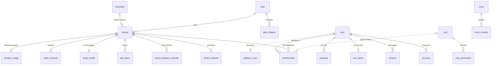
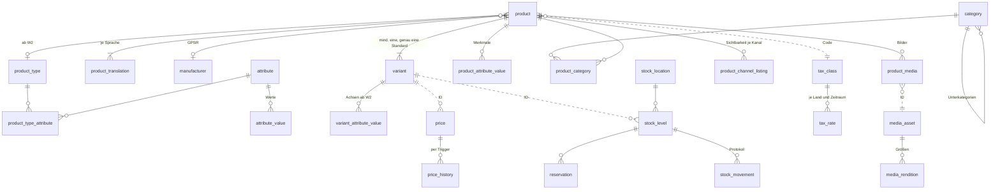
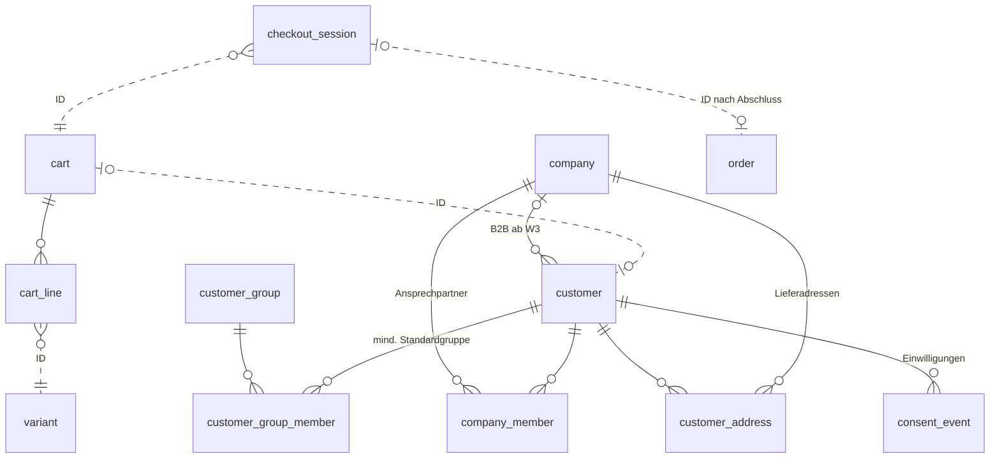
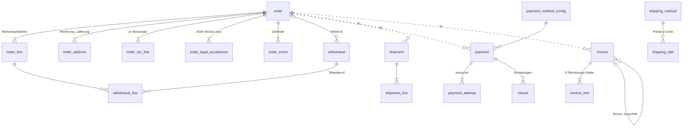
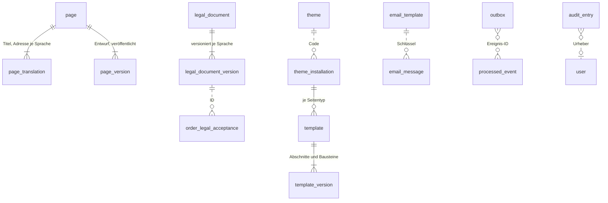

# Datenmodell der Shop-Plattform

Stand: 27.10.2026. Zweck: Dieses Dokument legt fest, welche Daten die Plattform speichert, in welchen Tabellen sie liegen und nach welchen Regeln. Es setzt die verbindlichen Entscheidungen aus `docs/03_Architektur.md` und den ADRs in `docs/entscheidungen/` um und berücksichtigt alle Architektur-Hinweise A-01 bis A-28 aus `docs/02_Featurekatalog.md`, Kapitel 4. Die passende, getestete Datenbankdatei liegt in `db/schema_welle1.sql`, der Test in `db/test_isolation.sh` und `db/test_isolation.sql`.

**Bewertungsskala in diesem Dokument:** 1 = beste Eignung, 9 = schlechteste Eignung.

**Disclaimer:** Rechtliche Angaben (Aufbewahrungsfristen, Steuersätze, E-Rechnung, Widerrufsbutton) sind technische Anforderungen nach bestem Wissen und keine Rechtsberatung. Punkte mit „zu prüfen“ sind nicht abschließend belegt. Die Datenbankdatei ist ein geprüfter Entwurf. Sie wird beim Bau von Welle 1 in Migrationen pro Modul aufgeteilt und kann sich dabei in Details ändern.

---

## Inhalt

1. Kurzfassung und Übersichtsbilder
2. Globale Regeln (Konventionen)
3. Die Tabellen je Modul
4. Spätere Erweiterungen ohne Umbau
5. Lebenszyklus der Daten: Löschen, Aufbewahren, Sichern
6. SQL-Datei und Testergebnis
7. Abweichungen von früheren Dokumenten
8. Offene Fragen an Kristof

---

## 1. Kurzfassung und Übersichtsbilder

### 1.1 Das Wichtigste in einfachen Worten

Eine Datenbank speichert Daten in **Tabellen**. Eine Tabelle sieht aus wie eine Tabelle in Excel: Jede **Zeile** ist ein Datensatz (zum Beispiel ein Produkt), jede **Spalte** ist eine Eigenschaft (zum Beispiel der Name). Mehrere Tabellen, die fachlich zusammengehören, liegen in einem **Schema**. Ein Schema ist ein benannter Bereich in der Datenbank, vergleichbar mit einem Ordner. Jedes Modul der Plattform besitzt genau ein Schema, so wie es die Architektur verlangt (ADR-002).

Das Datenmodell umfasst **20 Schemas mit 112 Tabellen**:

- **93 Tabellen gehören zu einem Shop** (Mandantentabellen). Jede dieser Tabellen hat die Spalte `tenant_id`, und die Datenbank selbst sorgt mit Row-Level-Security (RLS, „Sicherheit auf Zeilenebene“) dafür, dass jeder Shop nur seine eigenen Zeilen sieht und ändert.
- **19 Tabellen sind global**, also für die ganze Plattform gleich. Dazu gehören Steuersätze, Länder, Währungen, Händlerkonten, die Shops selbst und die Anmeldedaten der Menschen, die in mehreren Shops arbeiten können. Für sie gelten eigene, enge Zugriffsrechte.

Die wichtigsten Ideen des Modells sind:

1. **Jede Zeile kennt ihren Shop.** Das ist die Grundlage für die Mandantentrennung. Ein Test hat bewiesen, dass Shop A in keiner der 93 Tabellen eine Zeile von Shop B lesen, ändern, löschen oder anlegen kann (Kapitel 6).
2. **Jedes Produkt hat mindestens eine Variante.** Preis, Bestand und Artikelnummer hängen an der Variante. Ein einfaches Produkt hat genau eine Standardvariante. Echte Varianten wie Größen und Farben kommen in Welle 2 ohne Umbau hinzu.
3. **Preise stehen in einer eigenen Preistabelle.** Ein Preis gilt für eine Währung und optional nur für einen Verkaufskanal, eine Kundengruppe, ein Land, ab einer Mindestmenge und in einem Zeitraum. Jede Preisänderung wird automatisch protokolliert, damit der gesetzlich nötige 30-Tage-Tiefstpreis berechnet werden kann.
4. **Bestellungen sind Momentaufnahmen.** Preise, Steuern, Produkttexte, Adressen und die Versionen der Rechtstexte werden beim Kauf in die Bestellung kopiert. Die Datenbank verhindert, dass diese Werte später geändert werden. Nur der Status darf sich ändern.
5. **Bestellnummern und Rechnungsnummern sind lückenlos.** Ein Nummernkreis pro Shop und Belegart vergibt die Nummern so, dass auch bei gleichzeitigen Bestellungen keine Lücke und keine doppelte Nummer entsteht. Auch das ist getestet.
6. **Texte, die Kunden sehen, sind übersetzbar.** Sie stehen in eigenen Übersetzungstabellen mit Sprachcode. In Welle 1 gibt es nur Deutsch, weitere Sprachen sind später nur zusätzliche Zeilen.
7. **Nichts Wichtiges wird gelöscht.** Produkte und Kunden werden archiviert, Bestellungen und Rechnungen sind unveränderlich, Protokolle wachsen nur. Personenbezogene Daten werden bei Bedarf anonymisiert, ohne die Buchhaltung zu zerstören.
8. **Spätere Wellen brauchen keinen Umbau.** Firmenkunden (B2B), Kundengruppenpreise, Staffelpreise, mehrere Sprachen, Währungen und Länder, mehrere Lager und mehrere Shops pro Händler haben bereits ihren Platz im Modell (Kapitel 4).

### 1.2 Begriffe aus dem Auftrag und ihre Namen im Modell

Die Architektur legt einige Namen bereits fest. Wo der Auftrag einen anderen Namen nennt, gilt der Name aus der Architektur. Diese Tabelle ordnet beides zu.

| Begriff im Auftrag | Name im Modell | Grund |
|---|---|---|
| shop / tenant | `platform.tenant` | Architektur 5.1: Ein Mandant ist ein Shop. |
| shop_domain | `platform.tenant_domain` | Name aus Architektur 3.2 |
| platform_user | `platform.platform_user` | Betreiber-Konten, verweisen auf `identity.user` |
| users, sessions | `identity.user`, `identity.session` | Tabellennamen von Better Auth (Architektur 2.1) |
| api_tokens | `identity.api_token` | Einzahl laut Benennungsregel |
| 2FA | `identity.two_factor`, `identity.passkey` | Better Auth |
| product_variant | `catalog.variant` | Name aus Architektur 3.2 |
| tax_category | `tax.tax_class` | Architektur 3.2 nennt es Steuerklasse (`tax_class`). Der Begriff „tax category“ ist im Modell für den Steuerkategorie-Code der E-Rechnung reserviert (`vat_category_code`), damit es keine Verwechslung gibt. |
| sales_channel (channel) | `shop_settings.sales_channel` | Architektur ordnet Kanäle dem Modul `shop-settings` zu. |
| credit notes | `invoicing.invoice` mit `document_type = 'credit_note'` | Siehe Kapitel 7 |
| withdrawal | `orders.withdrawal`, `orders.withdrawal_line` | Architektur ordnet den Widerruf dem Modul `orders` zu. |
| legal texts | `content.legal_document`, `content.legal_document_version` | Architektur, Modul `content` |
| consents | `customers.consent_event` | Einwilligungen als unveränderliches Protokoll |
| cookie consent config | `shop_settings.cookie_service`, `cookie_consent_config`, `cookie_consent_log` | |
| outbox log (E-Mails) | `notifications.email_message` | |
| outbox/events | `kernel.outbox` | ADR-007 |
| idempotency keys | `kernel.idempotency_key` | Architektur 4.5 |

### 1.3 Übersichtsbilder

Die Bilder sind **ER-Diagramme** (Entity-Relationship-Diagramme, also Bilder von Tabellen und ihren Beziehungen) in der Schreibweise Mermaid. GitHub zeigt sie direkt als Grafik an. So liest man sie:

- Ein Kasten ist eine Tabelle. Der Schemaname steht in der Überschrift des Bildes, nicht im Kasten.
- Eine **durchgezogene Linie** ist ein echter Fremdschlüssel innerhalb eines Moduls. Ein Fremdschlüssel ist eine Datenbankregel, die sicherstellt, dass ein Verweis auf einen existierenden Datensatz zeigt.
- Eine **gestrichelte Linie** ist ein Verweis nur über die ID, meist über eine Modulgrenze hinweg. Hier prüft nicht die Datenbank, sondern die Fassade des anderen Moduls, ob der Verweis gültig ist (ADR-002).
- Die Zeichen an den Linienenden bedeuten: `||` genau eins, `o|` null oder eins, `|{` eins oder mehr, `o{` null oder mehr.

**Bild 1: Plattform und Zugang (Schemas `platform`, `identity`, `shop_settings`)**



**Bild 2: Katalog, Preise, Steuern, Lager (Schemas `catalog`, `pricing`, `tax`, `inventory`, `media`)**



**Bild 3: Kunden, Warenkorb, Checkout (Schemas `customers`, `cart`, `checkout`)**



**Bild 4: Bestellung, Zahlung, Versand, Widerruf, Rechnung (Schemas `orders`, `payments`, `shipping`, `invoicing`)**



**Bild 5: Inhalte, Editor, Kommunikation, Protokolle (Schemas `content`, `storefront`, `notifications`, `audit`, `kernel`)**



---

## 2. Globale Regeln (Konventionen)

Diese Regeln gelten für jede Tabelle. Ein automatischer Strukturtest prüft die wichtigsten davon bei jeder Änderung (Kapitel 6).

### 2.1 Datentypen kurz erklärt

| Typ | Bedeutung | Beispiel |
|---|---|---|
| `uuid` | Kennung aus 128 Bit, als Text 36 Zeichen lang | `0192f1c4-7a1e-7c3b-8d2e-4f1a2b3c4d5e` |
| `text` | Zeichenkette beliebiger Länge | `Grüner Tee` |
| `bigint`, `integer`, `smallint` | ganze Zahl (groß, mittel, klein) | `1299` (Cent) |
| `numeric(p,s)` | exakte Dezimalzahl, nur für Mengen und Maße, nie für Geld | `100.0000` |
| `boolean` | ja oder nein | `true` |
| `timestamptz` | Zeitpunkt mit Zeitzone, gespeichert in UTC (Weltzeit) | `2026-10-27 14:00:00+00` |
| `date` | Kalendertag ohne Uhrzeit | `2026-10-27` |
| `jsonb` | strukturierte Daten im JSON-Format, die PostgreSQL durchsuchen kann | `{"schemaVersion":1,"sections":[]}` |
| `bytea` | Rohdaten, hier fast nur Hashes (unumkehrbare Fingerabdrücke) | SHA-256-Wert |
| `inet` | IP-Adresse | `192.0.2.1` |
| `typ[]` | Liste von Werten dieses Typs | `{products:read,orders:read}` |

Dazu kommen vier eigene **Wertebereiche** (Domains) im Schema `kernel`. Eine Domain ist ein Datentyp mit eingebauter Prüfregel:

| Domain | Grundtyp | Regel |
|---|---|---|
| `kernel.currency_code` | `char(3)` | drei Großbuchstaben nach ISO 4217, zum Beispiel `EUR` |
| `kernel.country_code` | `char(2)` | zwei Großbuchstaben nach ISO 3166-1, zum Beispiel `DE` |
| `kernel.locale_code` | `text` | Sprachcode nach BCP 47, zum Beispiel `de` oder `de-CH` |
| `kernel.rate_bp` | `integer` | Steuersatz in Basispunkten zwischen 0 und 100000 |

### 2.2 IDs: UUIDv7

Jede Zeile bekommt eine **UUIDv7** als Kennung. Eine UUID ist eine 128 Bit lange Zufallskennung. Version 7 beginnt mit einem Zeitstempel in Millisekunden und endet mit 74 Bit Zufall. PostgreSQL 18 erzeugt sie selbst mit `uuidv7()`.

| Möglichkeit | Bewertung | Begründung |
|---|---|---|
| **UUIDv7** (gewählt) | 1 | Nicht erratbar (A-27), überall eindeutig ohne Absprache, auch wenn Shops später in eigene Datenbanken umziehen. Weil neue IDs zeitlich aufsteigend sind, bleiben die Indizes kompakt und schnell. |
| UUIDv4 (rein zufällig) | 3 | Ebenso sicher, aber neue IDs landen an zufälligen Stellen im Index. Das macht große Tabellen langsamer. |
| fortlaufende Zahl (`bigserial`) | 7 | Schnell und kurz, aber erratbar und verrät Geschäftszahlen, zum Beispiel wie viele Bestellungen es gibt. Beim Zusammenführen oder Aufteilen von Datenbanken entstehen Konflikte. |
| ULID | 4 | Ähnlich wie UUIDv7, aber ohne eingebauten Datentyp in PostgreSQL. |

**Disclaimer:** Eine UUIDv7 verrät den Zeitpunkt, an dem der Datensatz angelegt wurde. Das ist für Produkte und Bestellungen unbedenklich, weil dieser Zeitpunkt ohnehin angezeigt wird. Wo ein Zeitpunkt geheim bleiben muss, nutzt man keine ID, sondern ein zufälliges Token (zum Beispiel beim Warenkorb-Cookie).

Für Menschen lesbare Nummern wie die Bestellnummer `B-2026-00042` sind **zusätzliche** Spalten aus einem Nummernkreis (Abschnitt 3.4). Sie ersetzen die UUID nicht.

### 2.3 Primärschlüssel und Verweise

- Ein **Primärschlüssel** ist die Spalte (oder Spaltengruppe), die eine Zeile eindeutig bestimmt. Bei Mandantentabellen ist er **`(tenant_id, id)`**. Bei Tabellen ohne eigene ID (zum Beispiel Übersetzungen) besteht er aus `tenant_id` und den natürlichen Schlüsselspalten, etwa `(tenant_id, product_id, locale)`.
- Dass `tenant_id` vorne im Primärschlüssel steht, hat drei Vorteile: Jede Suche läuft über einen Index, der ohnehin nach Shop sortiert ist, Verweise können den Shop mitprüfen, und eine spätere Verteilung der Daten nach Shop (Citus, Architektur 5.8) passt ohne Umbau.
- **Verweise innerhalb eines Moduls** sind zusammengesetzte Fremdschlüssel `(tenant_id, x_id) → (tenant_id, id)`. Dadurch kann eine Variante von Shop A selbst durch einen Programmierfehler nie auf ein Produkt von Shop B zeigen. Der Test beweist das.
- **Verweise über Modulgrenzen** sind nur gespeicherte IDs ohne Fremdschlüssel (ADR-002). Die einzige Ausnahme ist `tenant_id`, das in jeder Mandantentabelle auf `platform.tenant(id)` verweist. Der Strukturtest prüft, dass es keine anderen modulübergreifenden Fremdschlüssel gibt.
- Wenn ein anderes Modul eine ID speichert, prüft der Kern vorher über die Fassade des Besitzermoduls, ob es den Datensatz im eigenen Shop gibt. Weil die Fassade unter RLS läuft, findet sie eine fremde ID nie.

### 2.4 Zeitstempel

- Zeitpunkte sind `timestamptz` und werden in UTC gespeichert (A-27). Die Umrechnung in deutsche Zeit geschieht erst bei der Anzeige.
- Rechtliche Kalendertage sind `date`, zum Beispiel der Beginn eines Steuersatzes oder das Rechnungsdatum, weil das Gesetz in Tagen und nicht in Zeitpunkten denkt.
- Zeitpunkte heißen `*_at` (`created_at`, `published_at`), Kalendertage `*_date` oder `valid_from`/`valid_to`.

### 2.5 Standardspalten „S“

Jede Tabelle, deren Zeilen sich ändern dürfen, hat diese fünf Spalten. In Kapitel 3 steht dafür kurz **„+ S“**.

| Spalte | Typ | Null | Standard | Bedeutung |
|---|---|---|---|---|
| `created_at` | timestamptz | nein | `now()` | Zeitpunkt der Anlage |
| `created_by` | uuid | ja | `kernel.current_actor_id()` | Wer die Zeile angelegt hat (Mensch, Token, KI, App). Wert aus `app.actor_id` der Transaktion |
| `updated_at` | timestamptz | nein | `now()` | Zeitpunkt der letzten Änderung |
| `updated_by` | uuid | ja | `kernel.current_actor_id()` | Wer zuletzt geändert hat |
| `version` | integer | nein | `1` | Versionszähler für gleichzeitige Änderungen (Abschnitt 2.8) |

Ein **Trigger** hält diese Spalten aktuell. Ein Trigger ist ein kleines Programm in der Datenbank, das automatisch bei jeder Änderung läuft. Der Trigger `kernel.tg_touch_row` erhöht bei jedem `UPDATE` die Version um eins, setzt `updated_at` und `updated_by` und verhindert, dass jemand `created_at` oder `created_by` verändert.

Tabellen, die nur wachsen (Protokolle), haben stattdessen nur einen Zeitpunkt wie `created_at`, `occurred_at` oder `changed_at`.

Wer was genau geändert hat (alter und neuer Wert), steht nicht in diesen Spalten, sondern im Audit-Log (`audit.audit_entry`, PLA-07).

### 2.6 Mandant: `tenant_id` und RLS

**Regel:** Jede Tabelle mit Shopdaten hat als erste Spalte `tenant_id uuid NOT NULL REFERENCES platform.tenant(id)`. In Kapitel 3 wird diese Spalte nicht mehr einzeln aufgeführt.

**Die Vorlage für jede Mandantentabelle** sieht so aus. Die Hilfsfunktion `kernel.current_tenant_id()` liest den Wert `app.tenant_id`, den der Kern zu Beginn jeder Transaktion setzt, und macht aus einem leeren Wert `NULL`:

```sql
-- einmalig im Schema kernel
CREATE FUNCTION kernel.current_tenant_id() RETURNS uuid
  LANGUAGE sql STABLE PARALLEL SAFE
  AS $$ SELECT nullif(current_setting('app.tenant_id', true), '')::uuid $$;

-- für jede Mandantentabelle (in der SQL-Datei über kernel.enable_tenant_rls erzeugt)
ALTER TABLE catalog.product ENABLE ROW LEVEL SECURITY;
ALTER TABLE catalog.product FORCE ROW LEVEL SECURITY;
CREATE POLICY tenant_isolation ON catalog.product
  USING      (tenant_id = kernel.current_tenant_id())
  WITH CHECK (tenant_id = kernel.current_tenant_id());
```

So wirkt die Vorlage:

- Eine **Policy** ist eine Regel, die PostgreSQL an jede Abfrage auf die Tabelle anhängt. `USING` bestimmt, welche Zeilen man lesen, ändern oder löschen kann. `WITH CHECK` bestimmt, welche Zeilen man schreiben darf.
- `ENABLE` schaltet RLS ein, `FORCE` sorgt dafür, dass es auch für den Besitzer der Tabelle gilt.
- `current_setting('app.tenant_id', true)` liefert den gesetzten Mandanten. Das zweite Argument `true` bedeutet „keinen Fehler werfen, wenn nichts gesetzt ist“. Ist nichts gesetzt, ergibt der Vergleich nie „wahr“, und die Abfrage liefert keine Zeilen. Die Regel ist also **im Zweifel geschlossen**.
- Ein ungültiger Wert (keine UUID) führt zu einem Fehler statt zu Daten.
- Der Kern setzt den Wert ausschließlich mit `set_config('app.tenant_id', <id>, true)` innerhalb einer Transaktion (Architektur 5.3). Eine **Transaktion** ist eine Gruppe von Datenbankschritten, die ganz oder gar nicht ausgeführt wird. Am Ende der Transaktion verschwindet der Wert automatisch.

**Datenbankrollen.** Eine Rolle ist ein Benutzerkonto in der Datenbank.

| Rolle | Anmeldung | Besonderheit | Rechte |
|---|---|---|---|
| `shop_owner` | nein | besitzt alle Tabellen, führt Migrationen aus | RLS gilt dank `FORCE` auch für sie |
| `shop_app` | ja | Kern (API und Worker), ohne `SUPERUSER`, ohne `BYPASSRLS` | Lesen und Schreiben auf Mandantentabellen, nur Lesen auf Referenzdaten und Plattformtabellen, kein `UPDATE`/`DELETE` auf Protokollen |
| `shop_platform` | ja | Platform API | volle Rechte im Schema `platform`, Anmeldetabellen, Audit-Einträge ohne Mandant |
| `shop_relay` | ja | Outbox-Weiterleitung | liest alle Outbox-Zeilen, darf nur `published_at`, `attempts`, `last_error` ändern und alte Zeilen löschen |
| `shop_backup` | ja | Datensicherung mit `pg_dump`, hat als einzige Rolle `BYPASSRLS` | nur Lesen (`pg_read_all_data`), wird nie von der Anwendung benutzt (siehe Kapitel 7) |

**Sonderregeln für vier Tabellen.** Diese Tabellen haben eine angepasste Policy. Sie sind trotzdem im Zweifel geschlossen.

| Tabelle | Lesen erlaubt, wenn | Warum |
|---|---|---|
| `identity.membership` | Zeile gehört zum aktuellen Shop **oder** zum angemeldeten Nutzer (`app.user_id`) | Nach dem Login muss der Kern die Shops des Nutzers finden, bevor ein Shop gewählt ist. |
| `identity.api_token` | Zeile gehört zum aktuellen Shop **oder** ihr Hash entspricht `app.api_token_hash` | Ein Token bestimmt erst, zu welchem Shop eine Anfrage gehört. Wer den Hash kennt, besitzt das Token. |
| `audit.audit_entry` | Zeile gehört zum aktuellen Shop. Für `shop_platform` zusätzlich Zeilen ohne Shop | Aktionen in der Plattform-Verwaltung haben keinen Shop. |
| `kernel.outbox` | Zeile gehört zum aktuellen Shop. `shop_platform` sieht Zeilen ohne Shop, `shop_relay` sieht alles | Das Relay muss Ereignisse aller Shops weiterleiten. |

**Globale Tabellen** ohne `tenant_id` und ohne RLS. Diese Liste kommt später in `db/global-tables.yaml` (Architektur 5.6). Der Strukturtest kennt sie bereits und schlägt bei jeder weiteren Tabelle ohne `tenant_id` Alarm.

| Tabelle | Warum global | Rechte von `shop_app` |
|---|---|---|
| `kernel.currency`, `kernel.country` | Referenzdaten nach ISO | nur lesen |
| `tax.tax_class`, `tax.tax_rate` | gesetzliche Steuerklassen und -sätze | nur lesen |
| `storefront.theme` | von der Plattform gelieferte Designs | nur lesen |
| alle 8 Tabellen in `platform` | gehören dem Betreiber, der Shop wird über die Domain gefunden, bevor ein Mandant feststeht | nur lesen auf `tenant`, `tenant_domain`, `plan`, `plan_feature`, `tenant_feature_override`, `platform_setting`; kein Zugriff auf `merchant` und `platform_user` |
| `identity.user`, `account`, `session`, `verification`, `two_factor`, `passkey` | Eine Person kann in mehreren Shops arbeiten, und die Anmeldung geschieht vor der Shopwahl | lesen und schreiben (über Better Auth) |

**Disclaimer:** Die Anmeldetabellen sind für `shop_app` voll zugänglich, weil Better Auth sie direkt benutzt. Eine eigene, noch engere Rolle nur für die Anmeldung ist möglich und wird im Sicherheitskonzept (`docs/05_Sicherheit.md`) bewertet (zu prüfen).

### 2.7 Archivieren statt Löschen

Es gibt bewusst **kein allgemeines „weiches Löschen“** mit einer Spalte `deleted_at` in jeder Tabelle. Bei weichem Löschen bleibt die Zeile liegen und wird nur als gelöscht markiert. Das führt in der Praxis zu zwei typischen Fehlern: Eine Abfrage vergisst den Filter und zeigt Gelöschtes an, und eindeutige Werte wie Artikelnummern oder Adressen bleiben blockiert.

Stattdessen gilt je nach Art der Daten:

| Art der Daten | Verhalten | Beispiele |
|---|---|---|
| Stammdaten mit Bezug zu Bestellungen | **Archivieren:** Status `archived` oder Spalte `archived_at`. Archivierte Zeilen erscheinen nicht mehr im Shop, bleiben aber für alte Bestellungen erhalten (A-28). | `catalog.product`, `catalog.variant`, `catalog.category`, `catalog.manufacturer`, `customers.customer`, `customers.company`, `shipping.shipping_method`, `content.page` |
| Personenbezogene Daten | **Anonymisieren:** Name, E-Mail und Adresse werden geleert oder ersetzt, `anonymized_at` wird gesetzt. | `customers.customer`, `orders.order`, `orders.order_address`, `notifications.email_message` |
| Belege und Protokolle | **Nie ändern, nie löschen** innerhalb der Aufbewahrungsfrist (Abschnitt 2.15). | Bestellungen, Rechnungen, Audit-Log, Lagerbewegungen, Preisverlauf |
| Kurzlebige oder rein technische Daten | **Echt löschen** nach Ablauf. | Warenkorbzeilen, abgelaufene Idempotenz-Schlüssel, alte Outbox-Zeilen, Sitzungen |
| Medien | Status `deleted` plus `deleted_at`, die Datei im Objektspeicher wird von einem Hintergrundjob entfernt, sobald `media.media_usage` keinen Verweis mehr zeigt. | `media.media_asset` |

### 2.8 Gleichzeitige Änderungen: `version` und ETag

Jede änderbare Zeile hat die Spalte `version`. Die API liefert sie als **ETag** aus, also als Versionskennung in der Antwort (Architektur 4.6). Wer ändert, schickt die Version zurück. Der Kern ändert dann nur, wenn die Version noch stimmt:

```sql
UPDATE catalog.product SET status = 'published'
 WHERE id = $1 AND version = $2;   -- 0 Zeilen getroffen => HTTP 412, neu laden
```

Dieses Verfahren heißt **optimistisches Sperren**: Es sperrt nichts im Voraus und erkennt Konflikte erst beim Speichern. Für den Fall, dass Händler und KI gleichzeitig am selben Produkt arbeiten, ist das genau richtig. Der Test prüft, dass eine Änderung mit veralteter Version null Zeilen trifft.

Bei Daten mit Unterzeilen (zum Beispiel Produkt mit Übersetzungen) gilt die Version des Hauptdatensatzes als ETag für das Ganze. Der Kern erhöht sie, wenn sich eine Unterzeile ändert.

### 2.9 Übersetzungen

Alle Texte, die Kunden sehen, stehen in eigenen Tabellen mit der Endung `_translation` (A-07). Es gibt nie Spalten wie `name_de` und `name_en`.

```text
catalog.product_translation
  PRIMARY KEY (tenant_id, product_id, locale)
  UNIQUE      (tenant_id, locale, slug)
```

- `locale` ist ein Sprachcode wie `de`. Länderspezifische Varianten wie `de-CH` sind erlaubt.
- Die **Rückfallreihenfolge** beim Lesen ist: gewünschte Sprache, dann Standardsprache des Verkaufskanals, dann Standardsprache des Shops (`platform.tenant.default_locale`). So bleibt ein Shop lesbar, wenn eine Übersetzung fehlt.
- Die Adresse im Browser (der **Slug**, zum Beispiel `gruener-tee`) steht ebenfalls in der Übersetzung. Jede Sprache hat also eigene, lesbare Adressen (MKT-01). Ändert sich ein Slug, legt der Kern eine Weiterleitung in `content.url_redirect` an.
- Übersetzungstabellen gibt es für Produkte, Varianten, Merkmale, Merkmalswerte, Kategorien, Versandarten, Seiten und Bildbeschreibungen. Rechtstexte und E-Mail-Vorlagen haben die Sprache direkt in ihrer Versionszeile, weil jede Sprache dort eine eigene Fassung mit eigener Versionsnummer ist.
- Texte, die nur der Händler sieht (zum Beispiel der Name eines Produkttyps), sind nicht übersetzbar. Das spart Tabellen ohne Nutzen.

### 2.10 Geld

- Jeder Betrag ist eine **ganze Zahl in der kleinsten Einheit** der Währung (`bigint`, bei Euro in Cent) und hat immer eine Währung daneben (ADR-006, A-04). 19,99 Euro sind `amount = 1999`, `currency = 'EUR'`.
- Spalten heißen `amount` oder `*_amount`. Eine Währungsspalte heißt `currency` oder `*_currency`, wenn eine Zeile Beträge in verschiedenen Rollen hat.
- Wie viele Nachkommastellen eine Währung hat und wie gerundet wird, steht in `kernel.currency` (`minor_units`, `rounding_mode`). Der Yen hat zum Beispiel null Nachkommastellen.
- Beträge sind nie Kommazahlen. `numeric` ist nur für Mengen und Maße erlaubt, zum Beispiel für den Inhalt beim Grundpreis.
- Grundpreise mit Bruchteilen von Cent werden nur für die Anzeige berechnet und gerundet (ADR-006). In der Bestellung steht der angezeigte Wert als Momentaufnahme.
- Negative Beträge gibt es nur, wo sie fachlich Sinn ergeben, etwa bei einer Gutschrift. Preise, Zahlungen und Erstattungen haben eine Prüfregel `>= 0` oder `> 0`.

### 2.11 Steuern in Basispunkten

- Ein **Basispunkt** ist ein Hundertstel Prozent. 19 Prozent sind `rate_bp = 1900`, 7 Prozent sind `700`.
- Das Produkt kennt nur eine **Steuerklasse** (`standard`, `reduced`, `zero`, `exempt`), nie einen Prozentsatz (A-08). Den Satz liefert `tax.tax_rate` je Land, Region, Steuerklasse und Gültigkeitszeitraum.
- Eine Ausschlussregel in der Datenbank verhindert, dass sich zwei Zeiträume für dasselbe Land und dieselbe Klasse überschneiden. Die Referenzdaten enthalten auch die befristete Senkung von Juli bis Dezember 2020, damit alte Belege nachvollziehbar bleiben.
- Jede Bestellposition speichert Klasse, Satz, Steuerbetrag und den **Steuerkategorie-Code** der E-Rechnung (`vat_category_code`). Dieser Code stammt aus der Liste UNCL5305 der europäischen Norm EN 16931: `S` = Normal- oder ermäßigter Satz, `Z` = Nullsatz, `E` = steuerbefreit, `AE` = Umkehr der Steuerschuld (Reverse Charge), `K` = innergemeinschaftliche Lieferung, `G` = Ausfuhr, `O` = nicht steuerbar.

### 2.12 Feste Wertelisten: Prüfregeln statt Enums

PostgreSQL kennt einen eigenen Aufzählungstyp (`ENUM`). Er ist hier bewusst **nicht** im Einsatz.

| Möglichkeit | Wofür | Bewertung | Begründung |
|---|---|---|---|
| `text` mit Prüfregel `CHECK (status IN (...))` | Status und feste Kategorien, die nur Programmierer ändern | 2 | Lesbar, mit einer kleinen Migration erweiterbar und auch wieder einschränkbar. Kysely erzeugt daraus trotzdem genaue Typen, wenn die Werte im Code als Zod-Schema stehen. |
| PostgreSQL-`ENUM` | – | 5 | Werte lassen sich hinzufügen, aber nicht entfernen oder umbenennen, ohne den Typ neu zu bauen. Das passt schlecht zu einem Projekt, das in Wellen wächst. |
| Nachschlagetabelle (Lookup) | Werte, die Händler oder Betreiber selbst pflegen, oder Referenzdaten mit Zusatzangaben | 1 für diesen Zweck | Beispiele: `customers.customer_group`, `tax.tax_class`, `kernel.country`, `kernel.currency`. |
| Domain | Codes mit Formatregel, die in vielen Tabellen vorkommen | 1 für diesen Zweck | Währungs-, Länder- und Sprachcodes (Abschnitt 2.1). |

Modulübergreifende Codes wie `tax_class_code` am Produkt sind Text ohne Fremdschlüssel, weil die Tabelle einem anderen Modul gehört. Der Kern prüft sie über die Fassade des Moduls `tax`.

### 2.13 Regeln für JSONB

JSONB-Spalten speichern strukturierte Daten in einer Spalte. Das ist bequem, aber die Datenbank kann solche Inhalte schlechter prüfen und verbinden. Deshalb gilt:

**JSONB ist erlaubt für:**

1. **Seiteninhalte** aus Abschnitten und Bausteinen (`document` in `page_version`, `legal_document_version`, `template_version`), weil ADR-005 genau das festlegt. Jedes Dokument hat ein Feld `schemaVersion`, und eine Prüfregel verlangt eine Liste `sections`.
2. **Formatierten Text** wie Produktbeschreibungen (`description`) als strukturierte Daten statt HTML (ADR-005).
3. **Zusatzfelder** (`custom_fields`, A-24) an Produkten, Varianten, Kunden, Firmen, Bestellungen und dem Shopprofil. Das Format jedes Zusatzfelds wird ab Welle 4 je Shop als Schema hinterlegt und bei jeder Speicherung geprüft.
4. **Momentaufnahmen**, die nur als Ganzes gelesen werden, etwa Hersteller- und Grundpreisangaben in `order_line` oder Verkäufer- und Käuferdaten in `invoice`.
5. **Ereignisinhalte** und **Rohdaten fremder Systeme** (`kernel.outbox.data`, `payments.provider_event.payload`).
6. **Einstellungen**, deren Aufbau im Code durch ein Zod-Schema beschrieben ist (`settings`, `limits`, `texts`).

**JSONB ist verboten für:**

- Geldbeträge, nach denen gerechnet oder summiert wird,
- Verweise auf andere Datensätze, die regelmäßig gesucht werden,
- alles, wonach regelmäßig gefiltert, sortiert oder gezählt wird. Solche Werte bekommen eine eigene Spalte.

Jede JSONB-Spalte hat einen Standardwert (`'{}'` oder `'[]'`), damit sie nie leer und unerwartet `NULL` ist, außer wenn `NULL` eine fachliche Bedeutung hat.

### 2.14 Namen

Es gelten die Benennungsregeln aus Architektur 6.2. Für die Datenbank heißt das:

| Bereich | Regel | Beispiel |
|---|---|---|
| Schema | Modulname mit Unterstrich | `shop_settings` |
| Tabelle | Englisch, Einzahl, snake_case (Kleinbuchstaben mit Unterstrich) | `order_line` |
| Primärschlüssel | `id` | `id uuid DEFAULT uuidv7()` |
| Verweis | `<tabelle>_id` | `variant_id` |
| Zeitpunkt, Kalendertag | `*_at`, `*_date` | `placed_at`, `issue_date` |
| Ja/Nein-Werte | `is_*`, `has_*`, `allow_*` oder ein klares Adjektiv | `is_default`, `allow_oversell` |
| Geld | `amount` oder `*_amount` plus Währung | `unit_price_amount` |
| Steuersatz | `*_bp` | `rate_bp` |
| Index | `<tabelle>_<zweck>_idx` | `order_placed_idx` |
| Trigger-Funktion | `tg_<zweck>` | `tg_order_guard` |
| Reservierte Wörter | in Anführungszeichen | `orders."order"`, `identity."user"` |

### 2.15 Unveränderliche Daten

Manche Daten dürfen sich nach dem Speichern nicht mehr ändern. Die Datenbank erzwingt das auf drei Wegen:

| Art | Tabellen | Wie es erzwungen wird |
|---|---|---|
| **Nur anhängen** (append-only): keine Änderung, kein Löschen | `audit.audit_entry`, `pricing.price_history`, `inventory.stock_movement`, `orders.order_line`, `orders.order_tax_line`, `orders.order_legal_acceptance`, `orders.order_event`, `customers.consent_event`, `payments.provider_event`, `invoicing.invoice_line`, `shop_settings.cookie_consent_log` | Trigger `kernel.tg_append_only` plus fehlende `UPDATE`- und `DELETE`-Rechte für `shop_app` |
| **Teilweise änderbar** | `orders.order`: nur Status, Notizen, `seen_at`, Stornierung und Zusatzfelder ändern sich, beim Anonymisieren zusätzlich die persönlichen Felder. `orders.order_address`: nur Anonymisierung. | Trigger `orders.tg_order_guard` und `orders.tg_order_address_guard`, kein `DELETE`-Recht |
| **Unveränderlich ab Veröffentlichung** | `invoicing.invoice` ab `status = 'issued'`; `content.legal_document_version`, `content.page_version`, `storefront.template_version` ab `state <> 'draft'` | Trigger `invoicing.tg_invoice_guard` und `kernel.tg_published_version_guard`. Bei Versionen ist nur der Wechsel von `published` zu `superseded` (abgelöst) erlaubt. |

Wenn alte Protokollzeilen nach Ablauf der Aufbewahrungsfrist weg müssen, geschieht das durch einen Wartungsjob mit der Besitzerrolle oder später durch das Löschen ganzer Monatsabschnitte (Partitionen, Architektur 9). Die Anwendung selbst kann es nicht.

### 2.16 Indizes

Ein **Index** ist ein Inhaltsverzeichnis, mit dem die Datenbank Zeilen schnell findet, ohne die ganze Tabelle zu lesen.

1. **Jeder Index auf einer RLS-Tabelle beginnt mit `tenant_id`**, weil jede Abfrage durch RLS ohnehin nach `tenant_id` filtert. Der Strukturtest prüft das. Erlaubte Ausnahmen sind global eindeutige Werte, die vor der Shopwahl gesucht werden (`identity.api_token.token_hash`, `identity.membership.user_id`), die Primärschlüssel von `audit.audit_entry` und `kernel.outbox` sowie der Index des Relays für unveröffentlichte Ereignisse.
2. Jede Fremdschlüsselspalte hat einen Index, der mit `(tenant_id, <spalte>)` beginnt, damit Löschen und Verknüpfen schnell bleiben. Meist erledigt das der Primärschlüssel oder ein eindeutiger Schlüssel.
3. **Teilindizes** (mit `WHERE`) sichern Regeln wie „genau eine Standardvariante pro Produkt“ oder „genau ein Standardlager pro Shop“ und halten Listen wie „offene Reservierungen“ klein.
4. Neue Indizes entstehen erst, wenn eine konkrete Abfrage sie braucht. Jeder Index kostet beim Schreiben Zeit.

---

## 3. Die Tabellen je Modul

### 3.0 So liest man die Tabellen

- **Welle:** „W1“ heißt, die Tabelle wird in Welle 1 benutzt. „vorbereitet, genutzt ab Welle X“ heißt, die Tabelle existiert schon in Welle 1, damit später kein Umbau nötig ist, bleibt aber bis dahin leer oder wird nur im Hintergrund befüllt.
- **RLS:** „ja“ heißt Mandantentabelle mit `tenant_id` und Policy. Die Spalte `tenant_id` steht nicht in den Spaltenlisten.
- **Schlüssel:** PK = Primärschlüssel, UK = eindeutiger Schlüssel (unique), FK = Fremdschlüssel. Wenn der PK `(tenant_id, id)` lautet, hat die Tabelle eine Spalte `id uuid NOT NULL DEFAULT uuidv7()`. Sie steht ebenfalls nicht in der Spaltenliste.
- **„+ S“** heißt, die Tabelle hat die fünf Standardspalten aus Abschnitt 2.5.
- **Null:** „nein“ heißt Pflichtfeld.

Übersicht der Schemas:

| Schema | Tabellen | davon RLS | Modul laut Architektur | Welle |
|---|---|---|---|---|
| `kernel` | 4 | 2 | Gemeinschaftspaket | 1 |
| `platform` | 8 | 0 | `platform` | 1 |
| `identity` | 10 | 4 | `identity` | 1 |
| `shop_settings` | 9 | 9 | `shop-settings` | 1 |
| `audit` | 2 | 2 | `audit` | 1 |
| `catalog` | 18 | 18 | `catalog` | 1 |
| `pricing` | 2 | 2 | `pricing` | 1 |
| `tax` | 3 | 1 | `tax` | 1 |
| `inventory` | 5 | 5 | `inventory` | 1 |
| `customers` | 8 | 8 | `customers` | 1 |
| `cart` | 2 | 2 | `cart` | 1 |
| `checkout` | 1 | 1 | `checkout` | 1 |
| `orders` | 9 | 9 | `orders` | 1 |
| `invoicing` | 2 | 2 | `invoicing` | vorbereitet, ab 2 |
| `payments` | 5 | 5 | `payments` | 1 |
| `shipping` | 5 | 5 | `shipping` | 1 |
| `content` | 7 | 7 | `content` | 1 |
| `storefront` | 4 | 3 | `storefront` | 1 |
| `media` | 4 | 4 | `media` | 1 |
| `notifications` | 4 | 4 | `notifications` | 1 |
| **Summe** | **112** | **93** | | |

Die Module `promotions`, `search`, `ai` und `integrations` aus der Architektur bekommen ihre Schemas erst in Welle 2 und Welle 4 (Abschnitt 4.7).

Die Tabelle `processed_event` (Inbox, ADR-007) gibt es in jedem Modul, das in Welle 1 auf Ereignisse reagiert: `audit`, `inventory`, `customers`, `orders`, `notifications`. Sie ist überall gleich aufgebaut und wird hier einmal beschrieben.

**`<modul>.processed_event`** – merkt sich, welche Ereignisse ein Empfänger schon verarbeitet hat, damit doppelt zugestellte Ereignisse nichts doppelt auslösen. W1. RLS ja. PK `(tenant_id, subscriber, event_id)`.

| Spalte | Typ | Null | Standard | Bedeutung |
|---|---|---|---|---|
| `event_id` | uuid | nein | – | ID des Ereignisses aus `kernel.outbox` |
| `subscriber` | text | nein | – | Name des Empfängers, zum Beispiel `send-order-confirmation` |
| `processed_at` | timestamptz | nein | `now()` | Zeitpunkt der Verarbeitung |

---

### 3.1 Schema `kernel` – Werkzeuge, Referenzdaten, Outbox, Idempotenz

Neben den Tabellen enthält `kernel` die Hilfsfunktionen `current_tenant_id()`, `current_actor_id()`, `current_user_id()`, `current_api_token_hash()`, die Trigger-Funktionen aus Abschnitt 2.5 und 2.15 und die Migrationshelfer `enable_tenant_rls`, `setup_tenant_table`, `add_touch_trigger` und `make_append_only`, die nur `shop_owner` ausführen darf.

**`kernel.currency`** – Währungen nach ISO 4217. W1. Global. PK `code`.

| Spalte | Typ | Null | Standard | Bedeutung |
|---|---|---|---|---|
| `code` | currency_code | nein | – | z. B. `EUR` |
| `minor_units` | smallint | nein | – | Nachkommastellen (EUR 2, JPY 0) |
| `rounding_mode` | text | nein | `half_up` | `half_up` (kaufmännisch) oder `half_even` |
| `cash_rounding_minor` | smallint | nein | `1` | Rundung bei Barzahlung, z. B. 5 Rappen in der Schweiz |
| `symbol` | text | nein | – | z. B. `€` |
| `name_de` | text | nein | – | deutscher Name |

**`kernel.country`** – Länder nach ISO 3166-1. W1. Global. PK `code`.

| Spalte | Typ | Null | Standard | Bedeutung |
|---|---|---|---|---|
| `code` | country_code | nein | – | z. B. `DE` |
| `name_de` | text | nein | – | deutscher Name |
| `is_eu` | boolean | nein | `false` | EU-Mitglied (für OSS und Reverse Charge) |
| `default_currency` | currency_code | ja | – | übliche Währung |
| `requires_region` | boolean | nein | `false` | Bundesstaat oder Provinz ist Pflicht (z. B. USA) |
| `address_format` | jsonb | nein | `{}` | Feldreihenfolge und Pflichtfelder der Adresse (INT-04, ab Welle 4) |

**`kernel.outbox`** – Ereignisse nach ADR-007, in derselben Transaktion wie die Datenänderung geschrieben. W1. RLS ja (Sonderregel, Abschnitt 2.6, `tenant_id` darf hier leer sein). PK `id`. Indizes: unveröffentlichte Ereignisse nach Zeit, `(tenant_id, occurred_at)`.

| Spalte | Typ | Null | Standard | Bedeutung |
|---|---|---|---|---|
| `id` | uuid | nein | `uuidv7()` | Ereignis-ID |
| `tenant_id` | uuid | ja | – | Shop, leer nur bei Plattform-Ereignissen |
| `type` | text | nein | – | z. B. `orders.order.placed.v1`, Format geprüft |
| `occurred_at` | timestamptz | nein | `now()` | Zeitpunkt |
| `actor` | jsonb | nein | – | Wer es ausgelöst hat (Art und ID) |
| `correlation_id` | uuid | nein | – | verbindet alle Schritte eines Vorgangs |
| `causation_id` | uuid | ja | – | Ereignis, das dieses ausgelöst hat |
| `data` | jsonb | nein | – | Inhalt, beschrieben durch ein Zod-Schema |
| `published_at` | timestamptz | ja | – | wann das Relay es weitergegeben hat |
| `attempts` | integer | nein | `0` | Zahl der Weitergabeversuche |
| `last_error` | text | ja | – | letzter Fehler beim Weitergeben |

**`kernel.idempotency_key`** – gespeicherte Antworten auf wiederholte Anfragen (Architektur 4.5). W1. RLS ja. PK `(tenant_id, id)`, UK `(tenant_id, scope, key)`, Index `(tenant_id, expires_at)`.

| Spalte | Typ | Null | Standard | Bedeutung |
|---|---|---|---|---|
| `scope` | text | nein | – | API und Vorgang, z. B. `store:placeOrder` |
| `key` | text | nein | – | Wert der Kopfzeile `Idempotency-Key` (8 bis 255 Zeichen) |
| `request_hash` | bytea | nein | – | Fingerabdruck der Anfrage, um abweichende Wiederholungen abzulehnen |
| `status` | text | nein | `in_progress` | `in_progress` oder `completed` |
| `response_status` | smallint | ja | – | gespeicherter HTTP-Status |
| `response_body` | jsonb | ja | – | gespeicherte Antwort |
| `created_at` | timestamptz | nein | `now()` | |
| `expires_at` | timestamptz | nein | `now() + 24 h` | danach löscht ein Job die Zeile |

---

### 3.2 Schema `platform` – Händler, Shops, Tarife, Domains

Alle Tabellen sind global. Nur `shop_platform` schreibt hier. Ein neuer Shop entsteht so: Die Platform API legt `merchant`, `tenant` und `tenant_domain` an und schreibt das Ereignis `platform.tenant.created.v1`. Jedes Modul legt daraufhin in einer eigenen Transaktion mit dem neuen Mandanten seine Voreinstellungen an (Verkaufskanal, Standardgruppe „Endkunden“, Standardlager, Nummernkreise, Rechtstext-Vorlagen, Test-Zahlung, Pauschalversand, Steuereinstellung). So kennt die Plattform-Verwaltung keine Shoptabellen (PLA-02).

**`platform.plan`** – Tarife (A-20). W1 mit einem Standardtarif. PK `id`, UK `code`, Teilindex „genau ein Standardtarif“. + S.

| Spalte | Typ | Null | Standard | Bedeutung |
|---|---|---|---|---|
| `code` | text | nein | – | z. B. `standard` |
| `name` | text | nein | – | Anzeigename |
| `is_default` | boolean | nein | `false` | Tarif für neue Shops |
| `limits` | jsonb | nein | `{}` | Grenzen wie maximale Produktzahl (PLA-10, Welle 5) |
| `status` | text | nein | `active` | `active`, `retired` |

**`platform.plan_feature`** – Funktionsschalter je Tarif. W1. PK `(plan_id, feature_key)`, FK `plan_id → plan`.

| Spalte | Typ | Null | Standard | Bedeutung |
|---|---|---|---|---|
| `plan_id` | uuid | nein | – | Tarif |
| `feature_key` | text | nein | – | z. B. `ai_assistant`, `b2b` |
| `enabled` | boolean | nein | `true` | eingeschaltet |
| `limit_value` | bigint | ja | – | optionale Obergrenze |

**`platform.merchant`** – Händlerkonto, also das Unternehmen, das Shops betreibt. W1. PK `id`. + S.

| Spalte | Typ | Null | Standard | Bedeutung |
|---|---|---|---|---|
| `name` | text | nein | – | Name des Händlers |
| `contact_email` | text | ja | – | Kontakt für den Betreiber |
| `contact_name` | text | ja | – | Ansprechpartner |
| `status` | text | nein | `active` | `active`, `suspended`, `deleted` |
| `notes` | text | ja | – | interne Notizen des Betreibers |
| `deleted_at` | timestamptz | ja | – | Zeitpunkt der Löschung |

**`platform.tenant`** – der Shop, also der Mandant. W1. PK `id`, UK `handle`, FK `merchant_id → merchant`, `plan_id → plan`, Index `merchant_id`. + S.

| Spalte | Typ | Null | Standard | Bedeutung |
|---|---|---|---|---|
| `merchant_id` | uuid | nein | – | Besitzer. Ein Händler kann mehrere Shops haben. |
| `plan_id` | uuid | nein | – | Tarif |
| `handle` | text | nein | – | Kurzname für die Subdomain, z. B. `teeladen` (PLA-05) |
| `name` | text | nein | – | Anzeigename in der Plattform-Verwaltung |
| `status` | text | nein | `provisioning` | `provisioning`, `active`, `suspended`, `deleting`, `deleted` |
| `default_locale` | locale_code | nein | `de` | Standardsprache |
| `default_currency` | currency_code | nein | `EUR` | Standardwährung |
| `home_country` | country_code | nein | `DE` | Sitzland |
| `timezone` | text | nein | `Europe/Berlin` | Zeitzone |
| `suspended_at` | timestamptz | ja | – | Zeitpunkt der Sperre |
| `suspended_reason` | text | ja | – | Grund der Sperre |
| `deleted_at` | timestamptz | ja | – | Zeitpunkt der Löschung |

**`platform.tenant_domain`** – Adressen eines Shops. W1 (Subdomain), eigene Domains ab Welle 5 (PLA-12). PK `id`, UK `hostname`, Teilindex „genau eine Hauptadresse je Shop“. + S.

| Spalte | Typ | Null | Standard | Bedeutung |
|---|---|---|---|---|
| `tenant_id` | uuid | nein | – | Shop (FK auf `tenant`) |
| `hostname` | text | nein | – | z. B. `teeladen.shop.localhost`, nur Kleinbuchstaben |
| `kind` | text | nein | – | `subdomain`, `custom` |
| `is_primary` | boolean | nein | `false` | Hauptadresse |
| `verified_at` | timestamptz | ja | – | Nachweis, dass die Domain dem Händler gehört |
| `verification_token_hash` | bytea | ja | – | Hash des Prüfwerts im DNS |
| `tls_status` | text | nein | `pending` | Zertifikat: `pending`, `active`, `failed` |

**`platform.tenant_feature_override`** – Ausnahme vom Tarif für einen Shop. W1. PK `(tenant_id, feature_key)`.

| Spalte | Typ | Null | Standard | Bedeutung |
|---|---|---|---|---|
| `tenant_id` | uuid | nein | – | Shop |
| `feature_key` | text | nein | – | Funktionsschalter |
| `enabled` | boolean | nein | – | ein oder aus |
| `limit_value` | bigint | ja | – | abweichende Grenze |
| `reason` | text | ja | – | Begründung |
| `created_at` | timestamptz | nein | `now()` | |

**`platform.platform_setting`** – Grundeinstellungen der Plattform (PLA-06). W1. PK `key`.

| Spalte | Typ | Null | Standard | Bedeutung |
|---|---|---|---|---|
| `key` | text | nein | – | z. B. `mail.smtp_host`, `ai.provider` |
| `value` | jsonb | nein | – | Wert, nie ein Geheimnis. Passwörter stehen in der Serverkonfiguration (SIC-06). |
| `updated_at` | timestamptz | nein | `now()` | |
| `updated_by` | uuid | ja | – | |

**`platform.platform_user`** – Betreiber-Konten (PLA-01). W1. PK `id`, UK `user_id`. + S.

| Spalte | Typ | Null | Standard | Bedeutung |
|---|---|---|---|---|
| `user_id` | uuid | nein | – | Verweis auf `identity.user` (nur ID) |
| `role` | text | nein | – | `owner`, `operator`, `support`, `viewer` |
| `status` | text | nein | `active` | `active`, `disabled` |

---

### 3.3 Schema `identity` – Anmeldung, Mitgliedschaften, Rollen, Token

Die sechs Anmeldetabellen folgen dem Aufbau von **Better Auth** (Architektur 2.1). Better Auth wird so eingestellt, dass es diese Tabellen- und Spaltennamen und UUIDs verwendet (zu prüfen beim Aufsetzen). Passwörter und Geheimnisse stehen nie im Klartext in der Datenbank.

**`identity.user`** – eine Person mit Anmeldung (Betreiber oder Händler). W1. Global. PK `id`, UK auf `lower(email)`.

| Spalte | Typ | Null | Standard | Bedeutung |
|---|---|---|---|---|
| `email` | text | nein | – | E-Mail, eindeutig ohne Groß- und Kleinschreibung |
| `email_verified` | boolean | nein | `false` | E-Mail bestätigt |
| `name` | text | ja | – | Anzeigename |
| `image_url` | text | ja | – | Profilbild |
| `locale` | locale_code | nein | `de` | Sprache des Backoffice |
| `status` | text | nein | `active` | `active`, `locked`, `disabled` |
| `locked_until` | timestamptz | ja | – | Sperre nach Fehlversuchen (SIC-02) |
| `two_factor_enabled` | boolean | nein | `false` | Zwei-Faktor aktiv (ab Welle 2) |
| `created_at`, `updated_at` | timestamptz | nein | `now()` | |

**`identity.account`** – Anmeldeweg eines Nutzers, in Welle 1 E-Mail und Passwort. W1. Global. PK `id`, UK `(provider_id, account_id)`, FK `user_id → user`.

| Spalte | Typ | Null | Standard | Bedeutung |
|---|---|---|---|---|
| `user_id` | uuid | nein | – | Nutzer |
| `provider_id` | text | nein | – | `credential` = Passwort, später z. B. ein externer Anbieter |
| `account_id` | text | nein | – | Kennung beim Anbieter |
| `password_hash` | text | ja | – | Argon2id-Hash (SIC-02) |
| `created_at`, `updated_at` | timestamptz | nein | `now()` | |

**`identity.session`** – angemeldete Sitzungen. W1. Global. PK `id`, UK `token_hash`, Indizes `user_id`, `expires_at`.

| Spalte | Typ | Null | Standard | Bedeutung |
|---|---|---|---|---|
| `user_id` | uuid | nein | – | Nutzer |
| `token_hash` | bytea | nein | – | Hash des Sitzungs-Cookies |
| `expires_at` | timestamptz | nein | – | Ablauf |
| `ip_address` | inet | ja | – | IP bei Anmeldung (Sicherheitsübersicht) |
| `user_agent` | text | ja | – | Browser |
| `impersonated_by` | uuid | ja | – | Betreiber, der im Namen handelt (Support-Zugriff, Welle 5) |
| `created_at`, `updated_at` | timestamptz | nein | `now()` | |

**`identity.verification`** – Einmal-Codes für E-Mail-Bestätigung, Passwort vergessen, Einladungen. W1. Global. PK `id`, Index `identifier`.

| Spalte | Typ | Null | Standard | Bedeutung |
|---|---|---|---|---|
| `identifier` | text | nein | – | meist die E-Mail |
| `value_hash` | bytea | nein | – | Hash des Codes |
| `purpose` | text | nein | – | `email_verification`, `password_reset`, `email_change`, `invitation` |
| `expires_at` | timestamptz | nein | – | Ablauf |
| `created_at` | timestamptz | nein | `now()` | |

**`identity.two_factor`** – Zwei-Faktor-Anmeldung mit Einmalcodes (TOTP). Vorbereitet, genutzt ab Welle 2 (SIC-09). Global. PK `id`, UK `user_id`.

| Spalte | Typ | Null | Standard | Bedeutung |
|---|---|---|---|---|
| `user_id` | uuid | nein | – | Nutzer |
| `secret_encrypted` | bytea | nein | – | verschlüsseltes TOTP-Geheimnis |
| `backup_codes_encrypted` | bytea | nein | – | verschlüsselte Ersatzcodes |
| `enabled_at` | timestamptz | ja | – | aktiviert seit |
| `created_at` | timestamptz | nein | `now()` | |

**`identity.passkey`** – Passkeys (Anmeldung per Fingerabdruck oder Gesicht nach WebAuthn). Vorbereitet, genutzt ab Welle 2. Global. PK `id`, UK `credential_id`, Index `user_id`.

| Spalte | Typ | Null | Standard | Bedeutung |
|---|---|---|---|---|
| `user_id` | uuid | nein | – | Nutzer |
| `name` | text | ja | – | Gerätename |
| `credential_id` | text | nein | – | Kennung des Passkeys |
| `public_key` | bytea | nein | – | öffentlicher Schlüssel |
| `sign_count` | bigint | nein | `0` | Zähler gegen kopierte Passkeys |
| `device_type`, `backed_up`, `transports` | text, boolean, text[] | ja/nein | – / `false` | technische Angaben |
| `last_used_at` | timestamptz | ja | – | |
| `created_at` | timestamptz | nein | `now()` | |

**`identity.role`** – eigene Rollen eines Shops. Vorbereitet, genutzt ab Welle 5 (PLA-09). RLS ja. PK `(tenant_id, id)`, UK `(tenant_id, key)`. + S. Die Systemrollen `owner` und `staff` stehen im Code, nicht in der Tabelle, weil sie für alle Shops gleich sind.

| Spalte | Typ | Null | Standard | Bedeutung |
|---|---|---|---|---|
| `key` | text | nein | – | z. B. `packer` |
| `name` | text | nein | – | Anzeigename |
| `description` | text | ja | – | Beschreibung in Alltagssprache |

**`identity.role_permission`** – Rechte einer eigenen Rolle. Vorbereitet, ab Welle 5. RLS ja. PK `(tenant_id, role_id, permission)`, FK `(tenant_id, role_id) → role`.

| Spalte | Typ | Null | Standard | Bedeutung |
|---|---|---|---|---|
| `role_id` | uuid | nein | – | Rolle |
| `permission` | text | nein | – | Berechtigung im Format `<bereich>:<read/write>`, z. B. `orders:read` |
| `created_at` | timestamptz | nein | `now()` | |

**`identity.membership`** – ein Nutzer gehört mit einer Rolle zu einem Shop (A-19). W1 (genau ein Inhaber je Shop). RLS ja (Sonderregel). PK `(tenant_id, id)`, UK `(tenant_id, user_id)`, Teilindex „genau ein Inhaber je Shop“, Index `user_id`. + S.

| Spalte | Typ | Null | Standard | Bedeutung |
|---|---|---|---|---|
| `user_id` | uuid | nein | – | Nutzer (FK auf `identity.user`, gleiches Modul) |
| `role_key` | text | nein | `owner` | Systemrolle oder `custom` |
| `role_id` | uuid | ja | – | eigene Rolle, nur wenn `role_key = 'custom'` |
| `status` | text | nein | `active` | `invited`, `active`, `disabled` |
| `invited_by` | uuid | ja | – | einladender Nutzer |

**`identity.api_token`** – Schlüssel für Skripte, KI und später Apps. W1 (intern für die KI ab Welle 2, für Händler ab Welle 4, API-08). RLS ja (Sonderregel). PK `(tenant_id, id)`, UK `token_hash`. + S.

| Spalte | Typ | Null | Standard | Bedeutung |
|---|---|---|---|---|
| `name` | text | nein | – | Bezeichnung |
| `token_prefix` | text | nein | – | erkennbarer Anfang wie `shp_at_3f9a`, für die Anzeige und für gitleaks |
| `token_hash` | bytea | nein | – | SHA-256 des Tokens, nie das Token selbst |
| `scopes` | text[] | nein | – | Berechtigungen, z. B. `{products:read,orders:write}`, mindestens eine |
| `actor_kind` | text | nein | `script` | `script`, `ai`, `app`, `integration` |
| `issued_for_user_id` | uuid | ja | – | im Namen dieses Nutzers (KI-Token haben höchstens dessen Rechte) |
| `expires_at` | timestamptz | ja | – | Ablauf |
| `last_used_at` | timestamptz | ja | – | letzte Nutzung |
| `revoked_at` | timestamptz | ja | – | widerrufen |

---

### 3.4 Schema `shop_settings` – Firmendaten, Kanäle, Länder, Zonen, Nummernkreise, Cookies

**`shop_settings.shop_profile`** – Firmendaten und Pflichtangaben für Impressum und Belege (EIN-01). W1. RLS ja. PK `(tenant_id, id)`, UK `tenant_id` (genau eine Zeile je Shop). + S.

| Spalte | Typ | Null | Standard | Bedeutung |
|---|---|---|---|---|
| `shop_name` | text | nein | – | Name des Shops |
| `company_name`, `legal_form`, `representative` | text | ja | – | Firma, Rechtsform, vertretungsberechtigte Person |
| `address_line1`, `address_line2`, `postal_code`, `city`, `region_code` | text | ja | – | Anschrift |
| `country_code` | country_code | nein | `DE` | Land |
| `email`, `phone` | text | ja | – | Kontakt |
| `vat_id` | text | ja | – | USt-IdNr. (Umsatzsteuer-Identifikationsnummer) |
| `tax_number` | text | ja | – | Steuernummer |
| `register_court`, `register_number` | text | ja | – | Registergericht und Registernummer |
| `supervisory_authority` | text | ja | – | Aufsichtsbehörde, falls nötig |
| `dispute_resolution` | text | nein | `not_willing` | Teilnahme an Verbraucherschlichtung (VSBG): `not_willing`, `willing`, `obliged` |
| `packaging_register_number` | text | ja | – | Registernummer im Verpackungsregister LUCID |
| `timezone` | text | nein | `Europe/Berlin` | maßgeblich für Jahreswechsel der Nummernkreise |
| `online_status` | text | nein | `offline` | `offline`, `online` (EIN-02) |
| `went_online_at` | timestamptz | ja | – | erstmals online |
| `logo_media_id` | uuid | ja | – | Logo (Verweis auf `media.media_asset`) |
| `custom_fields` | jsonb | nein | `{}` | Zusatzfelder (A-24) |

**`shop_settings.sales_channel`** – Verkaufskanäle (KAN-01, A-13). W1 mit einem Kanal `storefront`. RLS ja. PK `(tenant_id, id)`, UK `(tenant_id, code)`, Teilindex „genau ein Standardkanal“. + S.

| Spalte | Typ | Null | Standard | Bedeutung |
|---|---|---|---|---|
| `code` | text | nein | – | z. B. `storefront` |
| `kind` | text | nein | – | `storefront`, `ai_agent`, `marketplace`, `pos`, `api`, `feed` |
| `name` | text | nein | – | Anzeigename |
| `is_default` | boolean | nein | `false` | Standardkanal |
| `status` | text | nein | `active` | `active`, `disabled` |
| `default_locale` | locale_code | nein | `de` | Standardsprache des Kanals |
| `locales` | locale_code[] | nein | `{de}` | angebotene Sprachen (INT-01) |
| `default_currency` | currency_code | nein | `EUR` | Standardwährung |
| `currencies` | currency_code[] | nein | `{EUR}` | angebotene Währungen (INT-03) |
| `default_country` | country_code | nein | `DE` | Standardland für Steuer und Versand vor Adresseingabe |
| `tax_display` | text | nein | `gross` | Preise brutto oder netto anzeigen (A-09) |
| `settings` | jsonb | nein | `{}` | kanalbezogene Einstellungen |

**`shop_settings.sales_country`** – Länder, in die der Shop verkauft (A-22). W1 mit `DE`. RLS ja. PK `(tenant_id, country_code)`. + S.

| Spalte | Typ | Null | Standard | Bedeutung |
|---|---|---|---|---|
| `country_code` | country_code | nein | – | Land |
| `enabled` | boolean | nein | `true` | aktiv |

**`shop_settings.zone`** – Zusammenfassung von Ländern, etwa für Versand (A-22, VER-05). W1 mit Zone „Deutschland“. RLS ja. PK `(tenant_id, id)`, UK `(tenant_id, code)`. + S.

| Spalte | Typ | Null | Standard | Bedeutung |
|---|---|---|---|---|
| `code` | text | nein | – | z. B. `de`, `eu` |
| `name` | text | nein | – | Anzeigename |
| `purpose` | text | nein | `shipping` | `shipping`, `tax`, `payment`, `market` |

**`shop_settings.zone_country`** – Länder (und Regionen) einer Zone. W1. RLS ja. PK `(tenant_id, zone_id, country_code, region_code)`, FK `(tenant_id, zone_id) → zone`.

| Spalte | Typ | Null | Standard | Bedeutung |
|---|---|---|---|---|
| `zone_id` | uuid | nein | – | Zone |
| `country_code` | country_code | nein | – | Land |
| `region_code` | text | nein | `''` | Region, leer = ganzes Land |
| `postal_code_pattern` | text | ja | – | Postleitzahlbereich, z. B. für Inseln (später) |

**`shop_settings.number_range`** – Nummernkreise je Shop und Belegart (BUH-01, A-23). W1. RLS ja. PK `(tenant_id, id)`, UK `(tenant_id, kind)`. + S.

| Spalte | Typ | Null | Standard | Bedeutung |
|---|---|---|---|---|
| `kind` | text | nein | – | `order`, `customer`, `invoice`, `credit_note`, `withdrawal`, `delivery_note` |
| `prefix` | text | nein | `''` | Vorsilbe, z. B. `B-` |
| `include_year` | boolean | nein | `false` | Jahr in der Nummer, Zähler beginnt jedes Jahr neu |
| `min_digits` | smallint | nein | `5` | Mindestlänge der Zahl mit führenden Nullen |
| `start_value` | bigint | nein | `1` | erster Wert |
| `next_value` | bigint | nein | `1` | nächster zu vergebender Wert |
| `current_period` | text | nein | `''` | aktuelles Jahr, wenn `include_year` |

**So funktioniert die lückenlose Vergabe.** Die Funktion `shop_settings.next_number(kind)` wird **in derselben Transaktion** aufgerufen, in der die Bestellung (oder Rechnung) gespeichert wird:

1. Sie liest die Zeile des Nummernkreises mit `SELECT ... FOR UPDATE`. Das sperrt diese eine Zeile bis zum Ende der Transaktion.
2. Eine zweite, gleichzeitige Bestellung desselben Shops wartet an dieser Stelle, bis die erste fertig ist. Andere Shops warten nie, weil sie eigene Zeilen haben.
3. Die Funktion erhöht `next_value` und gibt die formatierte Nummer zurück, zum Beispiel `B-2026-00042`.
4. Gelingt die Transaktion, sind Bestellung und neuer Zählerstand gemeinsam gespeichert. Scheitert sie, wird beides zurückgenommen, und die Nummer gilt als nie vergeben. Die nächste Bestellung bekommt dieselbe Nummer.

Eine fortlaufende **Sequenz** (der übliche Zähler in Datenbanken) wäre schneller, aber nicht lückenlos, weil sie zurückgenommene Werte nicht wiederverwendet. Der Preis der Sperre ist, dass Bestellungen eines Shops beim Nummernvergeben kurz hintereinander statt gleichzeitig laufen. Das sind Millisekunden und für Hunderte Bestellungen pro Sekunde und Shop ausreichend. Damit die Sperre kurz bleibt, holt der Checkout-Workflow die Nummer erst im letzten Schritt vor dem Speichern. Der Test in Kapitel 6 hat 20 gleichzeitige Transaktionen plus 5 abgebrochene geprüft: Vergeben wurden genau die Nummern 1 bis 20.

**`shop_settings.cookie_service`** – Dienste, die Cookies setzen. W1 nur mit technisch notwendigen Cookies, damit die Datenschutzerklärung sie nennen kann. RLS ja. PK `(tenant_id, id)`, UK `(tenant_id, key)`. + S.

| Spalte | Typ | Null | Standard | Bedeutung |
|---|---|---|---|---|
| `key` | text | nein | – | z. B. `cart` |
| `category` | text | nein | – | `necessary`, `preferences`, `statistics`, `marketing` |
| `provider` | text | nein | – | Anbieter |
| `purpose` | text | nein | – | Zweck |
| `cookie_names` | text[] | nein | `{}` | Namen der Cookies |
| `retention` | text | ja | – | Speicherdauer |
| `enabled` | boolean | nein | `true` | aktiv |

**`shop_settings.cookie_consent_config`** – Einstellungen des Einwilligungsbanners. Vorbereitet, genutzt ab Welle 2 (STR-13). RLS ja. PK `(tenant_id, id)`, UK `tenant_id`. + S.

| Spalte | Typ | Null | Standard | Bedeutung |
|---|---|---|---|---|
| `banner_mode` | text | nein | `auto` | `auto` (Banner nur, wenn ein zustimmungspflichtiger Dienst aktiv ist), `always`, `never` |
| `config_revision` | integer | nein | `1` | steigt bei jeder inhaltlichen Änderung, damit alte Einwilligungen neu abgefragt werden |
| `texts` | jsonb | nein | `{}` | Bannertexte je Sprache |

**`shop_settings.cookie_consent_log`** – Nachweis der Einwilligungen von Besuchern. Vorbereitet, genutzt ab Welle 2. RLS ja, nur anhängen. PK `(tenant_id, id)`, Index `(tenant_id, consent_ref)`.

| Spalte | Typ | Null | Standard | Bedeutung |
|---|---|---|---|---|
| `consent_ref` | uuid | nein | – | zufällige Kennung im Cookie des Besuchers, keine Person |
| `config_revision` | integer | nein | – | Version der Bannereinstellungen |
| `choices` | jsonb | nein | – | Auswahl je Kategorie |
| `ip_hash`, `user_agent_hash` | bytea | ja | – | Fingerabdrücke statt Klartext |
| `created_at` | timestamptz | nein | `now()` | |

---

### 3.5 Schema `audit` – Änderungsprotokoll

**`audit.audit_entry`** – wer hat was wann getan, ob Mensch, KI oder App (PLA-07). W1. RLS ja (Sonderregel), nur anhängen. PK `id`, Indizes `(tenant_id, occurred_at)`, `(tenant_id, entity_type, entity_id)`.

| Spalte | Typ | Null | Standard | Bedeutung |
|---|---|---|---|---|
| `id` | uuid | nein | `uuidv7()` | |
| `tenant_id` | uuid | ja | – | Shop, leer bei Aktionen in der Plattform-Verwaltung |
| `occurred_at` | timestamptz | nein | `now()` | Zeitpunkt |
| `actor_type` | text | nein | – | `user`, `api_token`, `ai`, `app`, `system`, `operator` |
| `actor_id` | uuid | ja | – | ID des Akteurs |
| `on_behalf_of_user_id` | uuid | ja | – | Nutzer, in dessen Namen KI oder Support gehandelt hat |
| `action` | text | nein | – | z. B. `catalog.product.updated` |
| `entity_type`, `entity_id` | text, uuid | nein/ja | – | betroffener Datensatz |
| `changes` | jsonb | ja | – | geänderte Felder mit altem und neuem Wert, ohne Geheimnisse und möglichst ohne Personendaten |
| `request_id`, `correlation_id` | uuid | ja | – | Verbindung zur Anfrage und zum Vorgang |
| `ip_hash` | bytea | ja | – | Fingerabdruck der IP |

Dazu kommt `audit.processed_event` (Abschnitt 3.0). Das Audit-Modul hört auf alle Ereignisse und schreibt daraus Einträge. Aktionen ohne Ereignis (zum Beispiel ein fehlgeschlagener Login) schreibt der Kern direkt über die Fassade `audit.record`.

---

### 3.6 Schema `catalog` – Produkte, Varianten, Merkmale, Kategorien, Hersteller

**`catalog.manufacturer`** – Hersteller mit Angaben nach der EU-Produktsicherheitsverordnung GPSR (STR-10, A-25). W1. RLS ja. PK `(tenant_id, id)`, Index `(tenant_id, lower(name))`. + S.

| Spalte | Typ | Null | Standard | Bedeutung |
|---|---|---|---|---|
| `name` | text | nein | – | Name des Herstellers |
| `trade_name` | text | ja | – | Handelsname oder Marke |
| `address_line1`, `address_line2`, `postal_code`, `city` | text | ja | – | Postanschrift (GPSR-Pflicht) |
| `country_code` | country_code | ja | – | Land |
| `email`, `website_url` | text | ja | – | elektronische Kontaktmöglichkeit (GPSR-Pflicht) |
| `eu_responsible_name`, `eu_responsible_address`, `eu_responsible_email`, `eu_responsible_phone` | text | ja | – | verantwortliche Person in der EU, Pflicht wenn der Hersteller außerhalb der EU sitzt |
| `archived_at` | timestamptz | ja | – | archiviert |

**`catalog.product_type`** – Vorlage für ähnliche Produkte, z. B. „T-Shirt“ mit Größe und Farbe. Vorbereitet, genutzt ab Welle 2 (PRD-09). RLS ja. PK `(tenant_id, id)`, UK `(tenant_id, code)`. + S.

| Spalte | Typ | Null | Standard | Bedeutung |
|---|---|---|---|---|
| `code` | text | nein | – | Kurzname |
| `name` | text | nein | – | Name, nur im Backoffice sichtbar |
| `archived_at` | timestamptz | ja | – | archiviert |

**`catalog.attribute`** – Merkmal wie Größe, Farbe, Material (A-06). Vorbereitet, genutzt ab Welle 2 (PRD-10). RLS ja. PK `(tenant_id, id)`, UK `(tenant_id, code)`. + S.

| Spalte | Typ | Null | Standard | Bedeutung |
|---|---|---|---|---|
| `code` | text | nein | – | z. B. `size` |
| `input_type` | text | nein | – | `select`, `multiselect`, `text`, `number`, `boolean`, `color` |
| `unit` | text | ja | – | Einheit bei Zahlen, z. B. `cm` |
| `is_filterable` | boolean | nein | `false` | als Filter im Shop nutzbar (STF-09) |
| `position` | integer | nein | `0` | Reihenfolge |

**`catalog.attribute_translation`** – Name des Merkmals je Sprache. Vorbereitet, ab Welle 2. RLS ja. PK `(tenant_id, attribute_id, locale)`. + S. Spalten: `attribute_id` uuid, `locale` locale_code, `name` text (alle Pflicht).

**`catalog.attribute_value`** – vordefinierter Wert eines Merkmals, z. B. „M“. Vorbereitet, ab Welle 2. RLS ja. PK `(tenant_id, id)`, UK `(tenant_id, attribute_id, code)`. + S.

| Spalte | Typ | Null | Standard | Bedeutung |
|---|---|---|---|---|
| `attribute_id` | uuid | nein | – | Merkmal |
| `code` | text | nein | – | z. B. `m` |
| `swatch` | text | ja | – | Farbcode oder Bild für Farbmuster |
| `position` | integer | nein | `0` | Reihenfolge |

**`catalog.attribute_value_translation`** – Bezeichnung des Werts je Sprache. Vorbereitet, ab Welle 2. RLS ja. PK `(tenant_id, attribute_value_id, locale)`. + S. Spalten: `attribute_value_id` uuid, `locale` locale_code, `label` text.

**`catalog.product_type_attribute`** – welche Merkmale ein Produkttyp hat. Vorbereitet, ab Welle 2. RLS ja. PK `(tenant_id, product_type_id, attribute_id)`, Index `(tenant_id, attribute_id)`.

| Spalte | Typ | Null | Standard | Bedeutung |
|---|---|---|---|---|
| `product_type_id`, `attribute_id` | uuid | nein | – | Zuordnung |
| `usage` | text | nein | – | `variant_axis` (unterscheidet Varianten) oder `product_info` (nur Angabe) |
| `is_required` | boolean | nein | `false` | Pflichtmerkmal |
| `position` | integer | nein | `0` | Reihenfolge |

**`catalog.product`** – das Produkt als Beschreibung. Kaufbar ist immer die Variante. W1. RLS ja. PK `(tenant_id, id)`, Indizes `(tenant_id, status, id)`, `(tenant_id, manufacturer_id)`, `(tenant_id, product_type_id)`. Prüfregel am Transaktionsende: genau eine Standardvariante (siehe unten). + S.

| Spalte | Typ | Null | Standard | Bedeutung |
|---|---|---|---|---|
| `status` | text | nein | `draft` | `draft` (Entwurf), `published`, `archived` (PRD-04) |
| `product_type_id` | uuid | ja | – | Produkttyp (ab Welle 2) |
| `manufacturer_id` | uuid | ja | – | Hersteller (GPSR) |
| `tax_class_code` | text | nein | `standard` | Steuerklasse, Verweis auf `tax.tax_class` (A-08) |
| `delivery_time_min_days`, `delivery_time_max_days` | smallint | ja | – | Lieferzeit in Werktagen (STR-09) |
| `withdrawal_exclusion` | text | ja | – | Grund, warum kein Widerrufsrecht besteht: `custom_made`, `perishable`, `sealed_hygiene`, `sealed_media`, `digital_content`, `other` |
| `is_shippable` | boolean | nein | `true` | wird versendet (später false für digitale Produkte) |
| `custom_fields` | jsonb | nein | `{}` | Zusatzfelder (A-24) |
| `published_at` | timestamptz | ja | – | erstmals veröffentlicht (Grundlage für „Neu“-Etikett, PRD-14) |
| `archived_at` | timestamptz | ja | – | archiviert |

**Regel „jedes Produkt hat genau eine Standardvariante“ (A-05).** Ein Teilindex erlaubt höchstens eine Variante mit `is_default = true` pro Produkt. Ein **verzögerter Prüf-Trigger** (`catalog.tg_check_default_variant`) prüft am Ende der Transaktion, dass es auch mindestens eine gibt. „Verzögert“ heißt, dass Produkt und Variante in beliebiger Reihenfolge in derselben Transaktion angelegt werden können. Der Test beweist, dass ein Produkt ohne Variante abgelehnt wird.

**`catalog.product_translation`** – Texte des Produkts je Sprache (A-07). W1 mit Deutsch. RLS ja. PK `(tenant_id, product_id, locale)`, UK `(tenant_id, locale, slug)`. + S.

| Spalte | Typ | Null | Standard | Bedeutung |
|---|---|---|---|---|
| `product_id` | uuid | nein | – | Produkt |
| `locale` | locale_code | nein | – | Sprache |
| `name` | text | nein | – | Produktname |
| `slug` | text | nein | – | Adressteil, z. B. `gruener-tee` (MKT-01), nur Kleinbuchstaben, Ziffern, Bindestriche |
| `description` | jsonb | nein | leeres Dokument | Beschreibung als strukturierter Text, kein HTML |
| `key_features` | text | ja | – | wesentliche Merkmale, die direkt vor dem Bestellknopf stehen (STR-04) |
| `safety_information` | text | ja | – | Warn- und Sicherheitshinweise (GPSR) |
| `delivery_time_text` | text | ja | – | freie Lieferzeitangabe statt Tagen |
| `seo_title`, `seo_description` | text | ja | – | Suchmaschinen-Einträge (MKT-02, Welle 2) |

**`catalog.product_attribute_value`** – Merkmalswerte eines Produkts, die keine Varianten erzeugen, z. B. „Material: Baumwolle“. Vorbereitet, ab Welle 2. RLS ja. PK `(tenant_id, id)`, Indizes `(tenant_id, product_id)`, `(tenant_id, attribute_id, attribute_value_id)` für Filter.

| Spalte | Typ | Null | Standard | Bedeutung |
|---|---|---|---|---|
| `product_id`, `attribute_id` | uuid | nein | – | Zuordnung |
| `attribute_value_id` | uuid | ja | – | vordefinierter Wert (bei Auswahl) |
| `value_text` | text | ja | – | freier Text |
| `value_number` | numeric(18,6) | ja | – | Zahl (kein Geld) |
| `value_boolean` | boolean | ja | – | ja/nein |
| `position` | integer | nein | `0` | Reihenfolge |

**`catalog.variant`** – die kaufbare Einheit mit Artikelnummer (A-05). W1 mit genau einer Standardvariante je Produkt, mehrere Varianten ab Welle 2 (PRD-11). RLS ja. PK `(tenant_id, id)`, Index `(tenant_id, product_id, position)`, eindeutige Artikelnummer je Shop, Teilindex „eine Standardvariante je Produkt“. + S.

| Spalte | Typ | Null | Standard | Bedeutung |
|---|---|---|---|---|
| `product_id` | uuid | nein | – | Produkt |
| `is_default` | boolean | nein | `false` | Standardvariante |
| `sku` | text | ja | – | Artikelnummer, eindeutig im Shop |
| `gtin` | text | ja | – | EAN/GTIN mit 8 bis 14 Ziffern (PRD-16) |
| `position` | integer | nein | `0` | Reihenfolge |
| `status` | text | nein | `active` | `active`, `archived` |
| `weight_grams` | integer | ja | – | Versandgewicht (PRD-17, VER-02) |
| `unit_content_quantity`, `unit_content_unit` | numeric(12,4), text | ja | – | **Grundpreis:** Inhalt, z. B. `500` `g` (STR-03) |
| `unit_base_quantity`, `unit_base_unit` | numeric(12,4), text | ja | – | **Grundpreis:** Bezugsgröße, z. B. `1` `kg`. Prüfregel: alle vier Felder sind entweder gemeinsam gefüllt oder gemeinsam leer. |
| `track_inventory` | boolean | nein | `true` | Bestand wird geführt |
| `custom_fields` | jsonb | nein | `{}` | Zusatzfelder |
| `archived_at` | timestamptz | ja | – | archiviert |

Der Grundpreis selbst wird nicht gespeichert, sondern bei der Anzeige berechnet: Preis × Bezugsgröße ÷ Inhalt, umgerechnet auf dieselbe Einheit. Bei 12,99 Euro für 100 g und Bezug 1 kg ergibt das 129,90 Euro je kg.

**`catalog.variant_translation`** – Variantentitel je Sprache, z. B. „Größe M, Rot“. Vorbereitet, ab Welle 2. RLS ja. PK `(tenant_id, variant_id, locale)`. + S. Spalten: `variant_id` uuid, `locale` locale_code, `title` text.

**`catalog.variant_attribute_value`** – welche Merkmalswerte eine Variante ausmachen. Vorbereitet, ab Welle 2. RLS ja. PK `(tenant_id, variant_id, attribute_id)`, Index `(tenant_id, attribute_value_id)`. Spalten: `variant_id`, `attribute_id`, `attribute_value_id` (alle uuid, Pflicht). Der Primärschlüssel verhindert, dass eine Variante zwei Werte für dieselbe Achse hat.

**`catalog.category`** – Kategorie als Baum (KAT-01, KAT-02). W1 (eine Ebene sichtbar, Verschachtelung im Modell schon erlaubt). RLS ja. PK `(tenant_id, id)`, FK `(tenant_id, parent_id) → category`, Index `(tenant_id, parent_id, position)`. Ein Trigger verhindert Kreise im Baum. + S.

| Spalte | Typ | Null | Standard | Bedeutung |
|---|---|---|---|---|
| `parent_id` | uuid | ja | – | übergeordnete Kategorie, leer = oberste Ebene |
| `position` | integer | nein | `0` | Reihenfolge unter Geschwistern |
| `status` | text | nein | `visible` | `visible`, `hidden`, `archived` |
| `kind` | text | nein | `manual` | `manual` oder `rule_based` (automatische Kategorie, KAT-03, Welle 2) |
| `rule` | jsonb | ja | – | Regel bei automatischen Kategorien, sonst leer |
| `image_media_id` | uuid | ja | – | Bild |
| `archived_at` | timestamptz | ja | – | archiviert |

Der Baum wird als **Adjazenzliste** gespeichert, also mit einem Verweis auf den Elternteil. Ganze Äste liest die Datenbank mit einer rekursiven Abfrage. Für einige hundert Kategorien je Shop ist das schnell genug. Falls es später nötig wird, kann eine berechnete Pfadspalte ergänzt werden, ohne die bestehenden Daten zu ändern.

**`catalog.category_translation`** – Name, Adresse und Beschreibung je Sprache. W1. RLS ja. PK `(tenant_id, category_id, locale)`, UK `(tenant_id, locale, slug)`. + S. Spalten: `category_id`, `locale`, `name`, `slug`, `description` (jsonb), `seo_title`, `seo_description`.

**`catalog.product_category`** – Zuordnung Produkt zu Kategorie. W1. RLS ja. PK `(tenant_id, category_id, product_id)`, Index `(tenant_id, product_id)`, Teilindex „höchstens eine Hauptkategorie je Produkt“.

| Spalte | Typ | Null | Standard | Bedeutung |
|---|---|---|---|---|
| `category_id`, `product_id` | uuid | nein | – | Zuordnung |
| `position` | integer | nein | `0` | Reihenfolge in der Kategorie |
| `is_primary` | boolean | nein | `false` | Hauptkategorie für Brotkrümelnavigation und Adresse |

**`catalog.product_media`** – Bilder eines Produkts (PRD-05). W1. RLS ja. PK `(tenant_id, id)`, UK `(tenant_id, product_id, media_asset_id)`, Index `(tenant_id, product_id, position)`.

| Spalte | Typ | Null | Standard | Bedeutung |
|---|---|---|---|---|
| `product_id` | uuid | nein | – | Produkt |
| `variant_id` | uuid | ja | – | Bild nur für eine Variante (ab Welle 2) |
| `media_asset_id` | uuid | nein | – | Bild im Modul `media` (nur ID) |
| `position` | integer | nein | `0` | Reihenfolge, Position 0 ist das Hauptbild |

**`catalog.product_channel_listing`** – Sichtbarkeit eines Produkts je Verkaufskanal (KAN-01). W1, jedes veröffentlichte Produkt bekommt automatisch eine Zeile für die Storefront. RLS ja. PK `(tenant_id, product_id, channel_id)`, Index `(tenant_id, channel_id, is_visible)`. + S.

| Spalte | Typ | Null | Standard | Bedeutung |
|---|---|---|---|---|
| `product_id` | uuid | nein | – | Produkt |
| `channel_id` | uuid | nein | – | Kanal (Verweis auf `shop_settings.sales_channel`) |
| `is_visible` | boolean | nein | `true` | im Kanal sichtbar |
| `visible_from` | timestamptz | ja | – | geplante Veröffentlichung |

Sichtbar im Shop ist ein Produkt, wenn `product.status = 'published'` **und** es für den Kanal eine Zeile mit `is_visible = true` gibt.

---

### 3.7 Schema `pricing` – Preise und Preisverlauf

**`pricing.price`** – Preise mit Geltungsbereich (PRS-01, A-02). W1 mit genau einem Preis je Variante (Euro, brutto, ohne Kanal, ohne Gruppe). RLS ja. PK `(tenant_id, id)`, UK „gleicher Geltungsbereich nur einmal“ über `(tenant_id, variant_id, kind, currency, channel_id, customer_group_id, country_code, min_quantity, valid_from)` mit `NULLS NOT DISTINCT` (zwei leere Werte gelten als gleich), Index `(tenant_id, variant_id, currency)`. + S.

| Spalte | Typ | Null | Standard | Bedeutung |
|---|---|---|---|---|
| `variant_id` | uuid | nein | – | Variante (Verweis auf `catalog.variant`) |
| `kind` | text | nein | `base` | `base` (regulär), `sale` (Angebot, PRS-02), `msrp` (unverbindliche Preisempfehlung, PRS-03, wird nur angezeigt) |
| `currency` | currency_code | nein | – | Währung |
| `amount` | bigint | nein | – | Betrag in Cent, nie negativ |
| `tax_included` | boolean | nein | `true` | brutto (`true`) oder netto (A-09) |
| `channel_id` | uuid | ja | – | nur für diesen Kanal, leer = alle |
| `customer_group_id` | uuid | ja | – | nur für diese Kundengruppe (PRS-05, Welle 3), leer = alle |
| `country_code` | country_code | ja | – | nur für dieses Land (Welle 4), leer = alle |
| `min_quantity` | integer | nein | `1` | ab dieser Menge (Staffelpreis, PRS-04, Welle 3) |
| `valid_from`, `valid_to` | timestamptz | ja | – | Gültigkeitszeitraum (PRS-06), leer = unbegrenzt |

**Preisauswahl (verbindliche Rangfolge).** Der Kern wählt für eine Variante in einem Kontext (Währung, Kanal, Kundengruppe, Land, Menge, Zeitpunkt) den Preis so aus:

1. Infrage kommen nur Zeilen mit passender Währung, gültigem Zeitraum, `min_quantity` kleiner oder gleich der Menge und Art `base` oder `sale`. Jede Bereichsspalte muss leer sein oder zum Kontext passen.
2. Die spezifischste Zeile gewinnt. Gewichtung: Kundengruppe 4 Punkte, Kanal 2 Punkte, Land 1 Punkt.
3. Bei Gleichstand gewinnt die höhere Mindestmenge (Staffel).
4. Ein gültiger Angebotspreis (`sale`) ersetzt den regulären Preis mit gleichem Geltungsbereich, wenn er niedriger ist. Der reguläre Preis wird dann als Streichpreis gezeigt, zusammen mit dem 30-Tage-Tiefstpreis.
5. Bei weiterem Gleichstand gewinnt der jüngere Beginn (`valid_from`).

Diese Regel wird in Welle 1 mit Unit-Tests festgeschrieben, auch wenn es zunächst nur eine Preiszeile gibt (Vorbild commercetools, Marktanalyse 4.2).

**`pricing.price_history`** – Preisverlauf (A-03). W1, ausgewertet ab Welle 2 (STR-12). RLS ja, nur anhängen. PK `(tenant_id, id)`, Index `(tenant_id, variant_id, currency, changed_at)`. Ein Trigger auf `pricing.price` schreibt bei jedem Anlegen, Ändern und Löschen automatisch eine Zeile. So kann kein Programmteil die Aufzeichnung vergessen.

| Spalte | Typ | Null | Standard | Bedeutung |
|---|---|---|---|---|
| `price_id` | uuid | nein | – | betroffene Preiszeile |
| `variant_id` … `valid_to` | wie in `price` | | | Kopie aller Werte der Preiszeile nach der Änderung |
| `change_type` | text | nein | – | `created`, `updated`, `deleted` |
| `changed_at` | timestamptz | nein | `now()` | Zeitpunkt |
| `changed_by` | uuid | ja | `current_actor_id()` | Urheber |

Die Funktion `pricing.lowest_price(variant, currency, channel, days = 30)` berechnet den niedrigsten Preis der letzten 30 Tage aus dem Preis, der zu Beginn des Zeitraums galt, und allen Änderungen danach. Der Test hat einen Preis von 12,99 Euro auf 9,99 Euro und zurück geändert, und die Funktion lieferte 9,99 Euro. **Disclaimer:** Die Funktion ist eine vereinfachte Fassung. Geplante Preise, die in der Zukunft beginnen, und die genaue Auslegung von § 11 PAngV werden vor Welle 2 geprüft.

---

### 3.8 Schema `tax` – Steuerklassen, Steuersätze, Einstellungen

**`tax.tax_class`** – Steuerklassen (STR-01, A-08). W1. Global, nur lesen. PK `code`. Werte in Welle 1: `standard`, `reduced`, `zero`, `exempt`.

| Spalte | Typ | Null | Standard | Bedeutung |
|---|---|---|---|---|
| `code` | text | nein | – | Kurzname |
| `name_de` | text | nein | – | z. B. „Ermäßigter Satz“ |
| `description` | text | ja | – | Erklärung |
| `position` | integer | nein | `0` | Reihenfolge |

**`tax.tax_rate`** – Steuersätze je Land, Region, Klasse und Zeitraum. W1 mit den deutschen Sätzen ab 2007. Global, nur lesen. PK `id`, FK `tax_class_code → tax_class`, Ausschlussregel gegen überlappende Zeiträume.

| Spalte | Typ | Null | Standard | Bedeutung |
|---|---|---|---|---|
| `country_code` | country_code | nein | – | Land |
| `region_code` | text | nein | `''` | Region, leer = ganzes Land (z. B. Sonderregeln für Gebiete, später) |
| `tax_class_code` | text | nein | – | Steuerklasse |
| `rate_bp` | rate_bp | nein | – | Satz in Basispunkten |
| `vat_category_code` | text | nein | – | E-Rechnungs-Kategorie (UNCL5305) |
| `valid_from` | date | nein | – | erster Tag |
| `valid_to` | date | ja | – | letzter Tag (einschließlich), leer = unbegrenzt |
| `legal_reference` | text | ja | – | Rechtsgrundlage |

**`tax.tenant_tax_setting`** – Steuereinstellungen eines Shops. W1. RLS ja. PK `(tenant_id, id)`, UK `tenant_id`. + S.

| Spalte | Typ | Null | Standard | Bedeutung |
|---|---|---|---|---|
| `home_country` | country_code | nein | `DE` | Land des Unternehmens |
| `prices_include_tax` | boolean | nein | `true` | Händler pflegt Bruttopreise |
| `small_business_regime` | boolean | nein | `false` | Kleinunternehmerregelung nach § 19 UStG, keine Steuer ausweisen |
| `oss_enabled` | boolean | nein | `false` | EU-Verfahren OSS für Privatkunden im EU-Ausland (vorbereitet, ab Welle 4, STR-15) |
| `shipping_tax_mode` | text | nein | `proportional` | Steuer auf Versandkosten: `proportional` (anteilig nach Warenwert), `highest_rate`, `fixed_class` (zu prüfen, welche Methode Standard sein soll) |
| `shipping_tax_class_code` | text | ja | – | Klasse bei `fixed_class` |

---

### 3.9 Schema `inventory` – Lagerorte, Bestand, Reservierungen, Bewegungen

**`inventory.stock_location`** – Lagerort (A-14). W1 mit einem Standardlager. RLS ja. PK `(tenant_id, id)`, UK `(tenant_id, code)`, Teilindex „genau ein Standardlager“. + S.

| Spalte | Typ | Null | Standard | Bedeutung |
|---|---|---|---|---|
| `code`, `name` | text | nein | – | Kurzname und Anzeigename |
| `is_default` | boolean | nein | `false` | Standardlager |
| `kind` | text | nein | `warehouse` | `warehouse`, `store`, `dropship` |
| `allows_pickup` | boolean | nein | `false` | Abholung möglich (Click and Collect, VER-08, Welle 5) |
| `address_line1`, `postal_code`, `city` | text | ja | – | Adresse |
| `country_code` | country_code | ja | – | Land |
| `status` | text | nein | `active` | `active`, `disabled` |

**`inventory.stock_level`** – Bestand je Variante und Lagerort (LAG-01). W1. RLS ja. PK `(tenant_id, variant_id, location_id)`, FK `(tenant_id, location_id) → stock_location`, Index `(tenant_id, location_id)`. + S.

| Spalte | Typ | Null | Standard | Bedeutung |
|---|---|---|---|---|
| `variant_id` | uuid | nein | – | Variante (Verweis auf `catalog.variant`) |
| `location_id` | uuid | nein | – | Lagerort |
| `on_hand` | integer | nein | `0` | physisch vorhanden, nie negativ |
| `reserved` | integer | nein | `0` | für Bestellungen zurückgelegt |
| `available` | integer | (berechnet) | `on_hand - reserved` | verfügbar, berechnet die Datenbank selbst |
| `allow_oversell` | boolean | nein | `false` | Verkauf über den Bestand hinaus erlaubt (Vorbestellung) |
| `low_stock_threshold` | integer | ja | – | Schwelle für „fast ausverkauft“ (LAG-02, Welle 2) |

**Kein Überverkauf.** Die Prüfregel `stock_level_no_oversell` verlangt `reserved <= on_hand`, außer `allow_oversell` ist eingeschaltet. Das Reservieren geschieht mit einer einzigen Anweisung, die Prüfung und Änderung verbindet:

```sql
UPDATE inventory.stock_level
   SET reserved = reserved + $menge
 WHERE variant_id = $variante AND location_id = $lager
   AND (allow_oversell OR on_hand - reserved >= $menge);
-- 0 Zeilen getroffen => nicht genug Bestand
```

Zwei gleichzeitige Käufe des letzten Stücks laufen dadurch nacheinander, und der zweite trifft null Zeilen. Selbst wenn der Code die Bedingung vergäße, würde die Prüfregel die Änderung ablehnen. Der Test beweist das.

**`inventory.reservation`** – zurückgelegte Mengen je Checkout oder Bestellung. W1. RLS ja. PK `(tenant_id, id)`, FK auf `stock_level`, Indizes nach Bezug und nach Ablauf offener Reservierungen. + S.

| Spalte | Typ | Null | Standard | Bedeutung |
|---|---|---|---|---|
| `variant_id`, `location_id` | uuid | nein | – | Bestand |
| `quantity` | integer | nein | – | Menge, größer als 0 |
| `reference_type` | text | nein | – | `checkout` oder `order` |
| `reference_id` | uuid | nein | – | ID des Checkouts oder der Bestellung |
| `status` | text | nein | `active` | `active`, `committed` (abgebucht), `released` (freigegeben), `expired` |
| `expires_at` | timestamptz | ja | – | Ablauf, danach gibt ein Job den Bestand frei |

**`inventory.stock_movement`** – Protokoll jeder Bestandsänderung (Marktanalyse 4.2). W1. RLS ja, nur anhängen. PK `(tenant_id, id)`, Index `(tenant_id, variant_id, occurred_at)`.

| Spalte | Typ | Null | Standard | Bedeutung |
|---|---|---|---|---|
| `variant_id`, `location_id` | uuid | nein | – | Bestand |
| `quantity_delta` | integer | nein | – | Zu- oder Abgang, nie 0 |
| `reason` | text | nein | – | `initial`, `adjustment`, `sale`, `cancellation`, `return`, `correction`, `transfer_in`, `transfer_out`, `loss` |
| `reference_type`, `reference_id` | text, uuid | ja | – | auslösender Vorgang |
| `note` | text | ja | – | Bemerkung |
| `occurred_at` | timestamptz | nein | `now()` | Zeitpunkt |
| `actor_id` | uuid | ja | `current_actor_id()` | Urheber |

Dazu `inventory.processed_event` (Abschnitt 3.0).

---

### 3.10 Schema `customers` – Kunden, Gruppen, Firmen, Adressen, Einwilligungen

**`customers.customer_group`** – Kundengruppen (A-10). W1 mit der Standardgruppe „Endkunden“ (`consumers`). RLS ja. PK `(tenant_id, id)`, UK `(tenant_id, code)`, Teilindex „genau eine Standardgruppe“. + S.

| Spalte | Typ | Null | Standard | Bedeutung |
|---|---|---|---|---|
| `code`, `name` | text | nein | – | Kurzname, Anzeigename |
| `is_default` | boolean | nein | `false` | Standardgruppe für alle Kunden und Gäste |
| `tax_display` | text | nein | `gross` | Preise brutto oder netto anzeigen (B2B-02, Welle 3) |
| `min_order_amount`, `min_order_currency` | bigint, currency_code | ja | – | Mindestbestellwert (WKC-05, Welle 3) |

**`customers.company`** – Firmenkonto. Vorbereitet, genutzt ab Welle 3 (B2B-01, A-11). RLS ja. PK `(tenant_id, id)`, FK `(tenant_id, customer_group_id) → customer_group`. + S.

| Spalte | Typ | Null | Standard | Bedeutung |
|---|---|---|---|---|
| `name`, `legal_name` | text | nein/ja | – | Name und vollständiger Firmenname |
| `vat_id` | text | ja | – | USt-IdNr. |
| `vat_id_verified_at` | timestamptz | ja | – | letzte erfolgreiche Prüfung (B2B-04) |
| `vat_id_check_result` | jsonb | ja | – | Antwort des EU-Dienstes VIES als Nachweis |
| `tax_number` | text | ja | – | Steuernummer |
| `buyer_reference` | text | ja | – | Standard-**Leitweg-ID** für E-Rechnungen. Die Leitweg-ID ist die Adresse öffentlicher Auftraggeber für E-Rechnungen. |
| `customer_group_id` | uuid | ja | – | Gruppe der Firma (z. B. „Händler“) |
| `payment_terms_days` | smallint | ja | – | Zahlungsziel in Tagen (B2B-03) |
| `credit_limit_amount`, `credit_limit_currency` | bigint, currency_code | ja | – | Kreditlimit |
| `status` | text | nein | `active` | `pending`, `active`, `blocked`, `archived` |
| `custom_fields` | jsonb | nein | `{}` | Zusatzfelder |
| `archived_at` | timestamptz | ja | – | archiviert |

**`customers.customer`** – Kunde oder Gast. W1 als Gastkunde (WKC-03), Kundenkonto ab Welle 2 (STF-10). RLS ja. PK `(tenant_id, id)`, UK „E-Mail je Shop“ (ohne anonymisierte), UK „Kundennummer je Shop“, Index `(tenant_id, company_id)`. + S.

| Spalte | Typ | Null | Standard | Bedeutung |
|---|---|---|---|---|
| `customer_number` | text | ja | – | aus Nummernkreis `customer` |
| `kind` | text | nein | `guest` | `guest` oder `registered` |
| `account_status` | text | nein | `none` | `none`, `invited`, `active`, `disabled` (Konto ab Welle 2) |
| `email` | text | ja | – | E-Mail, leer nur nach Anonymisierung |
| `email_normalized` | text | (berechnet) | `lower(email)` | für die Eindeutigkeit |
| `first_name`, `last_name`, `phone` | text | ja | – | Kontaktdaten |
| `preferred_locale` | locale_code | nein | `de` | Sprache für E-Mails |
| `company_id` | uuid | ja | – | Firma (A-11), in Welle 1 immer leer |
| `default_billing_address_id`, `default_shipping_address_id` | uuid | ja | – | Standardadressen |
| `custom_fields` | jsonb | nein | `{}` | Zusatzfelder |
| `anonymized_at` | timestamptz | ja | – | anonymisiert (DSGVO) |
| `archived_at` | timestamptz | ja | – | archiviert |

Ein Gast, der mehrmals mit derselben E-Mail bestellt, bleibt ein Kundendatensatz (`findOrCreateGuest`). Legt er später ein Konto an, wechselt `kind` auf `registered`, ohne dass Daten kopiert werden (WKC-03 „neu gedacht“). Die Anmeldedaten der Endkunden kommen in Welle 2 in eine eigene Tabelle dieses Moduls, getrennt von `identity`, weil Kunden immer nur zu einem Shop gehören.

**`customers.customer_group_member`** – Zuordnung Kunde zu Gruppe. W1 (jeder Kunde in „Endkunden“). RLS ja. PK `(tenant_id, customer_group_id, customer_id)`, Index `(tenant_id, customer_id)`. Spalten: `customer_group_id`, `customer_id` (uuid), `created_at`.

**`customers.company_member`** – Ansprechpartner einer Firma mit Rolle. Vorbereitet, ab Welle 3 (B2B-01, B2B-11). RLS ja. PK `(tenant_id, company_id, customer_id)`, Index `(tenant_id, customer_id)`. + S.

| Spalte | Typ | Null | Standard | Bedeutung |
|---|---|---|---|---|
| `company_id`, `customer_id` | uuid | nein | – | Zuordnung |
| `role` | text | nein | `buyer` | `admin`, `buyer`, `approver`, `viewer` |
| `spending_limit_amount` | bigint | ja | – | Bestelllimit für Freigabe-Abläufe (B2B-11) |
| `status` | text | nein | `active` | `invited`, `active`, `disabled` |

**`customers.customer_address`** – Adressbuch (A-12). W1 (Adresse des Gastes), Adressbuch ab Welle 2. RLS ja. PK `(tenant_id, id)`, Indizes nach Kunde und Firma. Prüfregel: gehört zu einem Kunden oder einer Firma. + S.

| Spalte | Typ | Null | Standard | Bedeutung |
|---|---|---|---|---|
| `customer_id`, `company_id` | uuid | ja | – | Besitzer |
| `label` | text | ja | – | z. B. „Büro“ |
| `first_name`, `last_name`, `company_name` | text | ja | – | Empfänger |
| `address_line1` | text | nein | – | Straße und Hausnummer |
| `address_line2` | text | ja | – | Zusatz |
| `postal_code` | text | ja | – | Postleitzahl (nicht jedes Land hat eine) |
| `city` | text | nein | – | Ort |
| `region_code` | text | ja | – | Bundesstaat oder Provinz |
| `country_code` | country_code | nein | – | Land |
| `phone` | text | ja | – | Telefon |
| `extra` | jsonb | nein | `{}` | länderspezifische Zusatzfelder |

**`customers.consent_event`** – Einwilligungen und ihr Widerruf als Protokoll. W1 (Bestätigung der AGB wird an der Bestellung gespeichert, Marketing-Einwilligungen ab Welle 2 und 5). RLS ja, nur anhängen. PK `(tenant_id, id)`, Index `(tenant_id, customer_id, purpose, occurred_at)`. Der aktuelle Stand ist jeweils die jüngste Zeile je Zweck.

| Spalte | Typ | Null | Standard | Bedeutung |
|---|---|---|---|---|
| `customer_id` | uuid | ja | – | Kunde |
| `email_hash` | bytea | ja | – | Fingerabdruck der E-Mail, wenn kein Kundendatensatz existiert |
| `purpose` | text | nein | – | `newsletter`, `cart_reminder`, `review_request`, `marketing_profiling`, `terms_acceptance` |
| `action` | text | nein | – | `granted`, `confirmed` (Double-Opt-in), `withdrawn` |
| `source` | text | nein | – | `checkout`, `account`, `double_opt_in`, `merchant`, `import` |
| `legal_text_version_id` | uuid | ja | – | Version der Datenschutzerklärung |
| `wording` | text | ja | – | angezeigter Einwilligungstext |
| `ip_hash` | bytea | ja | – | Fingerabdruck der IP |
| `occurred_at` | timestamptz | nein | `now()` | Zeitpunkt |

Dazu `customers.processed_event` (Abschnitt 3.0).

---

### 3.11 Schema `cart` – Warenkorb

**`cart.cart`** – Warenkorb (WKC-01). W1. RLS ja. PK `(tenant_id, id)`, UK `(tenant_id, token_hash)`, Indizes nach Ablauf und Kunde. + S.

| Spalte | Typ | Null | Standard | Bedeutung |
|---|---|---|---|---|
| `token_hash` | bytea | nein | – | Hash des zufälligen Warenkorb-Tokens im Cookie |
| `channel_id` | uuid | nein | – | Verkaufskanal |
| `customer_id` | uuid | ja | – | Kunde (ab Welle 2 mit Konto) |
| `customer_group_id` | uuid | ja | – | Gruppe für die Preisauswahl |
| `currency` | currency_code | nein | `EUR` | Währung |
| `locale` | locale_code | nein | `de` | Sprache |
| `country_code` | country_code | nein | `DE` | Land für Steuer und Versand |
| `status` | text | nein | `active` | `active`, `frozen` (Checkout läuft), `converted` (bestellt), `abandoned` |
| `last_activity_at` | timestamptz | nein | `now()` | letzte Aktivität |
| `expires_at` | timestamptz | nein | `now() + 30 Tage` | danach löscht ein Job den Warenkorb |

**`cart.cart_line`** – Position im Warenkorb. W1. RLS ja. PK `(tenant_id, id)`, UK `(tenant_id, cart_id, line_key)`. + S.

| Spalte | Typ | Null | Standard | Bedeutung |
|---|---|---|---|---|
| `cart_id` | uuid | nein | – | Warenkorb |
| `variant_id` | uuid | nein | – | Variante |
| `line_key` | text | nein | – | Variante plus Personalisierung, damit gleiche Artikel zusammengefasst werden |
| `quantity` | integer | nein | – | Menge zwischen 1 und 9999 |
| `added_unit_amount` | bigint | ja | – | Preis beim Hineinlegen, um Kunden auf Preisänderungen hinzuweisen |
| `custom_input` | jsonb | ja | – | Personalisierung (PRD-20, Welle 5) |
| `position` | integer | nein | `0` | Reihenfolge |

Der Warenkorb speichert **keine** gültigen Preise. Preise, Steuern und Versandkosten berechnet der Kern bei jedem Abruf neu über die Fassaden von `pricing`, `tax` und `shipping`. So zeigt der Warenkorb nie einen veralteten Preis.

---

### 3.12 Schema `checkout` – vom Warenkorb zur Bestellung

**`checkout.checkout_session`** – laufender Bestellvorgang (WKC-02). W1. RLS ja. PK `(tenant_id, id)`, Teilindex „höchstens ein offener Checkout je Warenkorb“. + S.

| Spalte | Typ | Null | Standard | Bedeutung |
|---|---|---|---|---|
| `cart_id` | uuid | nein | – | Warenkorb |
| `channel_id` | uuid | nein | – | Kanal |
| `status` | text | nein | `open` | `open`, `placing` (Bestellung wird angelegt), `completed`, `abandoned`, `expired` |
| `email` | text | ja | – | E-Mail des Käufers |
| `billing_address`, `shipping_address` | jsonb | ja | – | eingegebene Adressen (Entwurf, wird bei Abschluss in `order_address` kopiert) |
| `shipping_method_id` | uuid | ja | – | gewählte Versandart |
| `payment_method_config_id` | uuid | ja | – | gewählte Zahlart |
| `customer_note` | text | ja | – | Anmerkung des Kunden |
| `totals_preview` | jsonb | ja | – | zuletzt angezeigte Summen, nur zur Anzeige |
| `order_id` | uuid | ja | – | entstandene Bestellung |
| `expires_at` | timestamptz | nein | `now() + 2 h` | Ablauf |
| `completed_at` | timestamptz | ja | – | Abschluss |

---

### 3.13 Schema `orders` – Bestellungen, Zeitleiste, Widerruf

**`orders.order`** – die Bestellung als unveränderliche Momentaufnahme (BST-01 bis BST-03, A-15, A-16). W1. RLS ja. PK `(tenant_id, id)`, UK `(tenant_id, order_number)`, Indizes nach Datum, Status, Kunde und „ungesehen“. Prüfregel: Summe stimmt. Trigger `tg_order_guard`: nur Status, Notizen, `seen_at`, Stornierung und Zusatzfelder ändern sich, Löschen ist verboten. + S.

| Spalte | Typ | Null | Standard | Bedeutung |
|---|---|---|---|---|
| `order_number` | text | nein | – | lückenlose Bestellnummer, z. B. `B-2026-00042` |
| `channel_id` | uuid | nein | – | Verkaufskanal |
| `checkout_session_id` | uuid | ja | – | Herkunft |
| `customer_id` | uuid | ja | – | Kunde |
| `company_id` | uuid | ja | – | Firma (B2B, Welle 3) |
| `customer_group_id` | uuid | ja | – | Gruppe zum Kaufzeitpunkt |
| `email`, `phone` | text | ja | – | Kontakt (wird beim Anonymisieren geleert) |
| `locale` | locale_code | nein | – | Sprache des Kunden |
| `currency` | currency_code | nein | – | Währung |
| `tax_display` | text | nein | – | `gross` oder `net` |
| `small_business_regime` | boolean | nein | `false` | Kleinunternehmer zum Kaufzeitpunkt |
| `subtotal_amount` | bigint | nein | – | Warenwert |
| `shipping_amount` | bigint | nein | `0` | Versandkosten |
| `discount_amount` | bigint | nein | `0` | Rabatt (ab Welle 2) |
| `tax_amount` | bigint | nein | – | enthaltene oder zusätzliche Steuer |
| `total_amount` | bigint | nein | – | Gesamtbetrag. Prüfregel: Warenwert + Versand − Rabatt, bei Nettoanzeige plus Steuer |
| `shipping_method_id`, `shipping_method_name` | uuid, text | ja | – | Versandart (ID und Name als Kopie) |
| `payment_method_config_id`, `payment_method_name`, `payment_provider` | uuid, text, text | ja | – | Zahlart (Kopie) |
| `buyer_vat_id` | text | ja | – | USt-IdNr. des Käufers (B2B) |
| `buyer_reference` | text | ja | – | Leitweg-ID oder Bestellzeichen des Käufers (E-Rechnung) |
| `payment_terms_days` | smallint | ja | – | Zahlungsziel (B2B) |
| `status` | text | nein | `pending_payment` | Bestellstatus: `pending_payment`, `open`, `in_progress`, `completed`, `cancelled` |
| `payment_status` | text | nein | `unpaid` | Zahlungsstatus: `unpaid`, `authorized`, `paid`, `partially_refunded`, `refunded`, `failed` |
| `fulfillment_status` | text | nein | `unfulfilled` | Versandstatus: `unfulfilled`, `partially_shipped`, `shipped`, `delivered`, `partially_returned`, `returned` |
| `customer_note` | text | ja | – | Anmerkung des Kunden |
| `merchant_note` | text | ja | – | interne Notiz |
| `seen_at` | timestamptz | ja | – | vom Händler angesehen (BST-04) |
| `cancelled_at`, `cancel_reason` | timestamptz, text | ja | – | Stornierung |
| `custom_fields` | jsonb | nein | `{}` | Zusatzfelder |
| `anonymized_at` | timestamptz | ja | – | anonymisiert |
| `placed_at` | timestamptz | nein | `now()` | Bestellzeitpunkt |

**`orders.order_line`** – Bestellposition mit allen Angaben zum Kaufzeitpunkt. W1. RLS ja, nur anhängen. PK `(tenant_id, id)`, UK `(tenant_id, order_id, position)`, Index `(tenant_id, variant_id)`.

| Spalte | Typ | Null | Standard | Bedeutung |
|---|---|---|---|---|
| `order_id` | uuid | nein | – | Bestellung |
| `position` | integer | nein | – | Positionsnummer |
| `product_id`, `variant_id` | uuid | nein | – | Herkunft (für Auswertungen) |
| `sku` | text | ja | – | Artikelnummer (Kopie) |
| `product_name`, `variant_title` | text | nein/ja | – | Bezeichnung (Kopie) |
| `key_features` | text | ja | – | wesentliche Merkmale (Kopie, STR-04) |
| `quantity` | integer | nein | – | Menge |
| `unit_price_amount` | bigint | nein | – | Stückpreis |
| `unit_price_includes_tax` | boolean | nein | – | brutto oder netto |
| `line_subtotal_amount` | bigint | nein | – | Menge × Stückpreis |
| `discount_amount` | bigint | nein | `0` | Rabatt auf die Position |
| `tax_class_code` | text | nein | – | Steuerklasse |
| `tax_rate_bp` | rate_bp | nein | – | Steuersatz |
| `vat_category_code` | text | nein | – | E-Rechnungs-Kategorie |
| `tax_amount` | bigint | nein | – | Steuerbetrag der Position, kaufmännisch gerundet |
| `line_total_amount` | bigint | nein | – | Positionssumme |
| `unit_pricing` | jsonb | ja | – | Grundpreisangaben wie angezeigt |
| `delivery_time_text` | text | ja | – | Lieferzeit wie angezeigt |
| `withdrawal_exclusion` | text | ja | – | Ausnahme vom Widerrufsrecht (Kopie) |
| `manufacturer_snapshot` | jsonb | ja | – | GPSR-Herstellerangaben (Kopie) |
| `image_media_id` | uuid | ja | – | Produktbild |
| `custom_input` | jsonb | ja | – | Personalisierung |
| `created_at` | timestamptz | nein | `now()` | |

**`orders.order_address`** – Rechnungs- und Lieferadresse als Kopie. W1. RLS ja, unveränderlich außer Anonymisierung, kein Löschen. PK `(tenant_id, id)`, UK `(tenant_id, order_id, kind)`. Spalten wie `customer_address` (`first_name` … `extra`), dazu `kind` (`billing`, `shipping`), `anonymized_at`, `created_at`.

**`orders.order_tax_line`** – Steuerbetrag je Satz und Land, für Belege und Auswertungen. W1. RLS ja, nur anhängen. PK `(tenant_id, id)`, Index `(tenant_id, order_id)`.

| Spalte | Typ | Null | Standard | Bedeutung |
|---|---|---|---|---|
| `order_id` | uuid | nein | – | Bestellung |
| `tax_class_code` | text | nein | – | Steuerklasse |
| `rate_bp` | rate_bp | nein | – | Satz |
| `vat_category_code` | text | nein | – | E-Rechnungs-Kategorie |
| `country_code` | country_code | nein | – | Land der Besteuerung (wichtig für OSS) |
| `taxable_amount` | bigint | nein | – | Nettobetrag dieser Gruppe |
| `tax_amount` | bigint | nein | – | Steuer dieser Gruppe |
| `created_at` | timestamptz | nein | `now()` | |

**`orders.order_legal_acceptance`** – welche Version welches Rechtstexts zum Kauf gehörte (A-15, STR-05, STR-07). W1. RLS ja, nur anhängen. PK `(tenant_id, id)`, UK `(tenant_id, order_id, document_type)`.

| Spalte | Typ | Null | Standard | Bedeutung |
|---|---|---|---|---|
| `order_id` | uuid | nein | – | Bestellung |
| `document_type` | text | nein | – | `terms`, `withdrawal_policy`, `privacy`, `shipping_payment` usw. |
| `legal_document_version_id` | uuid | nein | – | Version (Verweis auf `content.legal_document_version`) |
| `version_number` | integer | nein | – | Versionsnummer (Kopie, lesbar) |
| `content_hash` | bytea | nein | – | SHA-256 des Textes, beweist den genauen Inhalt |
| `acceptance` | text | nein | – | `checkbox` (aktiv bestätigt), `notice` (Hinweis), `sent_with_confirmation` (in der Bestätigungsmail mitgeschickt) |
| `accepted_at` | timestamptz | nein | `now()` | Zeitpunkt |

**`orders.order_event`** – Zeitleiste der Bestellung (BST-02). W1. RLS ja, nur anhängen. PK `(tenant_id, id)`, Index `(tenant_id, order_id, occurred_at)`.

| Spalte | Typ | Null | Standard | Bedeutung |
|---|---|---|---|---|
| `order_id` | uuid | nein | – | Bestellung |
| `type` | text | nein | – | z. B. `placed`, `paid`, `shipped`, `note`, `withdrawal_received`, `email_sent` |
| `data` | jsonb | nein | `{}` | Einzelheiten |
| `actor_type` | text | nein | – | `customer`, `user`, `api_token`, `ai`, `app`, `system` |
| `actor_id` | uuid | ja | – | Urheber |
| `occurred_at` | timestamptz | nein | `now()` | Zeitpunkt |

**`orders.withdrawal`** – Widerruf, auch über den elektronischen Widerrufsbutton (STR-07, STR-08). W1. RLS ja, kein Löschen. PK `(tenant_id, id)`, Indizes nach Bestellung und offenen Vorgängen, UK Widerrufsnummer. + S.

Die EU-Richtlinie 2023/2673 verlangt eine gut sichtbare, während der ganzen Widerrufsfrist erreichbare Widerrufsfunktion (deutsche Umsetzung zu prüfen). Weil Gäste kein Kundenkonto haben, funktioniert der Button bei uns auch ohne Anmeldung. Deshalb speichert die Tabelle zuerst, was der Kunde angegeben hat, und ordnet die Erklärung danach einer Bestellung zu. Eine Erklärung geht also nie verloren, auch wenn der Kunde eine falsche Bestellnummer eintippt.

| Spalte | Typ | Null | Standard | Bedeutung |
|---|---|---|---|---|
| `withdrawal_number` | text | ja | – | aus Nummernkreis `withdrawal` |
| `order_id` | uuid | ja | – | Bestellung, leer solange nicht zugeordnet |
| `channel` | text | nein | – | `button`, `form`, `email`, `letter`, `phone`, `merchant` |
| `entered_order_number`, `entered_email`, `entered_name` | text | ja | – | Angaben des Kunden, unverändert (Beweis) |
| `statement` | text | ja | – | Erklärungstext |
| `scope` | text | nein | `full` | `full` oder `partial` |
| `status` | text | nein | `received` | `received`, `confirmed`, `processing`, `completed`, `rejected` |
| `received_at` | timestamptz | nein | `now()` | Eingang, maßgeblich für die 14-Tage-Frist |
| `confirmation_sent_at` | timestamptz | ja | – | Eingangsbestätigung auf dauerhaftem Datenträger (E-Mail) verschickt |
| `completed_at` | timestamptz | ja | – | abgeschlossen |
| `rejection_reason` | text | ja | – | z. B. Frist abgelaufen oder Ausnahme vom Widerrufsrecht |
| `ip_hash`, `user_agent_hash` | bytea | ja | – | Fingerabdrücke als Nachweis |

**`orders.withdrawal_line`** – widerrufene Positionen bei Teilwiderruf. W1. RLS ja. PK `(tenant_id, withdrawal_id, order_line_id)`. Spalten: `withdrawal_id`, `order_line_id` (uuid), `quantity` (integer > 0).

Dazu `orders.processed_event` (Abschnitt 3.0).

---

### 3.14 Schema `invoicing` – Rechnungen und Gutschriften

Rechnungs-PDFs kommen erst in Welle 2 (BST-08), E-Rechnungen in Welle 3 (STR-16). Die Tabellen und alle Pflichtfelder der europäischen Norm EN 16931 sind aber schon da, damit Bestellungen aus Welle 1 später ohne Umbau abgerechnet werden können. Rechnungen sind ein eigenes Modul, weil sie andere Regeln haben als Bestellungen: Eine Rechnung wird nie geändert, nur storniert oder durch eine Korrektur ersetzt (BUH-02).

**`invoicing.invoice`** – Rechnung, Gutschrift, Stornorechnung oder Korrekturrechnung. Vorbereitet, genutzt ab Welle 2. RLS ja, ab `issued` unveränderlich, kein Löschen. PK `(tenant_id, id)`, UK `(tenant_id, document_type, invoice_number)`, Index nach Bestellung, FK `(tenant_id, related_invoice_id) → invoice`. Prüfregel: ausgestellte Belege haben Nummer, Datum und Zeitpunkt. + S.

| Spalte | Typ | Null | Standard | Bedeutung |
|---|---|---|---|---|
| `document_type` | text | nein | – | `invoice`, `credit_note`, `cancellation`, `correction` |
| `invoice_number` | text | ja | – | lückenlose Nummer, erst beim Ausstellen vergeben (Nummernkreis `invoice` oder `credit_note`) |
| `status` | text | nein | `draft` | `draft` oder `issued` |
| `order_id` | uuid | nein | – | Bestellung |
| `related_invoice_id` | uuid | ja | – | ursprüngliche Rechnung bei Storno, Gutschrift, Korrektur |
| `issue_date` | date | ja | – | Rechnungsdatum |
| `service_date_from`, `service_date_to` | date | ja | – | Leistungsdatum oder -zeitraum |
| `currency` | currency_code | nein | – | Währung |
| `net_amount`, `tax_amount`, `gross_amount` | bigint | nein | – | Summen (bei Gutschriften negativ möglich) |
| `seller` | jsonb | nein | – | Name, Anschrift, USt-IdNr., Steuernummer des Händlers (Kopie) |
| `buyer` | jsonb | nein | – | Name und Anschrift des Käufers (Kopie) |
| `buyer_vat_id` | text | ja | – | USt-IdNr. des Käufers |
| `buyer_reference` | text | ja | – | Leitweg-ID (Feld BT-10 der Norm) |
| `payment_terms` | text | ja | – | Zahlungsbedingungen |
| `payment_due_date` | date | ja | – | Fälligkeit |
| `tax_exemption_note` | text | ja | – | Pflichthinweis, z. B. § 19 UStG oder „Steuerschuldnerschaft des Leistungsempfängers“ |
| `e_invoice_format` | text | ja | – | `none`, `zugferd`, `xrechnung_cii`, `xrechnung_ubl` |
| `pdf_media_id`, `xml_media_id` | uuid | ja | – | erzeugte Dateien im Modul `media` |
| `issued_at` | timestamptz | ja | – | Zeitpunkt des Ausstellens |

**`invoicing.invoice_line`** – Rechnungsposition mit den Steuerangaben je Position, die die E-Rechnung verlangt. Vorbereitet, ab Welle 2. RLS ja, nur anhängen. PK `(tenant_id, id)`, UK `(tenant_id, invoice_id, position)`.

| Spalte | Typ | Null | Standard | Bedeutung |
|---|---|---|---|---|
| `invoice_id` | uuid | nein | – | Rechnung |
| `position` | integer | nein | – | Positionsnummer |
| `order_line_id` | uuid | ja | – | Herkunft |
| `sku` | text | ja | – | Artikelnummer |
| `description` | text | nein | – | Bezeichnung |
| `quantity` | numeric(12,3) | nein | – | Menge (auch Bruchteile, z. B. 1,5 kg) |
| `unit_code` | text | nein | `C62` | Einheit nach UN/ECE Empfehlung 20 (`C62` = Stück) |
| `unit_net_amount` | bigint | nein | – | Nettostückpreis |
| `net_amount` | bigint | nein | – | Nettobetrag |
| `tax_rate_bp` | rate_bp | nein | – | Steuersatz |
| `vat_category_code` | text | nein | – | **Steuerkategorie je Position** (UNCL5305) |
| `tax_exemption_reason` | text | ja | – | Befreiungsgrund bei `E`, `AE`, `K`, `G` |
| `tax_amount` | bigint | nein | – | Steuerbetrag |
| `created_at` | timestamptz | nein | `now()` | |

Eine Rechnung wird als Entwurf mit allen Positionen in **einer** Transaktion angelegt und in derselben Transaktion ausgestellt. Erst dabei holt sie ihre Nummer aus dem Nummernkreis, sodass Rechnungsnummern lückenlos bleiben, auch wenn ein Entwurf verworfen wird.

---

### 3.15 Schema `payments` – anbieterneutrale Zahlungen

Kartendaten berühren die Plattform nie (SIC-07). Der Kunde bezahlt auf der Seite des Anbieters. Die Plattform speichert nur Verweise, Beträge und Status.

**`payments.payment_method_config`** – Zahlarten eines Shops (ZAH-01, ZAH-02, A-21). W1 mit der Test-Zahlung. RLS ja. PK `(tenant_id, id)`, UK `(tenant_id, provider, method_code)`. + S.

| Spalte | Typ | Null | Standard | Bedeutung |
|---|---|---|---|---|
| `provider` | text | nein | – | Adapter: `test`, später `stripe`, `paypal`, `manual` |
| `method_code` | text | nein | – | z. B. `test_card`, `prepayment` |
| `name`, `description` | text | nein/ja | – | Anzeige im Checkout |
| `status` | text | nein | `active` | `active`, `disabled` |
| `position` | integer | nein | `0` | Reihenfolge |
| `settings` | jsonb | nein | `{}` | nicht geheime Einstellungen |
| `secret_ciphertext` | bytea | ja | – | verschlüsselte Zugangsdaten echter Anbieter (Envelope Encryption, Architektur 7.4, ab Welle 2) |
| `allowed_countries` | country_code[] | ja | – | nur für diese Länder (ZAH-09, Welle 4) |
| `allowed_customer_group_ids` | uuid[] | ja | – | nur für diese Gruppen (Welle 3) |

**`payments.payment`** – eine Zahlung zu einer Bestellung. W1. RLS ja, kein Löschen. PK `(tenant_id, id)`, Index nach Bestellung, UK `(tenant_id, provider, provider_reference)`. Prüfregel: erfasst ≤ Betrag, erstattet ≤ erfasst. + S.

| Spalte | Typ | Null | Standard | Bedeutung |
|---|---|---|---|---|
| `order_id` | uuid | nein | – | Bestellung |
| `payment_method_config_id` | uuid | nein | – | Zahlart |
| `provider` | text | nein | – | Adapter |
| `provider_reference` | text | ja | – | Kennung beim Anbieter |
| `currency`, `amount` | currency_code, bigint | nein | – | Betrag, größer als 0 |
| `captured_amount` | bigint | nein | `0` | tatsächlich eingezogen |
| `refunded_amount` | bigint | nein | `0` | erstattet |
| `status` | text | nein | `pending` | `pending`, `authorized`, `captured`, `partially_refunded`, `refunded`, `failed`, `cancelled`, `expired` |

**`payments.payment_attempt`** – einzelne Versuche, z. B. nach einer Ablehnung (ZAH-01). W1. RLS ja, kein Löschen. PK `(tenant_id, id)`, UK `(tenant_id, payment_id, attempt_no)`. + S.

| Spalte | Typ | Null | Standard | Bedeutung |
|---|---|---|---|---|
| `payment_id` | uuid | nein | – | Zahlung |
| `attempt_no` | integer | nein | – | laufende Nummer ab 1 |
| `provider_session_id` | text | ja | – | Sitzung beim Anbieter |
| `redirect_url` | text | ja | – | Adresse der Bezahlseite |
| `status` | text | nein | `created` | `created`, `redirected`, `succeeded`, `failed`, `cancelled`, `expired` |
| `failure_code`, `failure_message` | text | ja | – | Grund einer Ablehnung |
| `completed_at` | timestamptz | ja | – | Ende des Versuchs |

**`payments.refund`** – Erstattung. Tabelle in Welle 1, Funktion ab Welle 2 (BST-06). RLS ja, kein Löschen. PK `(tenant_id, id)`, Index nach Zahlung. + S.

| Spalte | Typ | Null | Standard | Bedeutung |
|---|---|---|---|---|
| `payment_id` | uuid | nein | – | Zahlung |
| `currency`, `amount` | currency_code, bigint | nein | – | Betrag, größer als 0 |
| `reason` | text | ja | – | `withdrawal`, `cancellation`, `goodwill`, `duplicate`, `other` |
| `withdrawal_id` | uuid | ja | – | zugehöriger Widerruf |
| `provider_reference` | text | ja | – | Kennung beim Anbieter |
| `status` | text | nein | `pending` | `pending`, `succeeded`, `failed` |
| `completed_at` | timestamptz | ja | – | Abschluss |

**`payments.provider_event`** – jede Rückmeldung (Webhook) eines Zahlungsanbieters im Rohformat. W1. RLS ja, nur anhängen. PK `(tenant_id, id)`, UK `(tenant_id, provider, provider_event_id)`. Der eindeutige Schlüssel erkennt doppelt zugestellte Rückmeldungen.

| Spalte | Typ | Null | Standard | Bedeutung |
|---|---|---|---|---|
| `provider` | text | nein | – | Anbieter |
| `provider_event_id` | text | nein | – | Kennung beim Anbieter |
| `type` | text | nein | – | z. B. `payment.captured` |
| `payload` | jsonb | nein | – | Rohdaten |
| `signature_valid` | boolean | nein | – | Signatur geprüft und gültig |
| `received_at` | timestamptz | nein | `now()` | Eingang |

---

### 3.16 Schema `shipping` – Versandarten, Versandkosten, Sendungen

**`shipping.shipping_method`** – Versandart (VER-01, A-21). W1 mit Pauschalversand. RLS ja. PK `(tenant_id, id)`, UK `(tenant_id, code)`. + S.

| Spalte | Typ | Null | Standard | Bedeutung |
|---|---|---|---|---|
| `code` | text | nein | – | Kurzname |
| `kind` | text | nein | `delivery` | `delivery`, `pickup`, `local_delivery` |
| `rate_type` | text | nein | `flat` | Berechnung: `flat` (W1), `weight`, `order_value` (Welle 2), `quantity` (Welle 5) |
| `status` | text | nein | `active` | `active`, `disabled` |
| `position` | integer | nein | `0` | Reihenfolge |
| `free_shipping_threshold_amount`, `free_shipping_threshold_currency` | bigint, currency_code | ja | – | versandkostenfrei ab |
| `delivery_time_min_days`, `delivery_time_max_days` | smallint | ja | – | Laufzeit des Versands |
| `archived_at` | timestamptz | ja | – | archiviert |

**`shipping.shipping_method_translation`** – Name und Beschreibung je Sprache. W1. RLS ja. PK `(tenant_id, shipping_method_id, locale)`. + S. Spalten: `shipping_method_id`, `locale`, `name`, `description`.

**`shipping.shipping_rate`** – Preis einer Versandart je Zone und Bedingung. W1 mit einem Pauschalpreis. RLS ja. PK `(tenant_id, id)`, Index `(tenant_id, shipping_method_id, zone_id)`. + S.

| Spalte | Typ | Null | Standard | Bedeutung |
|---|---|---|---|---|
| `shipping_method_id` | uuid | nein | – | Versandart |
| `zone_id` | uuid | ja | – | Zone (Verweis auf `shop_settings.zone`), leer = alle Verkaufsländer |
| `currency`, `amount` | currency_code, bigint | nein | – | Versandkosten |
| `tax_included` | boolean | nein | `true` | brutto |
| `condition_min`, `condition_max` | bigint | ja | – | Bereich je nach `rate_type`: Gramm, Cent oder Stück |

**`shipping.shipment`** – Sendung zu einer Bestellung. W1 (BST-03 „versendet“ erzeugt eine Sendung mit allen Positionen), Sendungsverfolgung ab Welle 2. RLS ja. PK `(tenant_id, id)`, Index nach Bestellung. + S.

| Spalte | Typ | Null | Standard | Bedeutung |
|---|---|---|---|---|
| `order_id` | uuid | nein | – | Bestellung |
| `shipping_method_id` | uuid | ja | – | Versandart |
| `location_id` | uuid | ja | – | versendendes Lager |
| `status` | text | nein | `pending` | `pending`, `shipped`, `delivered`, `returned`, `cancelled` |
| `carrier`, `tracking_number`, `tracking_url` | text | ja | – | Sendungsverfolgung (VER-04) |
| `shipped_at`, `delivered_at` | timestamptz | ja | – | Zeitpunkte |

**`shipping.shipment_line`** – Positionen in einer Sendung (Grundlage für Teillieferungen, A-16). W1. RLS ja. PK `(tenant_id, shipment_id, order_line_id)`. Spalten: `shipment_id`, `order_line_id` (uuid), `quantity` (integer > 0).

---

### 3.17 Schema `content` – Seiten, Rechtstexte, Menüs, Weiterleitungen

**`content.page`** – Inhaltsseite wie „Über uns“ oder die Startseite (INH-01). W1. RLS ja. PK `(tenant_id, id)`, Teilindex „genau eine Startseite“. + S.

| Spalte | Typ | Null | Standard | Bedeutung |
|---|---|---|---|---|
| `kind` | text | nein | `content` | `content`, `home`, `landing`, `contact` |
| `status` | text | nein | `draft` | `draft`, `published`, `archived` |
| `show_in_footer` | boolean | nein | `false` | im Footer verlinkt (EDI-02) |
| `archived_at` | timestamptz | ja | – | archiviert |

**`content.page_translation`** – Titel, Adresse und Suchmaschinen-Einträge je Sprache. W1. RLS ja. PK `(tenant_id, page_id, locale)`, UK `(tenant_id, locale, slug)`. + S. Spalten: `page_id`, `locale`, `title`, `slug`, `seo_title`, `seo_description`.

**`content.page_version`** – Inhalt der Seite als Abschnitte und Bausteine, mit Entwurf und veröffentlichten Versionen (ADR-005, A-17, EDI-05). W1 (einfache Textseiten im selben Format). RLS ja, ab Veröffentlichung unveränderlich. PK `(tenant_id, id)`, UK `(tenant_id, page_id, locale, version_number)`, Teilindizes „höchstens ein Entwurf“ und „höchstens eine veröffentlichte Version“ je Seite und Sprache. + S.

| Spalte | Typ | Null | Standard | Bedeutung |
|---|---|---|---|---|
| `page_id` | uuid | nein | – | Seite |
| `locale` | locale_code | nein | – | Sprache |
| `version_number` | integer | nein | – | fortlaufend je Seite und Sprache |
| `state` | text | nein | `draft` | `draft`, `published`, `superseded` |
| `document` | jsonb | nein | – | `{"schemaVersion":1,"sections":[{"id","type","settings","blocks":[...]}]}`, Prüfregel: `sections` ist eine Liste |
| `origin` | text | nein | `user` | `user`, `ai` (KI-Entwurf), `template`, `import` |
| `published_at`, `superseded_at` | timestamptz | ja | – | Zeitpunkte |

Veröffentlichen heißt: Die bisher veröffentlichte Version wechselt auf `superseded`, der Entwurf auf `published`, beides in einer Transaktion. Eine alte Version wiederherstellen heißt: Ihr Inhalt wird als neuer Entwurf kopiert. Die KI erzeugt nur Entwürfe.

**`content.legal_document`** – Rechtstext eines Shops (STR-05). W1. RLS ja. PK `(tenant_id, id)`, UK `(tenant_id, type, country_code)` mit `NULLS NOT DISTINCT`. + S.

| Spalte | Typ | Null | Standard | Bedeutung |
|---|---|---|---|---|
| `type` | text | nein | – | `imprint` (Impressum), `terms` (AGB), `withdrawal_policy` (Widerrufsbelehrung), `withdrawal_form` (Muster-Widerrufsformular), `privacy` (Datenschutzerklärung), `shipping_payment` (Versand und Zahlung), `accessibility_statement` (Barrierefreiheitserklärung), `cookie_policy` (Welle 2) |
| `country_code` | country_code | ja | – | Land, leer = gilt überall (INT-06, Welle 4) |
| `is_required` | boolean | nein | `true` | Pflichtseite, kann im Footer nicht entfernt werden |
| `footer_position` | integer | nein | `0` | Reihenfolge im Footer |

**`content.legal_document_version`** – versionierter Text je Sprache. W1. RLS ja, ab Veröffentlichung unveränderlich. PK `(tenant_id, id)`, UK `(tenant_id, legal_document_id, locale, version_number)`, Teilindizes wie bei `page_version`. Prüfregel: veröffentlichte Versionen haben Hash und Zeitpunkt. + S.

| Spalte | Typ | Null | Standard | Bedeutung |
|---|---|---|---|---|
| `legal_document_id` | uuid | nein | – | Rechtstext |
| `locale` | locale_code | nein | – | Sprache |
| `version_number` | integer | nein | – | Versionsnummer |
| `state` | text | nein | `draft` | `draft`, `published`, `superseded` |
| `title`, `slug` | text | nein | – | Überschrift und Adresse, z. B. `agb` |
| `document` | jsonb | nein | – | Inhalt als Abschnitte und Bausteine |
| `content_hash` | bytea | ja | – | SHA-256 des veröffentlichten Inhalts |
| `source` | text | nein | `template` | `template` (Plattform-Vorlage), `merchant`, `provider` (Rechtstexte-Dienst, STR-18) |
| `published_at`, `superseded_at` | timestamptz | ja | – | Zeitpunkte |

Die Fassade `assertLegalPagesComplete()` verhindert, dass ein Shop online geht, solange eine Pflichtseite keine veröffentlichte Version hat (STR-05 „neu gedacht“).

**`content.navigation_menu`** – Hauptmenü und Footer (EDI-02, INH-03). W1. RLS ja. PK `(tenant_id, id)`, UK `(tenant_id, key)`. + S.

| Spalte | Typ | Null | Standard | Bedeutung |
|---|---|---|---|---|
| `key` | text | nein | – | `main` oder `footer` |
| `items` | jsonb | nein | `[]` | Einträge mit Typ (`category`, `page`, `legal`, `url`), ID und Unterpunkten. Pflichtseiten fügt der Kern immer selbst hinzu. |

**`content.url_redirect`** – Weiterleitung alter Adressen (MKT-01). W1. RLS ja. PK `(tenant_id, id)`, UK `(tenant_id, from_path)`.

| Spalte | Typ | Null | Standard | Bedeutung |
|---|---|---|---|---|
| `from_path`, `to_path` | text | nein | – | alte und neue Adresse, beginnen mit `/`, nie gleich |
| `status_code` | smallint | nein | `301` | `301`, `302`, `308` |
| `reason` | text | nein | `slug_change` | `slug_change`, `manual`, `import` |
| `created_at` | timestamptz | nein | `now()` | |

---

### 3.18 Schema `storefront` – Designs und Vorlagen für den Shop-Editor

**`storefront.theme`** – Designs der Plattform. W1 mit dem Design `standard` (EDI-01). Global, nur lesen. PK `code`.

| Spalte | Typ | Null | Standard | Bedeutung |
|---|---|---|---|---|
| `code`, `name` | text | nein | – | Kurzname, Anzeigename |
| `theme_version` | text | nein | – | Version des Designs |
| `settings_schema` | jsonb | nein | `{}` | welche Einstellungen das Design anbietet (Farben, Schriften) |
| `is_available` | boolean | nein | `true` | wählbar |

**`storefront.theme_installation`** – Design eines Shops mit seinen Einstellungen. W1 (Standarddesign aktiv), Einstellungen im Editor ab Welle 2 (EDI-04, EDI-09, EDI-10). RLS ja. PK `(tenant_id, id)`, UK `(tenant_id, theme_code)`, Teilindex „genau ein aktives Design“. + S.

| Spalte | Typ | Null | Standard | Bedeutung |
|---|---|---|---|---|
| `theme_code` | text | nein | – | Design |
| `is_active` | boolean | nein | `false` | aktiv im Shop |
| `settings_draft` | jsonb | nein | `{}` | Entwurf der Einstellungen |
| `settings_published` | jsonb | nein | `{}` | veröffentlichte Einstellungen |
| `published_at` | timestamptz | ja | – | letzte Veröffentlichung |

**`storefront.template`** – Vorlage je Seitentyp (Startseite, Produktseite, Kopf, Fuß usw.). W1 (Grundgerüst), Editor ab Welle 2. RLS ja. PK `(tenant_id, id)`, UK `(tenant_id, theme_installation_id, kind)`. + S. Spalten: `theme_installation_id` (uuid), `kind` (`home`, `product`, `category`, `cart`, `checkout`, `page`, `header`, `footer`, `search`, `error`).

**`storefront.template_version`** – Inhalt einer Vorlage als Abschnitte und Bausteine mit Entwurf und Versionen (ADR-005). W1 (Grundgerüst), Editor ab Welle 2. RLS ja, ab Veröffentlichung unveränderlich. PK `(tenant_id, id)`, UK `(tenant_id, template_id, version_number)`, Teilindizes für Entwurf und veröffentlichte Version. + S. Spalten wie `content.page_version`, aber ohne `locale` (Texte in Vorlagen stehen je Sprache in den Bausteineinstellungen).

---

### 3.19 Schema `media` – Bilder und Dokumente

**`media.media_asset`** – hochgeladene Datei (BET-04, PRD-05). W1. RLS ja. PK `(tenant_id, id)`, UK `(tenant_id, storage_key)`. Prüfregel: Der Speicherpfad beginnt mit `tenants/<tenant_id>/`, damit Dateien im Objektspeicher immer dem Shop zugeordnet sind (Architektur 5.7). + S.

| Spalte | Typ | Null | Standard | Bedeutung |
|---|---|---|---|---|
| `kind` | text | nein | – | `image`, `document`, `video` |
| `storage_key` | text | nein | – | Pfad im Objektspeicher |
| `original_filename` | text | ja | – | ursprünglicher Dateiname |
| `mime_type` | text | nein | – | Dateityp, nach Prüfung des Inhalts |
| `byte_size`, `width`, `height` | bigint, integer | ja | – | Größe und Maße |
| `checksum_sha256` | bytea | ja | – | Fingerabdruck, erkennt doppelte Uploads |
| `status` | text | nein | `pending_upload` | `pending_upload`, `processing`, `ready`, `rejected`, `deleted` |
| `rejection_reason` | text | ja | – | Grund der Ablehnung (z. B. kein echtes Bild) |
| `ai_generated` | boolean | nein | `false` | von KI erzeugt oder bearbeitet (KI-11) |
| `deleted_at` | timestamptz | ja | – | gelöscht |

**`media.media_asset_translation`** – Bildbeschreibung (Alternativtext) je Sprache, wichtig für Barrierefreiheit (STR-11, EDI-15). W1. RLS ja. PK `(tenant_id, media_asset_id, locale)`. + S. Spalten: `media_asset_id`, `locale`, `alt_text`, `title`.

**`media.media_rendition`** – umgerechnete Größen und Formate (WebP, AVIF). W1. RLS ja. PK `(tenant_id, id)`, UK `(tenant_id, media_asset_id, preset, format)`. Spalten: `media_asset_id`, `preset` (z. B. `w640`), `format`, `width`, `height`, `byte_size`, `storage_key`, `created_at`.

**`media.media_usage`** – wo eine Datei verwendet wird, damit nichts gelöscht wird, was noch gebraucht wird. W1. RLS ja. PK `(tenant_id, media_asset_id, owner_module, owner_type, owner_id)`, Index nach Besitzer. Spalten: `media_asset_id`, `owner_module` (z. B. `catalog`), `owner_type` (z. B. `product`), `owner_id`, `created_at`. Die Zeilen entstehen über Ereignisse der anderen Module.

---

### 3.20 Schema `notifications` – E-Mails und Meldungen

**`notifications.email_template`** – vom Händler angepasste E-Mail-Vorlagen. Vorbereitet, genutzt ab Welle 2 (EIN-05). In Welle 1 kommen alle Vorlagen aus dem Code (React Email). RLS ja. PK `(tenant_id, id)`, UK `(tenant_id, template_key, locale)`. + S.

| Spalte | Typ | Null | Standard | Bedeutung |
|---|---|---|---|---|
| `template_key` | text | nein | – | z. B. `order_confirmation`, `new_order_merchant`, `withdrawal_received` |
| `locale` | locale_code | nein | – | Sprache |
| `subject` | text | nein | – | Betreff |
| `body` | jsonb | nein | – | Bausteine. Rechtliche Pflichtbausteine (Widerrufsbelehrung, AGB) bleiben im Code fest und können nicht entfernt werden. |
| `is_active` | boolean | nein | `true` | aktiv |

**`notifications.email_message`** – Protokoll jeder E-Mail mit Versandstatus (BST-04, BST-05, STR-07). W1. RLS ja. PK `(tenant_id, id)`, Indizes nach Bezug und nach offenen Sendungen. + S.

| Spalte | Typ | Null | Standard | Bedeutung |
|---|---|---|---|---|
| `template_key` | text | nein | – | Vorlage |
| `template_version` | integer | ja | – | Version der Händlervorlage, leer = Standard aus dem Code |
| `locale` | locale_code | nein | – | Sprache |
| `recipient_type` | text | nein | – | `customer`, `merchant`, `operator` |
| `to_email` | text | nein | – | Empfänger |
| `subject` | text | nein | – | Betreff |
| `related_type`, `related_id` | text, uuid | ja | – | Bezug, z. B. Bestellung |
| `rendered_storage_key` | text | ja | – | vollständige E-Mail als Datei im Objektspeicher, als Nachweis, dass Widerrufsbelehrung und AGB mitgeschickt wurden |
| `attachments` | jsonb | nein | `[]` | Anhänge (z. B. Widerrufsformular als PDF) |
| `status` | text | nein | `queued` | `queued`, `sending`, `sent`, `failed`, `bounced` |
| `attempts` | integer | nein | `0` | Versuche |
| `last_error` | text | ja | – | letzter Fehler |
| `provider_message_id` | text | ja | – | Kennung des Mailservers |
| `queued_at`, `sent_at` | timestamptz | nein/ja | `now()` / – | Zeitpunkte |
| `anonymized_at` | timestamptz | ja | – | Empfänger anonymisiert |

**`notifications.inbox_notification`** – Meldung im Backoffice (BST-04). W1. RLS ja. PK `(tenant_id, id)`, Teilindex „ungelesen“.

| Spalte | Typ | Null | Standard | Bedeutung |
|---|---|---|---|---|
| `recipient_user_id` | uuid | ja | – | Empfänger, leer = alle Mitglieder |
| `kind` | text | nein | – | z. B. `order_placed`, `withdrawal_received`, `stock_low` |
| `title`, `body` | text | nein/ja | – | Text |
| `link_path` | text | ja | – | Ziel im Backoffice |
| `related_type`, `related_id` | text, uuid | ja | – | Bezug |
| `read_at` | timestamptz | ja | – | gelesen |
| `created_at` | timestamptz | nein | `now()` | |

Dazu `notifications.processed_event` (Abschnitt 3.0).

---

## 4. Spätere Erweiterungen ohne Umbau

„Ohne Umbau“ heißt: Bestehende Tabellen und Spalten bleiben, wie sie sind, und bestehende Daten müssen nicht umgeschrieben werden. Es kommen höchstens neue Tabellen, neue Spalten mit Standardwert oder neue Werte in einer Prüfregel hinzu. Das ist für die Datenbank jeweils eine kleine, risikoarme Migration.

### 4.1 B2B (Welle 3)

| Funktion | Was schon da ist | Was später dazukommt |
|---|---|---|
| Firmenkonten mit mehreren Ansprechpartnern (B2B-01) | `customers.company`, `customers.company_member` mit Rolle, `customers.customer.company_id`, `customer_address.company_id` | Oberfläche und Einladungsablauf |
| Nettopreise (B2B-02, A-09) | `customer_group.tax_display`, `sales_channel.tax_display`, `price.tax_included`, `order.tax_display` | nichts |
| Kundengruppenpreise (PRS-05) | `price.customer_group_id`, Preisauswahl mit Gewichtung | nur zusätzliche Preiszeilen |
| Staffelpreise (PRS-04) | `price.min_quantity`, Preisauswahl nach Mindestmenge | nur zusätzliche Preiszeilen |
| Kauf auf Rechnung mit Zahlungsziel und Kreditlimit (B2B-03) | `company.payment_terms_days`, `credit_limit_amount`, `order.payment_terms_days`, `payment_method_config.allowed_customer_group_ids` | Zahlart `manual/invoice` als neuer Adapter |
| USt-IdNr. prüfen, Reverse Charge (B2B-04) | `company.vat_id`, `vat_id_verified_at`, `vat_id_check_result`, `order.buyer_vat_id`, `vat_category_code = 'AE'` in Positionen und Rechnungen | Prüfung über VIES im Modul `tax` |
| E-Rechnung (STR-16) | alle Felder in `invoicing.invoice` und `invoice_line`, inklusive Leitweg-ID und Steuerkategorie je Position | Erzeugung der XML- und PDF-Dateien |
| Mindestbestellwert je Gruppe (WKC-05) | `customer_group.min_order_amount` | Prüfung im Checkout |
| Freigabe-Abläufe (B2B-11) | `company_member.role = 'approver'`, `spending_limit_amount` | neue Tabelle `orders.approval_request` |
| Bestellung für eine Firma | `order.company_id`, `order.buyer_reference` | nichts |
| Kundenspezifische Sortimente (B2B-06) | `product_channel_listing` | neue Tabelle `catalog.assortment` mit Zuordnung zu Gruppen |
| Angebotsanfrage (B2B-07) | – | neues Modul `quotes` mit eigenen Tabellen |

### 4.2 Internationalisierung (Welle 4)

| Funktion | Was schon da ist | Was später dazukommt |
|---|---|---|
| Mehrere Sprachen (INT-01) | alle `*_translation`-Tabellen mit `locale`, Slug je Sprache, `sales_channel.locales`, `customer.preferred_locale`, `order.locale`, Rechtstext- und E-Mail-Versionen je Sprache | nur neue Zeilen |
| Mehrere Währungen (INT-03) | `currency` an jedem Betrag, `kernel.currency` mit Rundungsregel, `sales_channel.currencies`, Preiszeilen je Währung | optional neue Tabelle `pricing.exchange_rate` für umgerechnete Preise |
| Länder und Regionen (INT-02) | `shop_settings.sales_country`, `zone`, `zone_country` mit Region und Postleitzahlbereich, `price.country_code`, `payment_method_config.allowed_countries` | nur neue Zeilen |
| Steuern je Land, OSS (STR-15) | `tax.tax_rate` je Land, Region und Zeitraum, `tenant_tax_setting.oss_enabled`, `order_tax_line.country_code` | Steuersätze weiterer Länder als Referenzdaten |
| Adressformate (INT-04) | `kernel.country.address_format`, `requires_region`, `customer_address.region_code` und `extra` | Formatangaben je Land |
| Märkte (INT-05) | `sales_channel` bündelt Sprachen, Währungen und Standardland, `tenant_domain` | neue Tabelle `shop_settings.market` (Land, Sprache, Währung, Domain), die auf Kanal und Zone verweist |
| Rechtstexte je Land (INT-06) | `legal_document.country_code` | nur neue Zeilen |

### 4.3 Varianten (Welle 2)

| Schritt | Was schon da ist |
|---|---|
| Produkt hat mehrere Ausführungen | Jedes Produkt hat bereits eine Standardvariante. Weitere Varianten sind neue Zeilen in `catalog.variant`. Preise, Bestand und Bestellpositionen hängen schon an der Variante. |
| Achsen wie Größe und Farbe | `product_type`, `product_type_attribute.usage = 'variant_axis'`, `attribute`, `attribute_value`, `variant_attribute_value` |
| eigener Titel, Bild, Preis, Bestand je Variante | `variant_translation`, `product_media.variant_id`, `price.variant_id`, `stock_level.variant_id` |
| Filter im Shop | `attribute.is_filterable`, Index auf `product_attribute_value` und `variant_attribute_value` |

Bestehende Bestellungen bleiben gültig, weil sie Variante, Artikelnummer und Bezeichnung als Kopie enthalten.

### 4.4 Mehrere Lagerorte (Welle 5)

`inventory.stock_level` hat bereits den Schlüssel `(tenant_id, variant_id, location_id)`, Reservierungen und Bewegungen nennen ihren Lagerort, und `shipping.shipment.location_id` hält fest, aus welchem Lager versendet wurde. Ein zweites Lager ist eine neue Zeile in `stock_location`. Später kommen eine Regel für die Lagerauswahl (welches Lager liefert) und Umbuchungen (`reason = 'transfer_in'/'transfer_out'`) hinzu. Click and Collect nutzt `stock_location.allows_pickup` und `shipping_method.kind = 'pickup'`.

### 4.5 Mehrere Shops pro Händler

`platform.merchant` besitzt beliebig viele Zeilen in `platform.tenant`. Jeder Shop ist ein eigener Mandant mit eigenen Daten. Ein Nutzer kann über mehrere Zeilen in `identity.membership` in mehreren Shops arbeiten und wechselt im Backoffice den Shop über die Kopfzeile `Shop-Id`. In Welle 1 legt die Plattform-Verwaltung genau einen Shop pro Händler an. Für mehrere Shops ist nur die Oberfläche zu erweitern. Daten, die ein Händler über mehrere Shops teilen möchte (zum Beispiel einen gemeinsamen Produktkatalog), werden nicht geteilt, sondern über die API kopiert oder abgeglichen. Das hält die Mandantentrennung einfach und sicher.

### 4.6 Weitere Vorbereitungen im Überblick

| Hinweis | Umsetzung |
|---|---|
| A-13 Verkaufskanäle | `sales_channel`, `product_channel_listing`, `price.channel_id`, `order.channel_id`, `cart.channel_id` |
| A-16 Getrennte Status | `order.status`, `payment_status`, `fulfillment_status`, dazu `shipment_line` und `withdrawal_line` für Teilmengen |
| A-18 Ereignisse | `kernel.outbox`, `processed_event` je Modul |
| A-24 Zusatzfelder | `custom_fields` an Produkt, Variante, Kunde, Firma, Bestellung, Shopprofil |
| A-20 Tarife | `plan`, `plan_feature`, `tenant_feature_override` |
| Riesige Shops später in eigener Datenbank (Architektur 5.8) | `tenant_id` vorne in jedem Schlüssel und Index, später neue Tabelle `platform.tenant_placement` |

### 4.7 Module, die erst später Tabellen bekommen

| Modul | Welle | Geplante Tabellen (Architektur 3.2) |
|---|---|---|
| `promotions` | 2 | `promotion`, `promotion_rule`, `coupon_code`, `promotion_usage`. Bestellungen haben dafür schon `discount_amount` je Bestellung und Position. |
| `search` | 2 | `search_document` |
| `ai` | 2 | `conversation`, `message`, `action_proposal`, `tool_call` |
| `customers` (Konto) | 2 | Anmeldedaten der Endkunden, Löschanfragen |
| `catalog` (Schlagworte) | 2 | `tag`, `product_tag` (KAT-04) |
| `integrations` | 4 | `webhook_subscription`, `webhook_delivery`, `app`, `app_installation`, `oauth_client` |

---

## 5. Lebenszyklus der Daten: Löschen, Aufbewahren, Sichern

**Disclaimer:** Die Fristen sind nach bestem Wissen angegeben, keine Rechtsberatung und vor dem ersten echten Einsatz zu prüfen. Weil die Plattform ein privates Experiment ohne echte Kunden ist, werden die Abläufe gebaut und getestet, aber mit Testdaten.

### 5.1 Zwei Pflichten, die sich widersprechen

- Die **DSGVO** (Datenschutz-Grundverordnung) verlangt, dass personenbezogene Daten gelöscht werden, sobald sie nicht mehr gebraucht werden oder die Person es verlangt (Recht auf Löschung, SIC-10).
- Das **Handels- und Steuerrecht** verlangt, dass Buchungsbelege wie Rechnungen unverändert aufbewahrt werden. Die GoBD (Grundsätze zur ordnungsmäßigen Führung und Aufbewahrung von Büchern) verlangen außerdem, dass diese Belege nachträglich nicht verändert werden können.

Die Lösung ist: Die Datenbank trennt Belegdaten von reinen Personendaten. Personendaten außerhalb von Belegen werden sofort gelöscht oder anonymisiert. Personendaten in Belegen bleiben bis zum Ende der Frist erhalten, werden in dieser Zeit aber gesperrt, also nur noch für die Buchhaltung genutzt. Danach werden sie anonymisiert. **Anonymisieren** heißt, die Daten so zu verändern, dass sie keiner Person mehr zugeordnet werden können. **Pseudonymisieren** heißt, Namen durch Kennungen zu ersetzen, die nur mit einem getrennt aufbewahrten Schlüssel zurückführbar sind.

### 5.2 Aufbewahrung je Datenart

| Daten | Frist | Was danach passiert | Status |
|---|---|---|---|
| Rechnungen, Gutschriften, Stornos (`invoicing.*`) | 10 Jahre laut Auftrag. Das Vierte Bürokratieentlastungsgesetz hat die Frist für Buchungsbelege ab 2025 auf 8 Jahre verkürzt (§ 147 Abs. 3 AO, § 257 Abs. 4 HGB, § 14b UStG), Handelsbücher und Jahresabschlüsse bleiben bei 10 Jahren. | Käuferdaten anonymisieren, Beträge bleiben für Statistik | entschieden am 28.10.2026: **10 Jahre** ab Ende des Kalenderjahres (Kristof), gesetzlich wären 8 Jahre genug, Wert als Einstellung (Sicherheitskonzept 5.15) |
| Bestellungen mit Positionen, Steuern, Zahlungen (`orders.*`, `payments.*`) | wie Rechnungen, weil sie Teil der Buchführung sind, solange es keine Rechnung gibt | `order.email`, `phone`, `customer_note` und `order_address` anonymisieren | **zu prüfen** |
| Bestellbestätigungen und andere geschäftliche E-Mails (`notifications.email_message`) | 6 Jahre als Handelsbriefe | Empfänger anonymisieren, gespeicherte E-Mail-Datei löschen | **zu prüfen** |
| Widerrufe (`orders.withdrawal`) | wie die zugehörige Bestellung | anonymisieren | **zu prüfen** |
| Kunden ohne Bestellung | bis zur Löschanfrage oder 3 Jahre nach letzter Aktivität | löschen | Vorschlag |
| Kunden mit Bestellung | Stammdaten bis zur Löschanfrage | `customer` anonymisieren, Bestellungen bleiben (gesperrt) | Vorschlag |
| Einwilligungen (`consent_event`, `cookie_consent_log`) | so lange die Einwilligung genutzt wird plus 3 Jahre als Nachweis | löschen | **zu prüfen** |
| Audit-Log | 2 Jahre für Shopaktionen, länger bei Bezug zu Belegen | Urheber pseudonymisieren, dann löschen | Vorschlag |
| Preisverlauf | mindestens 30 Tage, empfohlen 2 Jahre | löschen | Vorschlag |
| Lagerbewegungen | 10 Jahre, falls Inventur und Buchführung darauf beruhen | löschen | **zu prüfen** |
| Warenkörbe | 30 Tage nach letzter Aktivität | löschen | festgelegt |
| Checkout-Sitzungen | 30 Tage nach Ende | löschen | festgelegt |
| Sitzungen, Einmalcodes | bei Ablauf | löschen | festgelegt |
| Idempotenz-Schlüssel | 24 Stunden | löschen | festgelegt (Architektur 4.5) |
| Outbox | 7 Tage nach Weitergabe | löschen | Vorschlag |
| Zahlungsrückmeldungen (`provider_event`) | wie Zahlungen | löschen | **zu prüfen** |

### 5.3 Ablauf einer Löschanfrage eines Kunden (ab Welle 2, SIC-10)

1. Der Händler (oder die KI nach Bestätigung) startet die Löschung über die Admin API. Vorher kann er alle Daten des Kunden als Datei exportieren.
2. Das Modul `customers` anonymisiert den Kundendatensatz (`anonymized_at`, E-Mail und Name leer), löscht Adressen und schreibt das Ereignis `customers.customer.erased.v1`.
3. Jedes Modul reagiert auf das Ereignis: `cart` löscht Warenkörbe, `notifications` anonymisiert E-Mails ohne Belegbezug, `orders` sperrt die Bestellungen und merkt sich das Fristende für die spätere Anonymisierung.
4. Ein täglicher Job anonymisiert Bestellungen, Rechnungen und E-Mails, deren Frist abgelaufen ist.
5. Das Audit-Log hält fest, dass und wann gelöscht wurde, aber nicht, welche Daten es waren.

### 5.4 Löschen eines ganzen Shops (PLA-02)

1. Der Betreiber setzt `platform.tenant.status = 'deleting'`. Der Shop ist sofort offline.
2. Der Händler bekommt vorher einen vollständigen Export seiner Daten und Belege, weil er selbst für die Aufbewahrung verantwortlich ist.
3. Das Ereignis `platform.tenant.deleted.v1` löst in jedem Modul das Löschen aller Zeilen mit dieser `tenant_id` aus. Der Objektspeicher löscht den Ordner `tenants/<tenant_id>/`.
4. Am Ende bleibt nur die Zeile in `platform.tenant` mit Status `deleted` und ohne Personendaten, damit Verweise im Plattform-Audit-Log nicht ins Leere zeigen.

### 5.5 Datensicherung

- Jede Nacht erstellt der Sicherungsdienst einen vollständigen Auszug mit `pg_dump` und kopiert den Objektspeicher. Beides wird verschlüsselt und 14 Tage aufbewahrt (Architektur 7.5).
- `pg_dump` braucht eine Rolle, die RLS umgehen darf, sonst bricht es bei RLS-Tabellen ab. Deshalb hat `shop_backup` als einzige Rolle `BYPASSRLS`. Sie darf nur lesen, hat ein eigenes Passwort und wird von der Anwendung nie benutzt.
- Einmal pro Woche spielt ein Job die letzte Sicherung in eine Wegwerf-Datenbank ein und lässt dort den Isolationstest laufen. So ist geprüft, dass auch eine wiederhergestellte Datenbank die Mandantentrennung erzwingt.
- **Löschen und Sicherungen:** Gelöschte Daten verschwinden aus den Sicherungen spätestens nach 14 Tagen, weil alte Sicherungen dann überschrieben werden. Wird eine Sicherung zurückgespielt, wiederholt ein Job alle Löschungen der letzten 14 Tage anhand des Audit-Logs. Diese Lösung ist üblich und wird in der Datenschutzerklärung erwähnt (zu prüfen).

---

## 6. SQL-Datei und Testergebnis

### 6.1 Dateien

| Datei | Inhalt |
|---|---|
| `db/schema_welle1.sql` | Rollen, 20 Schemas, 112 Tabellen mit allen Prüfregeln, Schlüsseln und Indizes, RLS mit `ENABLE` und `FORCE` für 93 Tabellen, Trigger, die Funktionen `next_number` und `lowest_price`, Referenzdaten (Währungen, Länder, Steuerklassen, deutsche Steuersätze, Standarddesign, Standardtarif) und alle Rechte. Die Datei enthält keine Passwörter. |
| `db/test_isolation.sql` | der eigentliche Test, läuft angemeldet als `shop_app` |
| `db/test_isolation.sh` | legt eine frische Datenbank an, spielt das Schema ein, legt als `shop_platform` zwei Shops an, startet den Test und prüft danach die lückenlosen Nummern mit gleichzeitigen Verbindungen |

Claude führt den Test aus. Kristof muss dafür nichts tun. In Welle 1 wird der Test in die automatischen Tests mit Testcontainers übernommen (Architektur 8.1).

### 6.2 Testumgebung

- **PostgreSQL 18.6** (Paket `postgresql-18` aus dem offiziellen PostgreSQL-Paketarchiv für Ubuntu 24.04), also genau die in ADR-001 festgelegte Hauptversion. Die Funktion `uuidv7()` ist eingebaut.
- Erweiterung `btree_gist` für die Ausschlussregel bei Steuersätzen. Sie gehört zum Lieferumfang von PostgreSQL.
- Die Anmeldung im Test erfolgt echt als `shop_app` über das Netzwerk mit einem Zufallspasswort, nicht als Superuser mit Rollenwechsel.

### 6.3 Ergebnis vom 27.10.2026

Alle Prüfungen sind bestanden. Ausgabe des Testlaufs, gekürzt um Leerzeilen:

```text
== PostgreSQL-Version
PostgreSQL 18.6 (Ubuntu 18.6-1.pgdg24.04+2) on x86_64-pc-linux-gnu, 64-bit
== Isolationstest als shop_app
--- 1. Rolle und Struktur
OK   Test läuft angemeldet als shop_app
OK   shop_app hat weder SUPERUSER noch BYPASSRLS
OK   Keine Betriebsrolle (app, platform, relay, owner) hat SUPERUSER oder BYPASSRLS
OK   Jede Tabelle mit tenant_id hat RLS ENABLE + FORCE + Policy (Verstöße: keine)
OK   Tabellen ohne tenant_id stehen alle auf der Liste globaler Tabellen (unerwartet: keine)
OK   Keine Fremdschlüssel über Modulgrenzen außer auf platform.tenant (Verstöße: keine)
OK   Jeder Index auf RLS-Tabellen beginnt mit tenant_id (Ausnahmen: keine)
--- 2. Testdaten
OK   Testdaten für Shop A und Shop B angelegt
--- 3. Ohne Mandant
OK   Ohne app.tenant_id liefern alle 93 RLS-Tabellen 0 Zeilen
OK   Mit leerem app.tenant_id liefern Produkte und Bestellungen 0 Zeilen
OK   Ein ungültiger Wert in app.tenant_id führt zu einem Fehler statt zu Daten
OK   Schreiben ohne gesetzten Mandanten wird abgewiesen
--- 4. Lesen als Shop A
OK   Alle 93 RLS-Tabellen enthalten Daten von Shop A und keine einzige fremde Zeile
OK   Shop A findet das Produkt von Shop B auch über dessen genaue ID nicht
OK   Shop A findet die Bestellung von Shop B auch über deren genaue ID nicht
OK   Plattform-Einträge im Audit-Log (ohne Mandant) sind für Shops unsichtbar
OK   Shop A sieht die Mitgliedschaft des Inhabers von Shop B nicht
--- 5. Schreiben als Shop A
OK   UPDATE auf Zeilen von Shop B trifft in allen 81 änderbaren Tabellen 0 Zeilen
OK   DELETE auf Zeilen von Shop B trifft in allen 74 löschbaren Tabellen 0 Zeilen
OK   Shop A kann keine Zeile mit der tenant_id von Shop B anlegen (RLS WITH CHECK)
OK   Shop A kann eigene Zeilen nicht in Shop B verschieben
OK   Zusammengesetzter Fremdschlüssel verhindert Verweis von Shop A auf ein Produkt von Shop B
OK   Alle Daten von Shop B sind nach den Angriffen unverändert
--- 6. API-Token
OK   Mit dem Hash des Tokens von Shop A ist genau dieses eine Token sichtbar
OK   Mit einem falschen Token ist nichts sichtbar
--- 7. Schutzregeln
OK   Ein Produkt ohne Standardvariante wird beim Abschluss der Transaktion abgelehnt
OK   Beträge einer Bestellung sind unveränderlich
OK   Status einer Bestellung ist änderbar, die Version steigt um 1 (ETag)
OK   Änderung mit veralteter Version trifft 0 Zeilen (optimistisches Sperren)
OK   Das Audit-Log ist für die Anwendung nicht änderbar
OK   Eine ausgestellte Rechnung ist unveränderlich
OK   Eine veröffentlichte Rechtstext-Version ist unveränderlich
OK   Es kann nicht mehr reserviert werden als vorhanden ist
OK   Preisverlauf zeichnet jede Änderung auf, 30-Tage-Tiefstpreis = 9,99 EUR
--- Alle Prüfungen in test_isolation.sql bestanden
== Lückenlose Nummern bei 20 gleichzeitigen Transaktionen (5 davon brechen ab)
OK   20 gleichzeitige Transaktionen erhielten genau L-0001 bis L-0020, ohne Lücke und ohne Doppel
OK   Abgebrochene Transaktionen haben keine Nummer verbraucht, die nächste ist L-0021
== Alle Tests bestanden
```

**Gegenprobe.** Damit klar ist, dass der Test Fehler wirklich findet, wurde in einer Kopie der SQL-Datei die RLS für eine einzige Tabelle (`catalog.manufacturer`) weggelassen. Der Test brach sofort mit dieser Meldung ab: `FEHLGESCHLAGEN: Jede Tabelle mit tenant_id hat RLS ENABLE + FORCE + Policy (Verstöße: catalog.manufacturer)`.

### 6.4 Was der Test nicht abdeckt

- **Verweise über Modulgrenzen** prüft die Datenbank bewusst nicht (ADR-002). Shop A könnte also technisch in seiner eigenen Preistabelle die ID einer Variante von Shop B eintragen. Er sieht dadurch keine Daten von B, aber der Eintrag wäre Unsinn. Das verhindern die Fassaden, die jede fremde ID unter RLS nachschlagen, und der API-Isolationstest (IDOR-Test, Architektur 5.7) in Welle 1.
- **Die Anmeldetabellen** (`identity.user` usw.) sind global. Nachtrag 28.10.2026: Sie gehören seit dem Sicherheitskonzept allein der Rolle `shop_auth`, `shop_app` liest nur unkritische Spalten von `identity.user` (ADR-008, `docs/05_Sicherheit.md` Kapitel 8). Der Test `db/test_sicherheit.sql` prüft das.
- **Leistung** unter Last wurde nicht gemessen. Das folgt mit echten Datenmengen in Welle 1.

---

## 7. Abweichungen von früheren Dokumenten

Diese Punkte wichen von `docs/03_Architektur.md` oder `docs/01_Marktanalyse.md` ab. Nachtrag 28.10.2026: Alle sechs Punkte sind in Architektur und Marktanalyse eingearbeitet.

| Nr. | Stelle | Bisher | Jetzt | Grund |
|---|---|---|---|---|
| 1 | Architektur 5.4, Rolle `shop_backup` | nur Leserechte | Leserechte **plus `BYPASSRLS`** | `pg_dump` bricht bei erzwungener RLS sonst ab. Die Rolle wird nie von der Anwendung benutzt, die Regel „keine Betriebsrolle mit BYPASSRLS“ bleibt erfüllt. |
| 2 | Architektur 3.2, Modul `invoicing` | Tabellen `invoice`, `invoice_line`, `credit_note` | `credit_note` ist eine Belegart in `invoice` (`document_type`) | Gutschriften, Stornos und Korrekturen haben dieselben Pflichtfelder wie Rechnungen. Eine Tabelle vermeidet doppelte Regeln. Die Nummernkreise bleiben getrennt. |
| 3 | Architektur 3.2, Modul `identity` | Tabellen `role` und `role_permission` für alle Rollen | Systemrollen (`owner`, `staff`) im Code, Tabellen nur für eigene Rollen eines Shops (ab Welle 5) | Systemrollen sind für alle Shops gleich und brauchen keine Zeilen je Shop. |
| 4 | Architektur 3.5, Inbox `processed_event` | in jedem Subscriber | nur in Modulen, die in Welle 1 auf Ereignisse hören (`audit`, `inventory`, `customers`, `orders`, `notifications`) | weitere Module bekommen die Tabelle, sobald sie zuhören |
| 5 | Marktanalyse 4.2, Zeile „Mandant“ | `tenant_id` (Händler) und wo sinnvoll `shop_id` | `tenant_id` = Shop, Händler = `platform.merchant` | ADR-003 hat das bereits so entschieden. Die Marktanalyse ist an dieser Stelle veraltet. |
| 6 | Architektur 3.2, Modul `tax` | `tax_class`, `tax_rate`, `tenant_tax_setting` | unverändert, der Auftrag nannte `tax_category` | Begriff „tax category“ ist für die E-Rechnung reserviert (Abschnitt 1.2) |

---

## 8. Offene Fragen an Kristof

Es gibt keine offenen Fragen. Alle Entscheidungen in diesem Dokument ergeben sich aus der Architektur, den ADRs und den Antworten in `FRAGEN.md`. Die mit „zu prüfen“ markierten Punkte sind rechtliche Detailfragen (Fristen, Steuer auf Versandkosten, Widerrufsbutton), die Claude vor dem Bau der jeweiligen Funktion recherchiert. Sie verändern das Datenmodell nicht, sondern nur Einstellungswerte und Abläufe.

---

## Nächster Schritt

Laut `STATUS.md` folgt das Sicherheitskonzept `docs/05_Sicherheit.md`. Es baut auf den Rollen und Policies aus Kapitel 2.6 dieses Dokuments auf und bewertet dabei auch den Zugriff von `shop_app` auf die Anmeldetabellen (Abschnitt 6.4).
