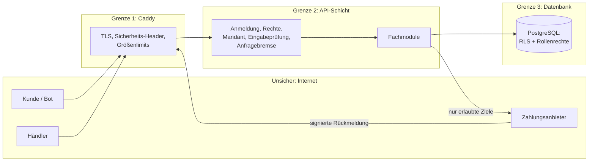

# Sicherheitskonzept der Shop-Plattform

Stand: 28.10.2026, Antworten von Kristof vom selben Tag eingearbeitet. Zweck: Dieses Dokument legt fest, wovor die Plattform geschützt wird, mit welchen Maßnahmen und wie automatische Tests beweisen, dass die Maßnahmen wirken. Es baut auf der Architektur (`docs/03_Architektur.md`), dem Datenmodell (`docs/04_Datenmodell.md`) und den Sicherheitsfunktionen SIC-01 bis SIC-11 aus dem Featurekatalog (`docs/02_Featurekatalog.md`) auf.

**Rahmen:** Die Plattform ist ein privates Experiment ohne echte Händler, Kunden oder Zahlungen und läuft nur lokal und in Tests (Antwort in `FRAGEN.md`). Trotzdem wird so gebaut, als wäre sie öffentlich erreichbar. Dann ist ein späterer Schritt ins Internet keine Umbauarbeit, sondern nur noch eine Prüfung.

**Bewertungsskala:** 1 = harmlos, 9 = sehr ernst. Die Bewertung berücksichtigt, wie wahrscheinlich ein Angriff ist und wie schlimm die Folgen wären, wenn die Plattform echt betrieben würde.

**Priorität der Maßnahmen:** **Muss** (Welle 1), **Wäre gut** (später in Welle 1 oder Welle 2), **Vielleicht später**. Besonders aufwendige Punkte tragen das Zeichen ⚠.

**Disclaimer:** Versionsnummern, Grenzwerte und Empfehlungen entsprechen dem Planungsstand. Punkte mit „zu prüfen“ werden vor dem Bau der jeweiligen Funktion nachgeschlagen. Rechtliche Hinweise sind technische Anforderungen und keine Rechtsberatung.

---

## Inhalt

1. Kurzfassung
2. Was geschützt wird
3. Wer angreifen könnte und wo die Grenzen verlaufen
4. Bedrohungen und Gegenmaßnahmen
5. Maßnahmen nach Bereichen
6. Abdeckung der OWASP-Listen
7. Automatische Sicherheitstests
8. Härtung der Datenbankrollen (heute umgesetzt und getestet)
9. Restrisiken und bewusste Entscheidungen
10. Entscheidungen von Kristof

---

## 1. Kurzfassung

Die Sicherheit der Plattform beruht auf fünf Grundsätzen:

1. **Im Zweifel geschlossen.** Fehlt eine Angabe (kein Mandant, keine Berechtigung, unbekanntes Feld), wird abgelehnt, nicht durchgelassen. Das gilt in der Datenbank (RLS liefert ohne Mandant null Zeilen), in der API (jeder Endpunkt muss seine Berechtigung erklären) und bei Eingaben (unbekannte Felder führen zu einem Fehler).
2. **Mehrere Sicherungen hintereinander.** Jede wichtige Regel wird an mindestens zwei Stellen durchgesetzt, zum Beispiel die Mandantentrennung in der API-Schicht **und** in der Datenbank. Ein einzelner Programmierfehler reicht dann nicht für ein Datenleck.
3. **So wenig Rechte wie möglich.** Jede Datenbankrolle, jedes Token und jeder Container darf nur, was er für seine Aufgabe braucht. Seit heute gilt das auch für die Anmeldedaten: Passwort-Hashes und Sitzungen sind nur noch für das Anmeldemodul lesbar (Kapitel 8, ADR-008).
4. **Fremde Daten sind nie Befehle.** Alles, was von außen kommt (Eingaben, Bilder, Rückmeldungen des Zahlungsanbieters, später Texte für die KI), wird geprüft und nur als Daten behandelt.
5. **Was nicht automatisch getestet ist, gilt als nicht vorhanden.** Für jede Maßnahme gibt es einen Test, der bei jeder Änderung läuft. Für die Datenbank gibt es diese Tests bereits (Kapitel 7 und 8).

Die größten Risiken einer Shop-Plattform und die wichtigste Antwort darauf:

| Risiko | Bewertung | Wichtigste Antwort |
|---|---|---|
| Ein Shop sieht Daten eines anderen Shops | 9 | RLS in der Datenbank, IDOR-Tests für jeden Endpunkt |
| Fremde übernehmen ein Händlerkonto | 8 | Argon2id, Bremse bei Fehlversuchen, sichere Sitzungen, Zwei-Faktor ab Welle 2 |
| Preise oder Bestellungen werden im Checkout manipuliert | 7 | Server rechnet jeden Betrag selbst, Zahlung gilt nur mit signierter Bestätigung |
| Eingeschleuster Code in Shopseiten (XSS) | 7 | Shop-Editor speichert JSON statt HTML, automatisches Maskieren, strenge CSP |
| Eine verseuchte Fremdbibliothek | 6 | feste Versionen, Wartezeit für neue Versionen, Scans, keine Installationsskripte |

---

## 2. Was geschützt wird

| Schutzgut | Beispiele | Was schlimmstenfalls passiert | Bewertung |
|---|---|---|---|
| Kundendaten | Namen, Adressen, E-Mails, Bestellungen | Datenleck, Meldepflicht nach DSGVO, Vertrauensverlust | 9 |
| Händlerkonten | Anmeldung ins Backoffice | Fremde ändern Preise, leiten Auszahlungen um, lesen Kunden | 8 |
| Trennung der Shops | `tenant_id` und RLS | Ein Händler sieht Kunden und Umsätze der Konkurrenz | 9 |
| Belege | Rechnungen, Bestellungen, Widerrufe | Unveränderbarkeit nach GoBD verletzt, falsche Steuer | 7 |
| Geld und Zahlungsstatus | Bestellung „bezahlt“, Erstattungen | Ware wird ohne Zahlung verschickt, doppelte Erstattung | 7 |
| Shopseiten | Storefront, Rechtstexte | Schadcode stiehlt Daten von Kunden, Rechtstexte werden gefälscht | 7 |
| Geheimnisse | Datenbankpasswörter, Hauptschlüssel, API-Token | Vollzugriff auf alles | 9 |
| Verfügbarkeit | Shop ist erreichbar | Bots legen den Shop lahm, kein Umsatz | 5 |
| Protokolle | Audit-Log | Spuren eines Angriffs werden verwischt | 6 |

Kartendaten sind **kein** Schutzgut, weil sie die Plattform nie berühren: Kunden geben sie nur auf der Seite des Zahlungsanbieters ein (SIC-07).

---

## 3. Wer angreifen könnte und wo die Grenzen verlaufen

### 3.1 Angreifer

| Angreifer | Ziel | Fähigkeiten |
|---|---|---|
| Anonymer Besucher oder Bot | Daten abgreifen, Gutscheine raten, Shop lahmlegen | ruft die Storefront API millionenfach auf, probiert Passwörter |
| Böswilliger Händler | Daten anderer Shops sehen, Plattform übernehmen | hat ein gültiges Konto, kennt die API, lädt Dateien hoch, schreibt Texte im Shop-Editor |
| Übernommenes Händlerkonto | wie oben, plus Schaden im eigenen Shop | hat alle Rechte dieses Händlers |
| Manipulierte Fremdbibliothek | Geheimnisse stehlen, Hintertür einbauen | läuft mit den Rechten unseres Programms |
| Manipulierte Eingaben für die KI (ab Welle 2) | KI zu ungewollten Aktionen bringen | versteckt Befehle in Produkttexten, Kundennachrichten oder Bildern |
| Neugieriger Plattform-Betreiber | Shopdaten ohne Grund ansehen | hat Zugang zur Plattform-Verwaltung |

### 3.2 Vertrauensgrenzen

Eine Vertrauensgrenze ist eine Stelle, an der Daten aus einem weniger vertrauenswürdigen Bereich in einen vertrauenswürdigeren fließen. Genau dort wird geprüft.



Wichtig: Die Datenbank vertraut der Anwendung **nicht** blind. Selbst wenn die API-Schicht einen Fehler hat, verhindern RLS und die Rollenrechte, dass fremde Shopdaten oder Passwort-Hashes herauskommen.

---

## 4. Bedrohungen und Gegenmaßnahmen

Die Bedrohungen sind nach dem verbreiteten Schema **STRIDE** sortiert. STRIDE steht für sechs Arten von Angriffen: **S**poofing (sich als jemand anderes ausgeben), **T**ampering (Daten manipulieren), **R**epudiation (abstreiten, etwas getan zu haben), **I**nformation Disclosure (Daten abgreifen), **D**enial of Service (lahmlegen) und **E**levation of Privilege (sich mehr Rechte verschaffen).

| Nr. | Art | Bedrohung mit Beispiel | Bewertung | Maßnahmen (Kapitel) | Test (Kapitel 7) |
|---|---|---|---|---|---|
| B-01 | I | Shop A ruft `/admin/v1/orders/<ID aus Shop B>` auf (IDOR) | 9 | RLS, 404 statt 403 (5.1, 5.3) | T-01, T-02, T-08 |
| B-02 | I | Ein Fehler im Code liest Passwort-Hashes aller Händler | 8 | Rolle `shop_auth`, Spaltenrechte (5.2, 8) | T-03 |
| B-03 | S | Bot probiert tausende Passwörter für ein Händlerkonto | 8 | Bremse, Sperre, Argon2id, Liste bekannter Passwörter (5.2) | T-10 |
| B-04 | S | Gestohlenes Sitzungs-Cookie wird weiterbenutzt | 7 | `HttpOnly`, `Secure`, `__Host-`, Ablauf, Abmelden überall (5.2) | T-11 |
| B-05 | E | Mitarbeiter mit Rolle „Packer“ ändert Preise | 6 | Berechtigung je Endpunkt, Standard „verboten“ (5.3) | T-09 |
| B-06 | E | Händler schickt `{"tenantId": "..."}` oder `{"status":"paid"}` mit (Mass Assignment) | 7 | strenge Zod-Schemas, unbekannte Felder abgelehnt (5.4) | T-12 |
| B-07 | T | Kunde ändert im Browser den Preis im Warenkorb | 7 | Server rechnet alles selbst (5.6) | T-14 |
| B-08 | S | Angreifer schickt eine gefälschte „Zahlung erfolgreich“-Meldung | 8 | HMAC-Signatur, Abgleich mit Anbieter, Idempotenz (5.6) | T-15 |
| B-09 | T | Zwei gleichzeitige Bestellungen kaufen das letzte Stück doppelt | 5 | Reservierung in der Datenbank mit Prüfregel (5.6) | vorhanden (Isolationstest) |
| B-10 | I/T | Eingeschleustes JavaScript in Produktbeschreibung oder Shop-Editor (XSS) | 7 | JSON statt HTML, Maskieren, Bereinigen, CSP (5.4, 5.5) | T-13 |
| B-11 | T | Fremde Webseite löst im Namen des Händlers eine Änderung aus (CSRF) | 6 | `SameSite`, Herkunftsprüfung (5.5) | T-11 |
| B-12 | I | SQL-Injection über Such- oder Filterfelder | 8 | nur Kysely mit Parametern, Lint-Verbot für rohes SQL (5.4) | T-05, T-12 |
| B-13 | T | Hochgeladenes Bild enthält Schadcode oder ist eine „Bildbombe“ | 6 | Prüfen, neu kodieren, Größenlimits, eigene Domain (5.7) | T-16 |
| B-14 | I | Server wird über eine eingegebene Adresse dazu gebracht, interne Dienste aufzurufen (SSRF) | 6 | Liste erlaubter Ziele, private Netze gesperrt (5.9) | T-17 |
| B-15 | D | Bots überfluten Storefront, Login oder Checkout | 5 | Anfragebremse, Größenlimits, Zeitlimits (5.8) | T-18 |
| B-16 | I | Geheimnisse landen im Code, in Protokollen oder Fehlermeldungen | 8 | `.env`, gitleaks, Schwärzen in Protokollen, Problem Details (5.10, 5.12) | T-06, T-19 |
| B-17 | E | Verseuchte Fremdbibliothek | 6 | Lieferkette (5.11) | T-07 |
| B-18 | R | Händler bestreitet, eine Erstattung ausgelöst zu haben | 4 | unveränderliches Audit-Log mit Urheber (5.12) | vorhanden (Isolationstest) |
| B-19 | I | Betreiber liest ohne Grund Shopdaten | 5 | keine Shopdaten in der Plattform-Rolle, Support-Zugriff nur mit Grund (5.3) | T-04 |
| B-20 | T | Weiterleitung nach dem Login führt auf eine fremde Phishing-Seite (Open Redirect) | 5 | nur relative Ziele oder eigene Domains (5.5) | T-12 |
| B-21 | E | KI führt einen in einem Produkttext versteckten Befehl aus (Prompt Injection, ab Welle 2) | 6 | KI hat höchstens Händlerrechte, Bestätigung bei kritischen Aktionen (5.14) | ab Welle 2 |
| B-22 | D/T | Fehler mitten in einem Ablauf hinterlässt halbe Daten oder öffnet eine Lücke | 5 | Transaktionen, „im Zweifel geschlossen“ (5.13) | T-12 |

---

## 5. Maßnahmen nach Bereichen

### 5.1 Mandantentrennung

Ausführlich beschrieben in Architektur Kapitel 5 und Datenmodell Kapitel 2.6. Kurz:

| Maßnahme | Priorität | Status |
|---|---|---|
| Jede Shoptabelle hat `tenant_id`, RLS mit `ENABLE` und `FORCE` und eine Policy | Muss | umgesetzt und getestet (93 Tabellen) |
| Der Mandant wird nur in `withTenantTransaction` gesetzt, mit `set_config(..., true)` nur für die laufende Transaktion | Muss | Welle 1 (Code) |
| Zusammengesetzte Fremdschlüssel `(tenant_id, id)` | Muss | umgesetzt und getestet |
| Fremde IDs ergeben immer `404`, nie `403` | Muss | Welle 1 |
| Objektspeicher-Pfade, Warteschlangen-Jobs und Zwischenspeicher-Schlüssel enthalten den Mandanten | Muss | Welle 1 |
| Ein Hostname gehört genau einem Shop, Hostnamen werden vor der Nutzung normalisiert (Kleinschreibung, ohne Punkt am Ende) | Muss | Welle 1 |

### 5.2 Anmeldung, Konten und Sitzungen (SIC-02, SIC-09)

| Maßnahme | Einzelheiten | Priorität |
|---|---|---|
| Passwörter mit **Argon2id** speichern | Mindestens 19 MiB Speicher, 2 Durchläufe, Parallelität 1 (Mindestempfehlung von OWASP, am 29.10.2026 bestätigt). Ein Passwort-Hash ist ein unumkehrbarer Fingerabdruck. Argon2id ist absichtlich langsam und speicherhungrig, damit massenhaftes Raten teuer wird. | Muss |
| Passwortregeln nach NIST | Mindestens 12 Zeichen, höchstens 128, alle Zeichen erlaubt, **keine** Zwangsregeln wie „ein Sonderzeichen“, **kein** regelmäßiger Wechselzwang. Neue Passwörter werden gegen eine mitgelieferte Liste der häufigsten gestohlenen Passwörter geprüft (ohne Internetverbindung). | Muss |
| Bremse bei Fehlversuchen | Je Konto und je IP-Adresse (IPv6 als /64): nach 5 Fehlversuchen wachsende Wartezeit (höchstens 60 Sekunden), nach 20 eine Sperre **des Kontos** von 15 Minuten (`identity.user.locked_until`) und eine E-Mail an den Kontoinhaber. Ein Netz wird nur gebremst, nie gesperrt (Entscheidung Kristof 06.11.2026), damit nicht alle hinter derselben Büro-Adresse mitgesperrt werden. Die Antwort ist immer gleich („E-Mail oder Passwort falsch“), auch wenn es die E-Mail gar nicht gibt, und dauert gleich lang. | Muss |
| Anmeldedaten nur im Anmeldemodul | Better Auth arbeitet mit einer eigenen Datenbankrolle `shop_auth`. Der restliche Kern sieht keine Passwörter, Sitzungen oder Einmalcodes (Kapitel 8, ADR-008). | Muss, **umgesetzt** |
| Sitzungs-Cookie | Name mit Präfix `__Host-` (der Browser erzwingt dann `Secure`, Pfad `/` und keine Weitergabe an Subdomains), `HttpOnly`, `SameSite=Lax`. In der Datenbank liegt nur der SHA-256-Hash des Cookies. | Muss |
| Sitzungsdauer | Backoffice: 12 Stunden ohne Aktivität, höchstens 7 Tage. Plattform-Verwaltung: 1 Stunde ohne Aktivität, höchstens 12 Stunden. Nach Anmeldung, Passwort- oder E-Mail-Änderung wird eine neue Sitzungs-ID vergeben. | Muss |
| Abmelden überall | Bei Passwortänderung und auf Knopfdruck werden alle anderen Sitzungen beendet. Der Händler sieht seine aktiven Sitzungen mit Gerät und ungefährem Ort. | Muss |
| Einmalcodes | Für E-Mail-Bestätigung, „Passwort vergessen“ und Einladungen: 32 Byte Zufall, nur der Hash in der Datenbank, einmal verwendbar, Ablauf nach 30 Minuten (Einladungen 7 Tage). „Passwort vergessen“ verrät nicht, ob es die E-Mail gibt. | Muss |
| API-Token | Präfix `shp_at_`, 32 Byte Zufall, nur der Hash gespeichert, immer an genau einen Shop und eine Liste von Berechtigungen gebunden, optional Ablaufdatum, jederzeit widerrufbar, letzte Nutzung sichtbar. Das Token wird nur einmal beim Anlegen angezeigt. | Muss |
| Zwei-Faktor und Passkeys | Für das **Betreiberkonto** schon in Welle 1 Pflicht (Code aus einer Authenticator-App nach TOTP, dazu Ersatzcodes; Entscheidung Kristof 28.10.2026). Für Händler ab Welle 2 (SIC-09). **Umgesetzt 07.11.2026 (E6 Teil 4, ADR-011):** jeder Code nur einmal, 5 falsche Codes beenden die Sitzung, Geheimnis mit Hauptschlüssel verschlüsselt, Platform-API nur mit bestätigtem Code. | Muss (Betreiber Welle 1, Händler Welle 2) |
| Neue Anmeldung von unbekanntem Gerät | E-Mail an den Kontoinhaber | Wäre gut |
| Kundenkonten der Storefront | erst ab Welle 2, dann mit denselben Regeln und eigener Cookie-Domain je Shop | Welle 2 |

**Zu Better Auth:** Die Bibliothek hatte 2025 und 2026 mehrere ernste Sicherheitsmeldungen (zum Beispiel CVE-2025-61928 zu fehlender Rechteprüfung, die genaue Liste ist zu prüfen). Das ist bei einer jungen, viel genutzten Bibliothek nicht ungewöhnlich, verlangt aber Vorsicht. Deshalb gilt: Version fest eintragen, Sicherheitsmeldungen des Projekts wöchentlich automatisch prüfen, nur die Funktionen einschalten, die wir brauchen (E-Mail und Passwort, später Passkeys und Zwei-Faktor, **keine** fremden Anmeldedienste, Geräte-Anmeldung oder OAuth-Proxy), und die Anmeldung hinter einer eigenen Schnittstelle halten, damit ein Wechsel möglich bleibt. Kristof hat am 28.10.2026 entschieden, Better Auth unter diesen Bedingungen zu behalten.

### 5.3 Rechte und Rollen (SIC-03)

- **Standard ist „verboten“.** Jeder Endpunkt erklärt in OpenAPI seine nötige Berechtigung (`x-required-scopes`). Ein Endpunkt ohne Erklärung lässt den Build scheitern. Ein globaler Wächter in NestJS lehnt jede Anfrage ab, für die keine Berechtigung erklärt ist.
- **Doppelte Prüfung:** Ein Akteur darf nur, was seine Rolle im Shop **und** sein Token erlauben (Schnittmenge).
- **Systemrollen in Welle 1:** `owner` (alles) und `staff` (alles außer Mitarbeiter, API-Token, Shop löschen und Zahlungseinstellungen). Eigene Rollen ab Welle 5.
- **Kritische Aktionen** (Shop löschen, Inhaber wechseln, Token anlegen, E-Mail ändern) verlangen eine erneute Passworteingabe, wenn die letzte Anmeldung länger als 15 Minuten zurückliegt.
- **Plattform-Betreiber:** eigene Adresse (`platform.localhost`), eigene Rolle `shop_platform` ohne Zugriff auf Shopdaten (getestet, Kapitel 8). Support-Zugriff erst ab Welle 5, dann zeitlich begrenzt, mit Grund und im Audit-Log.

### 5.4 Eingaben prüfen, Ausgaben maskieren (SIC-04)

| Maßnahme | Einzelheiten | Priorität |
|---|---|---|
| Jede Eingabe gegen ein Zod-Schema | Typ, Länge, Format, Wertebereich. Schemas sind **streng**: Unbekannte Felder führen zu `422`. Felder wie `tenantId`, `id`, `status`, `version`, `createdBy` sind in Eingabeschemas gar nicht vorhanden (Schutz gegen Mass Assignment, also das Mitschicken von Feldern, die man nicht ändern darf). | Muss |
| Längenbegrenzung überall | Jeder Text hat eine Höchstlänge, jede Liste eine Höchstzahl an Einträgen, jede Anfrage höchstens 1 MB (Bilder separat). | Muss |
| SQL nur mit Parametern | Kysely setzt Werte immer als Parameter ein. Rohes SQL (`sql.raw`) ist per ESLint-Regel verboten, Ausnahmen brauchen einen begründeten Kommentar und eine Freigabe im Review. Sortierfelder kommen nur aus einer festen Liste. | Muss |
| Kein freies HTML | Der Shop-Editor speichert Abschnitte und Bausteine als JSON (ADR-005). Formatierter Text (Produktbeschreibung) wird als strukturierter Text gespeichert und beim Ausgeben mit einer festen Liste erlaubter Elemente (Absatz, fett, kursiv, Liste, Link) erzeugt. Links nur mit `https:`, `http:` oder `mailto:`. | Muss |
| Automatisches Maskieren | Astro und React maskieren Ausgaben automatisch. `set:html` und `dangerouslySetInnerHTML` sind per ESLint verboten, außer in einer einzigen, getesteten Ausgabe-Funktion für strukturierten Text. | Muss |
| Eingaben in E-Mails | React Email maskiert ebenfalls. Betreffzeilen und Kopfzeilen werden von Zeilenumbrüchen befreit (Schutz vor eingeschleusten E-Mail-Kopfzeilen). | Muss |
| CSV-Exporte | Zellen, die mit `=`, `+`, `-` oder `@` beginnen, bekommen ein vorangestelltes `'`, damit Tabellenprogramme sie nicht als Formel ausführen (CSV-Injection). | Muss |
| Dateinamen und Pfade | Werden nie aus Eingaben gebaut. Objektspeicher-Pfade bestehen nur aus Mandant und UUID. | Muss |

### 5.5 Schutz im Browser

**Sicherheits-Header** (gesetzt zentral in Caddy, die CSP in der jeweiligen Oberfläche):

| Header | Wert | Wozu |
|---|---|---|
| `Strict-Transport-Security` | `max-age=63072000; includeSubDomains` (lokal aus) | Browser nutzt nur noch HTTPS |
| `Content-Security-Policy` | `default-src 'self'; script-src 'self' 'nonce-…'; style-src 'self' 'nonce-…'; img-src 'self' https://media.<domain> data:; object-src 'none'; base-uri 'none'; frame-ancestors 'none'; form-action 'self' https://pay.<domain>` | Erlaubt nur eigene Skripte. Selbst wenn Schadcode in die Seite gelangt, wird er nicht ausgeführt. |
| `X-Content-Type-Options` | `nosniff` | Browser rät keinen Dateityp |
| `Referrer-Policy` | `strict-origin-when-cross-origin` | Keine vollständigen Adressen an fremde Seiten |
| `Permissions-Policy` | `camera=(), microphone=(), geolocation=(), payment=()` | Schaltet ungenutzte Browserfunktionen ab |
| `Cross-Origin-Opener-Policy` | `same-origin` | Trennt unsere Fenster von fremden |
| `Cross-Origin-Resource-Policy` | `same-site` (Bilder auf `media.`: `cross-origin`) | Fremde Seiten können unsere Antworten nicht einbetten |
| `Cache-Control` | `no-store` für alle Antworten der Admin- und Platform-API | Keine Händlerdaten im Browser-Zwischenspeicher |

Die CSP wird zuerst im Modus „nur melden“ eingeführt und nach einer Woche ohne Meldungen scharf geschaltet. Eigenes JavaScript oder fremde Tracking-Skripte von Händlern sind in Welle 1 **nicht** erlaubt (siehe Kapitel 9).

**Untergeschobene Anfragen (CSRF):** Sitzungs-Cookies haben `SameSite=Lax`. Zusätzlich prüft der Kern bei jeder ändernden Anfrage die Kopfzeilen `Origin` beziehungsweise `Sec-Fetch-Site` und lehnt fremde Herkunft ab. Die Admin-API nimmt nur `application/json` an, was Formular-Angriffe von fremden Seiten zusätzlich verhindert. Die Checkout-Formulare der Storefront (die auch ohne JavaScript funktionieren) tragen ein verstecktes Prüffeld, das an den Warenkorb gebunden ist.

**CORS** (Regeln, welche fremden Webseiten unsere API aus dem Browser aufrufen dürfen): Die Admin- und Platform-API erlauben nur die eigenen Oberflächen. Die Storefront API erlaubt ab Welle 4 die beim Shop eingetragenen Domains fremder Frontends.

**Weiterleitungen:** Ziele nach Anmeldung oder Bezahlung sind nur relative Pfade oder Domains, die dem jeweiligen Shop gehören. Alles andere wird auf die Startseite umgeleitet (Schutz gegen Open Redirect).

### 5.6 Warenkorb, Checkout und Zahlung (SIC-07)

| Maßnahme | Einzelheiten | Priorität |
|---|---|---|
| Server rechnet alles | Der Browser schickt nur Varianten-IDs und Mengen. Preise, Rabatte, Steuern, Versandkosten und Summen berechnet ausschließlich der Kern. Vor dem Abschluss wird alles neu berechnet und mit dem angezeigten Betrag verglichen. Weicht es ab, sieht der Kunde die neue Summe und muss erneut bestätigen. | Muss |
| Mengen und Werte prüfen | Mengen ganze Zahlen von 1 bis 999, Beträge nie negativ, Gutscheincodes nur bei aktivem Gutschein. | Muss |
| Warenkorb-Token | 32 Byte Zufall im Cookie (`HttpOnly`, `SameSite=Lax`), in der Datenbank nur der Hash. Ein Warenkorb ist immer an einen Shop gebunden. | Muss |
| Zahlung nur über gehostete Seite | Der Kunde gibt Zahlungsdaten nur auf der Seite des (Test-)Zahlungsanbieters ein. Die Plattform speichert keine Kartendaten. | Muss |
| Signierte Rückmeldungen | Rückmeldungen des Zahlungsanbieters (Webhooks) tragen eine HMAC-SHA256-Signatur mit Zeitstempel. Der Kern prüft Signatur (Vergleich in konstanter Zeit), Alter (höchstens 5 Minuten) und ob die Ereignis-ID schon verarbeitet wurde. | Muss |
| Status kommt nie aus dem Browser | Die Rückkehr des Kunden auf die Erfolgsseite setzt die Bestellung **nicht** auf „bezahlt“. Nur eine geprüfte Rückmeldung oder eine direkte Abfrage beim Anbieter tut das. Betrag und Währung der Rückmeldung müssen genau zur Bestellung passen. | Muss |
| Idempotenz | Checkout-Abschluss, Zahlungen und Erstattungen brauchen einen `Idempotency-Key` (Architektur 4.5). Erstattungen können in Summe nie den bezahlten Betrag übersteigen (Prüfregel in der Datenbank). | Muss |
| Bestand ohne Doppelverkauf | Reservierung mit Prüfregel in der Datenbank (bereits getestet). | Muss, umgesetzt |
| Gutscheine gegen Raten schützen | Mindestens 8 Zeichen aus einem großen Zeichenvorrat, eigene Anfragebremse für Gutscheineingaben. | Muss |
| Bot-Schutz im Checkout | Unsichtbare, datensparsame Prüfung ohne fremden Dienst (zum Beispiel ein Rechenrätsel im Browser wie bei ALTCHA, Open Source, zu prüfen). | Wäre gut |

### 5.7 Dateien und Bilder

| Maßnahme | Einzelheiten | Priorität |
|---|---|---|
| Erlaubte Formate | JPEG, PNG, WebP, AVIF, GIF für Bilder, PDF für Dokumente. Der Typ wird am Dateiinhalt erkannt, nicht an Endung oder Angabe des Browsers. | Muss |
| Kein SVG | SVG-Dateien können Skripte enthalten und sind deshalb in Welle 1 nicht erlaubt. ⚠ Eine Bereinigung für SVG-Logos ist aufwendig und kommt frühestens später. | Vielleicht später |
| Neu kodieren | Jedes Bild wird mit sharp neu erzeugt. Dabei verschwinden versteckte Zusatzdaten (Standort, Kamera) und eingeschmuggelte Inhalte. Grenze: höchstens 50 Megapixel und 20 MB, damit eine „Bildbombe“ (kleine Datei, die beim Öffnen riesig wird) den Server nicht lahmlegt. | Muss |
| PDF | Werden nicht verändert, aber nur zum Herunterladen ausgeliefert (`Content-Disposition: attachment`), nie im Shop angezeigt. | Muss |
| Eigene Domain | Dateien kommen von `media.<domain>`, ohne Cookies und mit `X-Content-Type-Options: nosniff`. | Muss |
| Hochladen über vorab signierte Adressen | Der Browser lädt direkt in den Objektspeicher, mit einer Adresse, die 5 Minuten gilt, nur für einen Pfad im eigenen Mandanten und mit Größenlimit. Erst nach Prüfung wird die Datei sichtbar. | Muss |
| Virenscan | Mit ClamAV (Open Source) für PDFs | Vielleicht später |

### 5.8 Anfragebremse und Schutz vor Überlastung (SIC-05)

| Bereich | Grenze (Startwerte) | Schlüssel |
|---|---|---|
| Anmeldung, Passwort vergessen | 5 je Minute | IP-Adresse und E-Mail |
| Storefront API lesen | 300 je Minute | IP-Adresse und Shop |
| Warenkorb und Checkout schreiben | 60 je Minute | Warenkorb und IP-Adresse |
| Gutscheincode prüfen | 10 je Minute | Warenkorb und IP-Adresse |
| Admin API | 600 je Minute | Token oder Sitzung |
| Platform API | 120 je Minute | Betreiber |

- Überschreitung ergibt `429` mit Kopfzeile `Retry-After`. In Welle 1 zählt der Kern im Arbeitsspeicher, ab mehreren Instanzen in Valkey (Architektur Kapitel 9).
- **Größen- und Zeitlimits:** Anfragen höchstens 1 MB, Listen höchstens 100 Einträge, Datenbankabfragen höchstens 5 Sekunden (`statement_timeout` je Rolle), Verbindungen ohne Daten werden nach 10 Sekunden geschlossen.
- **Teure Abfragen:** Volltextsuche und Exporte laufen mit eigenen, strengeren Grenzen. Exporte laufen als Hintergrundjob.

### 5.9 Ausgehende Verbindungen (SSRF)

Der Kern ruft von sich aus nur wenige Ziele auf: den Zahlungsanbieter, den Mailserver, den Objektspeicher und ab Welle 4 Webhook-Adressen von Partnern. Feste Ziele stehen in der Konfiguration. Frei eingetragene Adressen (Webhooks, Bild-Import per Link ab Welle 2) dürfen nur `https` nutzen, werden vor **und** nach der Namensauflösung gegen private und interne Adressbereiche geprüft (zum Beispiel `127.0.0.0/8`, `10.0.0.0/8`, `169.254.0.0/16`, `::1`), folgen keinen Weiterleitungen und brechen nach 10 Sekunden ab. In Docker Compose hat nur der Worker-Container Zugang nach außen. ⚠ Die saubere Prüfung nach der Namensauflösung ist aufwendig, wird aber erst ab Welle 2 gebraucht.

### 5.10 Geheimnisse und Verschlüsselung (SIC-01, SIC-06)

- **Transport:** Alle Verbindungen laufen über TLS (HTTPS), lokal mit von Caddy erzeugten Zertifikaten. Intern sprechen die Container über ein abgeschottetes Docker-Netz. Die Datenbank ist von außen nicht erreichbar.
- **Geheimnisse:** nur in `.env` (nie in Git, gitleaks prüft jede Änderung), auf Servern verschlüsselt mit SOPS und age. Jede Datenbankrolle hat ein eigenes Zufallspasswort mit mindestens 32 Zeichen.
- **Hauptschlüssel:** Für die Verschlüsselung von Händler-Geheimnissen (Zahlungsanbieter-Schlüssel ab Welle 2, TOTP-Geheimnisse) gibt es einen Hauptschlüssel außerhalb der Datenbank. Verfahren: AES-256-GCM mit eigenem Schlüssel je Wert, der mit dem Hauptschlüssel verschlüsselt wird (Envelope Encryption). Jeder verschlüsselte Wert trägt eine Schlüsselversion, damit der Hauptschlüssel später gewechselt werden kann.
- **Zufall:** nur aus dem kryptografischen Zufallsgenerator von Node.js (`crypto.randomBytes`), nie aus `Math.random`.
- **Vergleiche** von Tokens und Signaturen in konstanter Zeit (`crypto.timingSafeEqual`).
- **Sicherungen** werden verschlüsselt (age) und 14 Tage aufbewahrt.

### 5.11 Lieferkette: fremde Bausteine (SIC-08)

Die Lieferkette sind alle fremden Bausteine, auf denen die Plattform aufbaut. Angriffe auf beliebte JavaScript-Pakete haben 2025 stark zugenommen. Deshalb gilt:

| Maßnahme | Einzelheiten | Priorität |
|---|---|---|
| Feste Versionen | `pnpm-lock.yaml` ist eingecheckt, Installation in der CI nur mit `--frozen-lockfile`. | Muss |
| Keine Installationsskripte | pnpm führt Installationsskripte fremder Pakete nur für eine ausdrückliche Liste aus (`onlyBuiltDependencies`, zum Beispiel für sharp und argon2). | Muss |
| Wartezeit für neue Versionen | Neue Paketversionen werden erst nach 7 Tagen übernommen (pnpm-Einstellung `minimumReleaseAge` in Minuten, also `10080`, am 29.10.2026 bestätigt). Die meisten verseuchten Versionen werden in dieser Zeit entdeckt und entfernt. | Muss |
| Lücken-Scan | OSV-Scanner und `pnpm audit` bei jedem Push, Trivy für Container wöchentlich. Kritische Lücken lassen den Build scheitern. | Muss |
| Updates | Dependabot wöchentlich, Claude prüft und übernimmt sie im täglichen Lauf. | Muss |
| GitHub Actions | Fremde Actions werden mit der vollständigen Commit-Kennung statt eines Versionsnamens eingebunden. Die Rechte des CI-Tokens sind auf „nur lesen“ gestellt. | Muss |
| Wenige Abhängigkeiten | Für Kleinigkeiten keine neuen Pakete. Jedes neue Paket wird im Commit begründet. | Muss |
| Stückliste (SBOM) | Wöchentlich erzeugt (Architektur 8.2). | Wäre gut |
| Container-Abbilder | Offizielle, schlanke Basisabbilder mit fester Kennung, Programme laufen nicht als Administrator (`root`), Dateisystem nur lesbar, wo möglich. | Muss |

### 5.12 Protokolle, Audit-Log und Alarm

- **Audit-Log** (`audit.audit_entry`): Jede ändernde Aktion mit Urheber (Mensch, Token, KI, System), Zeit, Objekt und gekürzter IP. Für die Anwendung nur anhängbar, nicht änderbar oder löschbar (bereits getestet).
- **Sicherheitsereignisse** landen zusätzlich im Audit-Log: Anmeldung erfolgreich und fehlgeschlagen, Sperre, Passwort- und E-Mail-Änderung, Token angelegt und widerrufen, Rechte geändert, abgelehnte Zugriffe auf fremde IDs.
- **Technische Protokolle** (pino): ohne Passwörter, Tokens, Cookies, Zahlungsdaten und vollständige IP-Adressen. Eine zentrale Schwärzungsliste (`redact`) entfernt diese Felder automatisch, ein Test prüft es. Jede Protokollzeile trägt `requestId` und `tenantId`.
- **Alarm:** In Welle 1 eine tägliche Zusammenfassung auffälliger Ereignisse (viele Fehlanmeldungen, viele `404` auf fremde IDs, abgelehnte Signaturen) im Plattform-Dashboard. Ab Welle 2 Alarme über Grafana.

### 5.13 Fehler und Ausnahmen

- Jede ändernde Aktion läuft in einer Datenbanktransaktion. Bei einem Fehler wird alles zurückgerollt, es bleiben keine halben Daten.
- Unerwartete Fehler ergeben `500` mit einer `requestId`, aber ohne Einzelheiten (keine SQL-Texte, Dateipfade oder Bibliotheksnamen). Die Einzelheiten stehen nur im Protokoll.
- Prüfungen schlagen geschlossen fehl: Kann die Rechteprüfung, die Signaturprüfung oder die Anfragebremse nicht arbeiten (zum Beispiel weil ein Dienst fehlt), wird die Anfrage abgelehnt und nicht durchgelassen.
- Der Kern startet nicht, wenn eine Einstellung fehlt oder unsicher ist, zum Beispiel ein zu kurzes Geheimnis oder ein abgeschaltetes TLS außerhalb von `local`.

### 5.14 KI-Assistent (ab Welle 2)

Bereits in Architektur 4.11 festgelegt: Die KI nutzt dieselbe Admin API mit einem kurzlebigen Token, das höchstens die Rechte des Händlers hat. Schreibrechte sind standardmäßig aus, kritische Aktionen brauchen eine Bestätigung des Händlers, jede Aktion steht im Audit-Log. Texte aus Produkten, Kundennachrichten und Bildern sind für die KI Daten, nie Anweisungen. Zusätzlich: Die KI bekommt keine Werkzeuge für Token, Mitarbeiter, Zahlungseinstellungen und das Löschen des Shops. Ein eigenes Sicherheitskapitel für die KI entsteht mit dem Anforderungskatalog von Welle 2.

### 5.15 Datenschutz (SIC-10, SIC-11)

- **Datensparsamkeit:** Gespeichert wird nur, was gebraucht wird. IP-Adressen werden für Nachweise (Einwilligungen, Widerrufe) nur gekürzt und mit einem täglich wechselnden Geheimnis gehasht gespeichert.
- **Fristen und Löschung:** Datenmodell Kapitel 5. Die Frist für Rechnungen und Buchungsbelege beträgt nach dem Vierten Bürokratieentlastungsgesetz seit 2025 **8 Jahre** (§ 147 Abs. 3 AO, § 257 Abs. 4 HGB, § 14b UStG, gilt für alle Belege, deren 10-Jahres-Frist am 1.1.2025 noch lief). Ausnahmen gelten für Banken, Versicherungen und Wertpapierinstitute, also nicht für Händler. Fristbeginn ist nach allgemeiner Regel das Ende des Kalenderjahres, in dem der Beleg entstanden ist. **Entscheidung (Kristof, 28.10.2026): Die Plattform bewahrt Rechnungen und Belege 10 Jahre auf**, also länger als gesetzlich nötig. Der Wert ist eine Einstellung und kann später auf 8 Jahre gesenkt werden.
- **Testdaten:** Die Plattform arbeitet ausschließlich mit erfundenen Daten. Echte Personendaten werden nie eingespielt.

### 5.16 Betrieb

- Nur Caddy ist von außen erreichbar. Datenbank, Objektspeicher, Mailpit und Worker hängen in einem internen Netz.
- Container laufen als eigener Nutzer ohne Administratorrechte, ohne zusätzliche Linux-Rechte (`cap_drop: ALL`) und mit `no-new-privileges`.
- Die Plattform-Verwaltung ist nur über ihre eigene Adresse erreichbar. Auf einem echten Server käme eine Freigabeliste von IP-Adressen oder ein VPN hinzu.
- Wöchentlicher Wiederherstellungstest der Sicherung inklusive Isolationstest (Datenmodell 5.5).

---

## 6. Abdeckung der OWASP-Listen

OWASP ist eine gemeinnützige Organisation, die regelmäßig Listen der häufigsten Sicherheitsprobleme veröffentlicht. Maßgeblich sind die **OWASP Top 10:2025** für Webanwendungen und die **OWASP API Security Top 10:2023** für APIs (Namen und Reihenfolge zu prüfen, siehe Quellen).

### 6.1 OWASP Top 10:2025

| Nr. | Thema | Abgedeckt durch |
|---|---|---|
| A01 | Broken Access Control (fehlerhafte Zugriffskontrolle) | 5.1, 5.3, Kapitel 8 |
| A02 | Security Misconfiguration (unsichere Einstellungen) | 5.5 Header, 5.13 Startprüfung, 5.16 |
| A03 | Software Supply Chain Failures (Lieferkette) | 5.11 |
| A04 | Cryptographic Failures (schwache Verschlüsselung) | 5.2 Argon2id, 5.10 |
| A05 | Injection (eingeschleuster Code, SQL, XSS) | 5.4, 5.5 CSP |
| A06 | Insecure Design (unsicherer Entwurf) | dieses Dokument, Kapitel 4, Server rechnet alles (5.6) |
| A07 | Authentication Failures (fehlerhafte Anmeldung) | 5.2 |
| A08 | Software or Data Integrity Failures (ungeprüfte Daten und Updates) | 5.6 Signaturen, 5.11 |
| A09 | Security Logging and Alerting Failures (fehlende Protokolle und Alarme) | 5.12 |
| A10 | Mishandling of Exceptional Conditions (schlechte Fehlerbehandlung) | 5.13 |

### 6.2 OWASP API Security Top 10:2023

| Nr. | Thema | Abgedeckt durch |
|---|---|---|
| API1 | Broken Object Level Authorization (fremde Objekte per ID) | RLS, IDOR-Test T-08 |
| API2 | Broken Authentication | 5.2 |
| API3 | Broken Object Property Level Authorization (Felder, die man nicht sehen oder ändern darf) | strenge Ein- und Ausgabeschemas (5.4), Test T-12 |
| API4 | Unrestricted Resource Consumption (Überlastung) | 5.8 |
| API5 | Broken Function Level Authorization (Funktionen ohne Rechteprüfung) | 5.3, CI-Prüfung `x-required-scopes` |
| API6 | Unrestricted Access to Sensitive Business Flows (Missbrauch von Abläufen, etwa Gutscheine raten) | 5.6, 5.8 |
| API7 | Server Side Request Forgery | 5.9 |
| API8 | Security Misconfiguration | 5.5, 5.16 |
| API9 | Improper Inventory Management (vergessene alte Endpunkte) | OpenAPI ist die einzige Quelle, oasdiff, Versionierung (Architektur 4.3) |
| API10 | Unsafe Consumption of APIs (blindes Vertrauen in fremde APIs) | Rückmeldungen des Zahlungsanbieters werden geprüft (5.6) |

---

## 7. Automatische Sicherheitstests

Alle Tests laufen mit `pnpm check` vor jedem Commit und in der CI (Architektur 8.2). Kristof muss nichts davon selbst starten.

| Nr. | Test | Werkzeug | Wann | Status |
|---|---|---|---|---|
| T-01 | Struktur: jede Shoptabelle mit RLS, `FORCE`, Policy | `db/test_isolation.sql` | jeder Push | **vorhanden, grün** |
| T-02 | Datenbank-Isolation: Shop A liest, ändert, löscht nichts von Shop B | `db/test_isolation.sql` | jeder Push | **vorhanden, grün** |
| T-03 | Rollenrechte: Anmeldedaten nur für `shop_auth`, keine Anmeldegeheimnisse für die Anwendung | `db/test_sicherheit.sql` | jeder Push | **neu, grün** |
| T-04 | Rollenrechte: Plattform sieht keine Shopdaten, Relay nur die Outbox, keine Rechte für alle, keine Rolle darf Objekte anlegen | `db/test_sicherheit.sql` | jeder Push | **neu, grün** |
| T-05 | Funktionen mit erhöhten Rechten haben einen festen Suchpfad | `db/test_sicherheit.sql` | jeder Push | **neu, grün** |
| T-06 | Keine Geheimnisse im Repository | gitleaks | jeder Push | Welle 1 (CI) |
| T-07 | Bekannte Lücken in Fremdbibliotheken und Containern | OSV-Scanner, `pnpm audit`, Trivy | jeder Push, Trivy wöchentlich | Welle 1 (CI) |
| T-08 | API-Isolation: jeder Endpunkt mit ID aus Shop B ergibt `404` | eigener Generator aus OpenAPI | jeder Push | Welle 1 ⚠ |
| T-09 | Jeder Endpunkt erklärt Berechtigungen, und ohne die Berechtigung kommt `403` | eigener Generator aus OpenAPI | jeder Push | Welle 1 |
| T-10 | Anmeldebremse und Sperre greifen, Antworten sind bei unbekannter E-Mail gleich | Vitest | jeder Push | Welle 1 |
| T-11 | Cookies haben die richtigen Eigenschaften, fremde Herkunft wird abgelehnt | Vitest | jeder Push | Welle 1 |
| T-12 | Zufällige und bösartige Eingaben an alle Endpunkte, unbekannte Felder abgelehnt, keine `500` | Schemathesis | jeder Push (kurz), nachts (lang) | Welle 1 |
| T-13 | XSS-Testwerte in allen Textfeldern erscheinen in Storefront und Backoffice nur als Text, CSP-Header vorhanden | Playwright | nachts | Welle 1 |
| T-14 | Manipulierte Preise, Mengen und Gutscheine im Checkout werden ignoriert oder abgelehnt | Vitest, Playwright | jeder Push | Welle 1 |
| T-15 | Rückmeldungen ohne, mit falscher oder alter Signatur und doppelte Rückmeldungen werden abgelehnt | Vitest | jeder Push | Welle 1 |
| T-16 | Hochladen von SVG, falschem Typ, Bildbombe und zu großer Datei wird abgelehnt | Vitest | jeder Push | Welle 1 |
| T-17 | Adressen auf private Netze werden abgelehnt | Vitest | jeder Push | Welle 2 |
| T-18 | Anfragebremse liefert `429` | Vitest | jeder Push | Welle 1 |
| T-19 | Protokolle enthalten keine Passwörter, Tokens oder Cookies | Vitest | jeder Push | Welle 1 |
| T-20 | Sicherheits-Header aller Oberflächen | Playwright | nachts | Welle 1 |
| T-21 | Automatischer Angriffsscan der laufenden Plattform | OWASP ZAP (Open Source) | vor Abschluss jeder Welle | Wäre gut |

---

## 8. Härtung der Datenbankrollen (heute umgesetzt und getestet)

### 8.1 Das Problem

Das Datenmodell (Kapitel 6.4) hatte eine Lücke offen gelassen: Die globalen Anmeldetabellen (`identity.user`, `account`, `session`, `verification`, `two_factor`, `passkey`) haben keine `tenant_id` und deshalb keine RLS. Die Anwendungsrolle `shop_app` durfte sie vollständig lesen und schreiben. Ein einziger Fehler irgendwo im Kern, etwa eine SQL-Injection in einer Produktsuche, hätte damit **alle Passwort-Hashes und Sitzungen aller Händler** aller Shops preisgeben können. Mit einem gültigen Sitzungs-Hash allein kann man zwar keine Sitzung übernehmen, aber Passwort-Hashes lassen sich offline angreifen, und Schreibrechte hätten ein Konto übernehmen lassen.

### 8.2 Die Lösung (ADR-008)

Better Auth bekommt eine **eigene Datenbankrolle `shop_auth`** und einen eigenen, kleinen Verbindungspool. Nur diese Rolle darf die sechs Anmeldetabellen lesen und schreiben, und sie darf **sonst nichts**. Der restliche Kern (`shop_app`) und die Plattform-Verwaltung (`shop_platform`) dürfen von Nutzern nur unkritische Spalten lesen (ID, E-Mail, Name, Bild, Sprache, Status), zum Beispiel um im Backoffice die Namen des Teams anzuzeigen. Nutzer anlegen, sperren oder Passwörter zurücksetzen geht nur über die Schnittstelle des Anmeldemoduls.

| Rolle | Zweck | Anmeldetabellen | Shopdaten |
|---|---|---|---|
| `shop_owner` | besitzt alle Tabellen, nur für Migrationen, kann sich nicht anmelden | – | – |
| `shop_app` | Kern (API und Worker) | `user` nur 7 Spalten lesen | ja, durch RLS auf den eigenen Shop begrenzt |
| `shop_auth` | **neu:** Anmeldemodul (Better Auth) | alle 6 Tabellen lesen und schreiben | **keine** |
| `shop_platform` | Platform API | `user` nur 9 Spalten lesen | keine (nur `platform`, Audit-Einträge, Outbox) |
| `shop_relay` | Outbox-Weiterleitung | – | nur `kernel.outbox` |
| `shop_backup` | Datensicherung, als einzige mit `BYPASSRLS`, nur lesen | lesen | lesen |

### 8.3 Ergebnis vom 28.10.2026

Getestet mit PostgreSQL 18.6. Der bisherige Isolationstest läuft unverändert grün, dazu kommen der neue Rechtetest `db/test_sicherheit.sql` und echte Zugriffsversuche als `shop_app` (Auszug):

```text
== Rechte der Datenbankrollen
--- 1. Rollen
OK   Keine shop_*-Rolle ist SUPERUSER, darf Rollen oder Datenbanken anlegen (Verstöße: keine)
OK   Nur shop_backup hat BYPASSRLS (gefunden: shop_backup)
OK   Die Besitzer-Rolle shop_owner kann sich nicht anmelden
OK   Keine Betriebsrolle ist Mitglied einer anderen Rolle (Verstöße: keine)
--- 2. Anmeldedaten nur für das Anmeldemodul (ADR-008)
OK   shop_app und shop_platform haben kein Recht auf Passwörter, Sitzungen, Einmalcodes, Zwei-Faktor und Passkeys (Verstöße: keine)
OK   shop_app und shop_platform können Nutzer nur lesen, nicht anlegen oder ändern
OK   shop_auth darf identity."user" lesen und schreiben  (ebenso account, session, verification, two_factor, passkey)
OK   shop_auth hat außerhalb der 6 Anmeldetabellen keinerlei Tabellenrechte (Verstöße: keine)
--- 3. Geheime Spalten
OK   shop_app, shop_platform und shop_relay lesen keine Anmeldegeheimnisse (Verstöße: keine)
OK   Die Prüfung oben erkennt die Anmeldegeheimnisse wirklich (3 Spalten gefunden)
--- 4. Weitere Rollen
OK   shop_relay sieht nur die Outbox (Verstöße: keine)
OK   shop_platform hat keinen Zugriff auf Shopdaten wie Produkte, Kunden, Bestellungen (Verstöße: keine)
OK   Niemand darf über PUBLIC (alle Rollen) auf Plattform-Tabellen zugreifen (Verstöße: keine)
OK   Keine Betriebsrolle darf in irgendeinem Schema Objekte anlegen (Verstöße: keine)
--- 5. Funktionen mit erhöhten Rechten
OK   Jede SECURITY-DEFINER-Funktion hat einen festen search_path (Verstöße: keine)
OK   Keine SECURITY-DEFINER-Funktion ist für alle (PUBLIC) aufrufbar (Verstöße: keine)
== Echte Zugriffsversuche als shop_app auf Anmeldedaten
OK   Verweigert: SELECT password_hash FROM identity.account
OK   Verweigert: SELECT token_hash FROM identity.session
OK   Verweigert: SELECT * FROM identity."user"
OK   Verweigert: UPDATE identity."user" SET status = 'active'
OK   Erlaubte Spalten (id, name, email) der Nutzer sind lesbar
== Alle Tests bestanden
```

**Gegenprobe:** In einer Testdatenbank wurde `shop_app` absichtlich das Leserecht auf `identity.account` gegeben. Der Test brach sofort ab: `FEHLGESCHLAGEN: shop_app und shop_platform haben kein Recht auf Passwörter, Sitzungen, Einmalcodes, Zwei-Faktor und Passkeys (Verstöße: shop_app auf identity.account)`.

**Was der Test bewusst erlaubt:** Hash-Spalten zum Wiederfinden (Warenkorb-Token, API-Token, gekürzte IP-Adressen, Prüfsummen von Rechtstexten) bleiben für die Anwendung lesbar, weil sie sie für ihre Arbeit braucht und sich aus dem SHA-256-Hash eines langen Zufallswerts der Wert nicht zurückrechnen lässt. Der verschlüsselte Zahlungsanbieter-Schlüssel (`payments.payment_method_config.secret_ciphertext`) bleibt lesbar, weil der Hauptschlüssel nicht in der Datenbank liegt. Derzeit gibt es keine Funktionen mit erhöhten Rechten (`SECURITY DEFINER`). Die Prüfung in Abschnitt 5 schützt künftige Funktionen.

---

## 9. Restrisiken und bewusste Entscheidungen

| Punkt | Entscheidung | Begründung |
|---|---|---|
| Eigenes JavaScript und Tracking-Skripte von Händlern | in Welle 1 nicht erlaubt | Fremde Skripte im Shop sind die häufigste Ursache für gestohlene Kundendaten. Ab Welle 4 nur über geprüfte Apps mit eigener CSP-Freigabe. |
| SVG-Bilder | nicht erlaubt | siehe 5.7 |
| Zwei-Faktor für Händler | erst Welle 2 | Featurekatalog SIC-09. Die Plattform ist in Welle 1 nicht öffentlich. Das Betreiberkonto bekommt den zweiten Faktor schon in Welle 1. |
| Anfragebremse im Arbeitsspeicher | Welle 1 | Reicht für eine Instanz. Bei mehreren Instanzen kommt Valkey. |
| Better Auth hat schon Sicherheitslücken gehabt | behalten, eingehegt (Entscheidung Kristof) | siehe 5.2 |
| Kein externer Penetrationstest | – | Kostet Geld und lohnt sich für ein privates Experiment nicht. Automatische Scans (T-21) ersetzen ihn teilweise. |
| Superuser der Datenbank | existiert nur für die Einrichtung | Die Anwendung benutzt ihn nie. Auf einem echten Server wird sein Passwort getrennt verwahrt. |

---

## 10. Entscheidungen von Kristof (28.10.2026)

| Frage | Antwort | Wirkung |
|---|---|---|
| Better Auth als Anmelde-Baustein behalten? | **behalten** | Nur nötige Funktionen, feste Version, wöchentliche Prüfung der Sicherheitsmeldungen (5.2) |
| Rechnungen 8 oder 10 Jahre aufbewahren? | **10 Jahre** | Einstellungswert 10 Jahre ab Ende des Kalenderjahres (5.15, Datenmodell 5.2) |
| Betreiberkonto schon in Welle 1 mit Zwei-Faktor? | **ja** | Zwei-Faktor für das Betreiberkonto ist Muss in Welle 1 (5.2) |

Es gibt keine offenen Fragen zu diesem Dokument.

---

## Quellen

- OWASP Top 10:2025: https://owasp.org/Top10/2025/
- OWASP API Security Top 10:2023: https://owasp.org/API-Security/editions/2023/en/0x11-t10/
- OWASP Password Storage Cheat Sheet: https://cheatsheetseries.owasp.org/cheatsheets/Password_Storage_Cheat_Sheet.html
- OWASP HTTP Headers Cheat Sheet: https://cheatsheetseries.owasp.org/cheatsheets/HTTP_Headers_Cheat_Sheet.html
- Viertes Bürokratieentlastungsgesetz, Aufbewahrungsfristen: https://www.haufe.de/steuern/gesetzgebung-politik/viertes-buerokratieentlastungsgesetz_168_613390.html und https://www.ey.com/de_de/technical/steuernachrichten/laengere-aufbewahrungsfristen-bei-banken-versicherungen-und-wertpapierinstituten
- Better Auth, Sicherheitsmeldung CVE-2025-61928: https://advisories.gitlab.com/npm/better-auth/CVE-2025-61928/

## Nächster Schritt

Laut `STATUS.md` folgt der Anforderungskatalog Welle 1 (`docs/06_Welle1_Anforderungen.md`). Die Maßnahmen mit Priorität „Muss“ aus diesem Dokument fließen dort als Anforderungen der jeweiligen Features ein.
